# Kaikan Cachoeira

## 1. Visão Geral

**Problema.** Falta de organização e centralização das informações de estoque, vendas, doações, tickets, associados e movimentações financeiras, com dependência de controles manuais e planilhas.
**Proposta de valor.** Centralizar e organizar os processos da associação em um sistema web, facilitando o controle de estoque, vendas, doações, tickets, associados e informações financeiras.
**Público-alvo.** Pessoas da associação com mais de 30 anos, principais utilizadores do sistema frente de caixa e gestores.
**Plataforma principal.** Web Responsivo. **Dispositivo de referência.** Web Desktop Responsivo (1920 x 1080). **Ferramenta de destino.** Figma.
**Contexto.** Associação Cultural e Agrícola de Cachoeira (Kaikan Cachoeira), fundada em 1928, com atividades culturais, comunitárias e eventos beneficentes.
**Tecnologias previstas.** HTML, CSS Modules, Typescript, React, Vite, Axios, TanStack Query, React Hook Form, React Router Dom.

## 2. Personas e Implicações de Design

### P01 — Harumi
**Resumo (3 linhas).** Harumi tem Mais de 40 anos e atua como Voluntária da associação. Atua nos eventos e participa da operação das vendas e arrecadações dos produtos vendidos. Objetivo: Registrar e acompanhar vendas e arrecadações com mais agilidade, incluindo a forma de pagamento e histórico.
**Dores e familiaridade.** Falta de organização; processo manual e ineficaz; precisa de agilidade nas vendas; ausência do registro da forma de pagamento; ausência de histórico de vendas. Familiaridade digital: Baixa / não adepta à tecnologia. Dispositivo: A definir.
**Necessidade declarada.** Interface simples, objetiva, com poucos passos e mensagens claras. “Eu não tenho controle das vendas e das arrecadações dos produtos vendidos nos eventos.”
**Implicações de design**
- Baixa familiaridade digital → ações principais evidentes, linguagem simples, poucos passos e feedback imediato.
- Falta de organização; processo manual e ineficaz; precisa de agilidade nas vendas; ausência do registro da forma de pagamento; ausência de histórico de vendas. → agrupar dados relacionados e manter ações operacionais próximas do conteúdo correspondente.
- Interface simples, objetiva, com poucos passos e mensagens claras. → tipografia legível, contraste alto, alvos de toque amplos e mensagens de erro explicativas.
- Dispositivo mais usado não informado (campo preenchido como “A definir”) → projetar mobile-first e validar também no desktop de referência; confirmar dispositivo com a associação.

### P02 — Yuji
**Resumo (3 linhas).** Yuji tem Mais de 40 anos e atua como Voluntário da associação. Atua no controle de estoque e no recebimento/registro das doações da associação. Objetivo: Controlar estoque e doações, acompanhar movimentações e consultar informações dos eventos.
**Dores e familiaridade.** Falta de organização; falta de registro de entradas e saídas; falta de controle das doações; ausência de análise de vendas; ausência de relatório de cada evento. Familiaridade digital: Baixa / não adepto à tecnologia. Dispositivo: A definir.
**Necessidade declarada.** Interface simples, com informações organizadas, ações evidentes e leitura facilitada. “Eu não tenho controle do estoque e das doações da associação.”
**Implicações de design**
- Baixa familiaridade digital → ações principais evidentes, linguagem simples, poucos passos e feedback imediato.
- Falta de organização; falta de registro de entradas e saídas; falta de controle das doações; ausência de análise de vendas; ausência de relatório de cada evento. → agrupar dados relacionados e manter ações operacionais próximas do conteúdo correspondente.
- Interface simples, com informações organizadas, ações evidentes e leitura facilitada. → tipografia legível, contraste alto, alvos de toque amplos e mensagens de erro explicativas.
- Dispositivo mais usado não informado (campo preenchido como “A definir”) → projetar mobile-first e validar também no desktop de referência; confirmar dispositivo com a associação.

## 3. Design Tokens

### Cores

| Token | HEX | RGB | Papel | Onde é usada | Cor do texto sobre ela | Contraste | WCAG AA |
|---|---|---|---|---|---|---|---|
| vinho | #8A1A10 | 138, 26, 16 | Cor principal da identidade e ações principais | Botões principais, destaques e elementos de identidade | #F4EFEF | 7.67:1 | Sim |
| vinho-escuro | #6E130B | 110, 19, 11 | Variação escura da cor principal | Hover/ativo de botões principais e destaques escuros | #F4EFEF | 9.73:1 | Sim |
| fundo | #FFFDF8 | 255, 253, 248 | Fundo da interface igual à cor selecionada na planilha | Fundo geral da interface | #1A1A2E | Depende da cor atrás (transparência) | Verificar após composição |
| branco-suave | #F4EFEF | 244, 239, 239 | Superfície clara; não usar branco puro | Cards, formulários, superfícies claras e áreas de conteúdo | #1A1A2E | 13.14:1 | Sim |
| texto | #1A1A2E | 26, 26, 46 | Texto principal | Títulos, textos principais e conteúdo | N/A (cor de texto) | — | — |
| texto-suave | #6B7280 | 107, 114, 128 | Texto secundário | Descrições, legendas e informações auxiliares | N/A (cor de texto) | — | — |
| borda | #E5E5E0 | 229, 229, 224 | Bordas e divisórias — variante 1 | Contornos de campos, cards e divisórias | #1A1A2E | 11.20:1 | Sim |
| borda-transparente | rgba(233, 224, 224, 0.614) | 233, 224, 224; alpha 0.614 | Bordas suaves com transparência — variante 2 | Bordas suaves quando for necessário um contorno discreto | #1A1A2E | Depende da cor atrás (transparência) | Verificar após composição |
| borda-bege | #DDD9C4 | 221, 217, 196 | Bordas/divisórias em tom bege — variante 3 | Divisórias e contornos em áreas com tons quentes | #1A1A2E | 10.00:1 | Sim |
| cor-erro (derivado) | #B42318 | 180, 35, 24 | Erro e validação | Mensagens e bordas de erro | #FFFFFF | A verificar sobre cada superfície | A verificar |
| cor-sucesso (derivado) | #217A45 | 33, 122, 69 | Confirmação positiva | Mensagens de sucesso | #FFFFFF | A verificar sobre cada superfície | A verificar |
| cor-aviso (derivado) | #8A4B08 | 138, 75, 8 | Aviso | Alertas de estoque baixo e avisos | #FFFFFF | A verificar sobre cada superfície | A verificar |

### Tipografia

| Elemento | Fonte | Peso | Tamanho (px / rem) | Altura de linha | Uso |
|---|---|---:|---:|---:|---|
| texto-titulo (derivado) | Fonte não informada; usar fonte sans-serif do sistema (derivado) | 700 (derivado) | 32 px / 2 rem (derivado) | 1,25 (derivado) | Título de página |
| texto-subtitulo (derivado) | Sans-serif do sistema (derivado) | 400 (derivado) | 18 px / 1,125 rem (derivado) | 1,5 (derivado) | Subtítulos e introduções |
| texto-corpo (derivado) | Sans-serif do sistema (derivado) | 400 (derivado) | 16 px / 1 rem (derivado) | 1,5 (derivado) | Texto, labels e conteúdo |
| texto-auxiliar (derivado) | Sans-serif do sistema (derivado) | 400 (derivado) | 14 px / 0,875 rem (derivado) | 1,4 (derivado) | Legendas e metadados; não usar para instruções essenciais |
| texto-botao (derivado) | Sans-serif do sistema (derivado) | 600 (derivado) | 16 px / 1 rem (derivado) | 1,25 (derivado) | Botões e ações |

### Espaçamento

Escala derivada de 4 px; usar tokens e não valores avulsos.

| Token | Valor | Uso |
|---|---:|---|
| espaco-4 (derivado) | 4 px | Espaço entre ícone e texto |
| espaco-8 (derivado) | 8 px | Espaçamento interno compacto |
| espaco-12 (derivado) | 12 px | Espaço entre controles relacionados |
| espaco-16 (derivado) | 16 px | Padding padrão de campos e cards |
| espaco-24 (derivado) | 24 px | Distância entre blocos e cards |
| espaco-32 (derivado) | 32 px | Separação entre seções |
| espaco-48 (derivado) | 48 px | Separação de grandes áreas |

### Raios de borda e sombras

| Token | Valor | Uso |
|---|---|---|
| raio-campo (derivado) | 6 px | Campos e botões |
| raio-card (derivado) | 12 px | Cards de conteúdo e indicadores |
| raio-modal (derivado) | 12 px | Modais |
| raio-pill (derivado) | 999 px | Chips e seletores arredondados |
| sombra-1 (derivado) | 0 2px 8px rgba(26, 26, 46, 0.08) | Elevação sutil de cards e modais |
| sombra-2 (derivado) | 0 8px 24px rgba(26, 26, 46, 0.14) | Modal sobre conteúdo |

## 4. Tom de Voz

Atributos da planilha: claro e direto, objetivo, acolhedor, prático e consistente. Preferir frases curtas, nomes consistentes e instruções orientadas à ação; não culpabilizar a pessoa usuária.

| Contexto | Faça | Não faça |
|---|---|---|
| Claro e direto — Botões, confirmações, mensagens de erro e ajuda. | “Venda registrada com sucesso.” | “Operação transacional processada com êxito.” |
| Objetivo — Botões, formulários e títulos. | “Registrar venda” | “Prosseguir com o procedimento de comercialização.” |
| Acolhedor — Erros, validações e estados vazios. | “Confira os dados e tente novamente.” | “Dados inválidos.” |
| Prático — PDV, estoque, doações e dashboards. | “Estoque atualizado.” | “A atualização do inventário foi concluída com sucesso.” |
| Consistente — Menus, títulos, tabelas e relatórios. | “Histórico de vendas” | “Registro comercial anterior” |
| Títulos (derivado) | Use o nome claro da tarefa ou área, como “Estoque”. | Evite títulos vagos como “Área de trabalho”. |
| Botões (CTA) (derivado) | Comece com verbo e objeto: “Registrar doação”. | Evite “Prosseguir com o procedimento”. |
| Mensagens de erro (derivado) | Explique o que conferir e como corrigir: “Confira os dados e tente novamente.” | Evite “Dados inválidos.” sem orientação. |
| Mensagens de sucesso | “Venda registrada com sucesso.” | “Operação transacional processada com êxito.” |
| Estados vazios (derivado) | Informar que não há registros e indicar a ação disponível somente quando prevista no briefing. | Não exibir mensagens genéricas ou ações inventadas. |
| Textos de ajuda (derivado) | Usar instruções curtas e concretas, próximas do campo. | Evitar termos técnicos sem explicação. |

## 5. Biblioteca de Componentes

Os estados visuais devem ser implementados por tokens. Estados não desenhados nos wireframes são especificações funcionais derivadas e devem ser validados visualmente antes da implementação.

### Botão
- **Anatomia:** rótulo, área clicável e ícone opcional.
- **Variantes:** primário (fundo `vinho`, texto `branco-suave`); hover/ativo (`vinho-escuro`); secundário (fundo `branco-suave`, texto `texto`, borda `borda`); terciário/link (texto `vinho`, sem preenchimento).
- **Tamanhos:** padrão com altura mínima 44 px (derivado); compacto 36 px (derivado, apenas controles densos e mantendo acessibilidade por área externa).
- **Estados:** padrão, hover, ativo, foco visível com contorno `vinho-escuro`, desabilitado com `texto-suave` e `borda`, carregando com indicador e rótulo preservado, erro associado a mensagem `cor-erro`.
- **Tokens:** `vinho`, `vinho-escuro`, `branco-suave`, `texto`, `texto-suave`, `borda`, `raio-campo`, `espaco-8`, `texto-botao`.

### Campo de formulário e pesquisa
- **Anatomia:** label persistente, controle, placeholder opcional, texto de ajuda/erro.
- **Variantes:** texto, e-mail, senha com mostrar/ocultar, número/moeda, data/hora, textarea e pesquisa.
- **Tamanhos:** largura total da coluna; altura mínima 44 px (derivado); textarea cresce conforme conteúdo.
- **Estados:** padrão, hover, foco com contorno visível, preenchido, desabilitado, carregando quando vinculado a envio, erro com borda e mensagem.
- **Tokens:** fundo `branco-suave`, texto `texto`, label `texto`, borda `borda`, erro `cor-erro` (derivado), raio `raio-campo`, padding `espaco-12`/`espaco-16`, texto `texto-corpo`.

### Select, radio e checkbox
- **Anatomia:** label, valor/opções, indicador de seleção e mensagem associada.
- **Variantes:** seleção única, seleção múltipla com caixas de marcação, categorias, status, forma de pagamento e tipo de movimentação.
- **Tamanhos:** altura mínima 44 px (derivado); opções em linhas com alvo de toque de 44 × 44 px (derivado).
- **Estados:** padrão, hover, foco, selecionado/ativo, desabilitado, carregando opções e erro.
- **Tokens:** `fundo`, `branco-suave`, `texto`, `texto-suave`, `borda`, `vinho`, `raio-campo`, `espaco-8` e `texto-corpo`.

### Card de produto / indicador / resumo
- **Anatomia:** título ou imagem, metadados, valor principal, alerta opcional e ações contextuais.
- **Variantes:** produto em estoque, produto de cardápio, resumo de venda, indicador de caixa e evento em andamento.
- **Tamanhos:** grade fluida; cards de produto em três colunas no desktop conforme observações da planilha; uma coluna em telas estreitas (derivado).
- **Estados:** padrão, hover quando clicável, foco, selecionado, desabilitado, carregando/skeleton, vazio e alerta de estoque baixo.
- **Tokens:** superfície `branco-suave`, texto `texto`, apoio `texto-suave`, borda `borda`, alerta `cor-aviso` (derivado), `raio-card`, `sombra-1`, padding `espaco-16`, intervalo `espaco-24`.

### Cabeçalho e navegação lateral
- **Anatomia:** logo/nome da associação, itens de navegação, título de página, menu do usuário e ação de sair quando prevista.
- **Variantes:** layout autenticado desktop; navegação adaptada para mobile (comportamento exato a confirmar).
- **Estados:** item atual destacado em `vinho`; foco visível; item indisponível/desabilitado quando sem permissão; menu aberto/fechado.
- **Tokens:** fundo `branco-suave`, texto `texto`, item ativo `vinho`, divisórias `borda`, espaçamentos `espaco-16`/`espaco-24`.

### Modal
- **Anatomia:** título, subtítulo opcional, fechar no canto superior direito quando previsto, conteúdo/formulário e ações no rodapé.
- **Variantes:** formulário, detalhes, confirmação de sucesso e seleção de tipo.
- **Tamanhos:** largura limitada ao conteúdo; em mobile usar largura disponível com margens `espaco-16` (derivado) e rolagem vertical interna quando necessário.
- **Estados:** padrão, carregando, validação/erro, desabilitado durante salvamento e sucesso quando houver tela/modal especificado.
- **Tokens:** fundo `branco-suave`, texto `texto`, borda `borda`, `raio-modal`, `sombra-2`, padding `espaco-24`, ações com tokens de botão.

### Tabela, lista, paginação e alerta
- **Anatomia:** cabeçalhos de coluna/lista, linhas, valores, ações por registro e controles de paginação.
- **Variantes:** tabela de vendas e produtos; listas de lançamentos e fiados; alerta de estoque baixo; empty state.
- **Estados:** carregando, vazio, sem resultados, linha cancelada em tom neutro, erro, paginação nas extremidades com botão desabilitado.
- **Tokens:** texto `texto`, cabeçalho `branco-suave`, divisória `borda`, linha cancelada `texto-suave`, alerta `cor-aviso`, `espaco-12`, `espaco-16`.

## 6. Telas
### TL01 — Login

- **Objetivo:** Permitir que o usuário acesse sua conta informando e-mail e senha.
- **Perfil de acesso:** Visitante / Usuário não autenticado
- **Entrada / retorno:** N/A (entrada).
- **Saídas previstas:** TL02 - Recuperação de senha, Tela inicial (a definir).
- **Wireframe(s):** TL-01 Login.png.
- **Prioridade:** Alta.

**Layout (de cima para baixo, baseado no wireframe e na descrição da planilha)**
1. **Estrutura principal:** tela pública em duas áreas: formulário alinhado à esquerda e painel ilustrativo à direita; em mobile, empilhar/ocultar painel visual sem perder a tarefa.
2. **Hierarquia:** título principal seguido de subtítulo quando listado; controles agrupados por tarefa; ações primárias destacadas com `vinho`; textos com `texto` e apoio com `texto-suave`.
3. **Composição específica:** Título e subtítulo, formulário de login (e-mail e senha com mostrar/ocultar), link 'Esqueci minha senha', botão 'ENTRAR', painel lateral com imagem.

**Grid e responsividade (mobile-first)**
- **360 px:** uma coluna; conteúdo e formulários em largura total; cards/listas empilhados; tabelas devem preservar leitura e ações por adaptação/rolagem horizontal (derivado, confirmar). Modais ocupam a largura disponível com margem `espaco-16` (derivado).
- **768 px:** duas colunas somente em áreas onde o wireframe já separa formulário e painel/resumo; grade de cards adaptável; navegação não pode encobrir conteúdo (comportamento exato a confirmar).
- **1024 px:** manter navegação lateral e área principal; listas e formulários aproveitam largura; grade de produtos conforme o wireframe.
- **1440 px:** ampliar área de conteúdo sem esticar campos indefinidamente; preservar proporções e hierarquia do wireframe desktop de referência 1920 × 1080.
- Breakpoints pedidos (360, 768, 1024, 1440 px) são limites de validação; valores de breakpoint não constam como tokens na planilha.

**Conteúdo literal da aba “Conteúdo das Páginas”**
- **Título da tela** (Título): “Título: 'Entrar'”
  - Origem: Estático.
- **Subtítulo da tela** (Subtítulo): “Subtítulo: 'Acesse sua conta para continuar'”
  - Origem: Estático.
- **Formulário de login** (Formulário): “Label: 'E-mail' | Label: 'Senha' | Link: 'Esqueci minha senha'”
  - Ação/destino: Link leva para TL02 - Recuperação de senha.
  - Origem: Entrada do usuário.
  - Observação: Validação do formato de e-mail. Link alinhado à direita, abaixo da senha.
- **Mostrar/ocultar senha** (Ícone): “Ícone de olho”
  - Ação/destino: Alterna a visibilidade da senha.
  - Origem: Estático.
  - Observação: Dentro do campo de senha.
- **Botão de login** (Botão (CTA)): “Botão: 'ENTRAR'”
  - Ação/destino: Botão envia para a tela inicial (a definir).
  - Origem: Estático.
  - Observação: Autentica as credenciais. Exibir carregamento e erro de credenciais inválidas.
- **Painel lateral** (Imagem): “Imagem ilustrativa”
  - Origem: Estático.
  - Observação: Placeholder no wireframe.

**Componentes usados:** botão, campo de formulário, select, card, cabeçalho/navegação, modal, tabela/lista e paginação conforme aplicável e conforme a descrição acima; tokens na seção 3 e estados/variantes na seção 5.

**Estados da tela:** Padrão, carregando, erro de credenciais, erro de validação, sucesso (redirect).
- **Sem permissão:** ocultar/bloquear ações não autorizadas conforme RF10; exibir orientação clara sem revelar dados protegidos. Texto exato não definido.

**Interações e destinos**
- A tela é acessada a partir de: N/A (entrada).
- Transições previstas: TL02 - Recuperação de senha, Tela inicial (a definir).
- Formulário de login: Link leva para TL02 - Recuperação de senha.
- Mostrar/ocultar senha: Alterna a visibilidade da senha.
- Botão de login: Botão envia para a tela inicial (a definir).

**Rastreabilidade**
- **RF/RNF relacionados identificáveis por ID de tela:** RF09.
- **User stories relacionadas:** não há vínculo explícito por ID de tela na planilha; validar com a equipe.

### TL02 — Recuperação de senha

- **Objetivo:** Permitir que o usuário solicite o link de redefinição de senha via e-mail.
- **Perfil de acesso:** Visitante / Usuário não autenticado
- **Entrada / retorno:** TL01 - Login.
- **Saídas previstas:** TL03 - Confirmação de recuperação de senha, TL01 - Login (ao voltar).
- **Wireframe(s):** TL-02 Recuperação de senha.png.
- **Prioridade:** Média.

**Layout (de cima para baixo, baseado no wireframe e na descrição da planilha)**
1. **Estrutura principal:** tela pública em duas áreas: formulário alinhado à esquerda e painel ilustrativo à direita; em mobile, empilhar/ocultar painel visual sem perder a tarefa.
2. **Hierarquia:** título principal seguido de subtítulo quando listado; controles agrupados por tarefa; ações primárias destacadas com `vinho`; textos com `texto` e apoio com `texto-suave`.
3. **Composição específica:** Link 'Voltar para o login', título, texto explicativo, campo de e-mail, botão 'RECUPERAR', painel lateral com imagem.

**Grid e responsividade (mobile-first)**
- **360 px:** uma coluna; conteúdo e formulários em largura total; cards/listas empilhados; tabelas devem preservar leitura e ações por adaptação/rolagem horizontal (derivado, confirmar). Modais ocupam a largura disponível com margem `espaco-16` (derivado).
- **768 px:** duas colunas somente em áreas onde o wireframe já separa formulário e painel/resumo; grade de cards adaptável; navegação não pode encobrir conteúdo (comportamento exato a confirmar).
- **1024 px:** manter navegação lateral e área principal; listas e formulários aproveitam largura; grade de produtos conforme o wireframe.
- **1440 px:** ampliar área de conteúdo sem esticar campos indefinidamente; preservar proporções e hierarquia do wireframe desktop de referência 1920 × 1080.
- Breakpoints pedidos (360, 768, 1024, 1440 px) são limites de validação; valores de breakpoint não constam como tokens na planilha.

**Conteúdo literal da aba “Conteúdo das Páginas”**
- **Link de retorno** (Botão (CTA)): “Link: 'Voltar para o login'”
  - Ação/destino: Link leva para TL01 - Login.
  - Origem: Estático.
  - Observação: Ícone de seta à esquerda.
- **Título da tela** (Título): “Título: 'Recupere sua senha'”
  - Origem: Estático.
- **Texto explicativo** (Parágrafo): “Texto: 'Informe seu e-mail para receber as instruções de recuperação de senha.'”
  - Origem: Estático.
- **Formulário de recuperação** (Formulário): “Label: 'E-mail'”
  - Origem: Entrada do usuário.
  - Observação: Validação do formato de e-mail.
- **Botão de recuperação** (Botão (CTA)): “Botão: 'RECUPERAR'”
  - Ação/destino: Botão envia para TL03 - Confirmação de recuperação de senha.
  - Origem: Estático.
  - Observação: Dispara o envio do link se o e-mail estiver cadastrado. Exibir carregamento.
- **Painel lateral** (Imagem): “Imagem ilustrativa”
  - Origem: Estático.
  - Observação: Placeholder no wireframe.

**Componentes usados:** botão, campo de formulário, select, card, cabeçalho/navegação, modal, tabela/lista e paginação conforme aplicável e conforme a descrição acima; tokens na seção 3 e estados/variantes na seção 5.

**Estados da tela:** Padrão, carregando, erro de validação, erro de conexão.
- **Sem permissão:** ocultar/bloquear ações não autorizadas conforme RF10; exibir orientação clara sem revelar dados protegidos. Texto exato não definido.

**Interações e destinos**
- A tela é acessada a partir de: TL01 - Login.
- Transições previstas: TL03 - Confirmação de recuperação de senha, TL01 - Login (ao voltar).
- Link de retorno: Link leva para TL01 - Login.
- Botão de recuperação: Botão envia para TL03 - Confirmação de recuperação de senha.

**Rastreabilidade**
- **RF/RNF relacionados identificáveis por ID de tela:** RF09.
- **User stories relacionadas:** não há vínculo explícito por ID de tela na planilha; validar com a equipe.

### TL03 — Confirmação de recuperação de senha

- **Objetivo:** Informar que, caso o e-mail esteja cadastrado, o link de recuperação será enviado.
- **Perfil de acesso:** Visitante / Usuário não autenticado
- **Entrada / retorno:** TL02 - Recuperação de senha.
- **Saídas previstas:** TL01 - Login.
- **Wireframe(s):** TL-03 Confirmação de recuperação de senha.png.
- **Prioridade:** Média.

**Layout (de cima para baixo, baseado no wireframe e na descrição da planilha)**
1. **Estrutura principal:** tela pública em duas áreas: formulário alinhado à esquerda e painel ilustrativo à direita; em mobile, empilhar/ocultar painel visual sem perder a tarefa.
2. **Hierarquia:** título principal seguido de subtítulo quando listado; controles agrupados por tarefa; ações primárias destacadas com `vinho`; textos com `texto` e apoio com `texto-suave`.
3. **Composição específica:** Título, mensagem de confirmação com o e-mail informado, botão 'Voltar para o login', painel lateral com imagem.

**Grid e responsividade (mobile-first)**
- **360 px:** uma coluna; conteúdo e formulários em largura total; cards/listas empilhados; tabelas devem preservar leitura e ações por adaptação/rolagem horizontal (derivado, confirmar). Modais ocupam a largura disponível com margem `espaco-16` (derivado).
- **768 px:** duas colunas somente em áreas onde o wireframe já separa formulário e painel/resumo; grade de cards adaptável; navegação não pode encobrir conteúdo (comportamento exato a confirmar).
- **1024 px:** manter navegação lateral e área principal; listas e formulários aproveitam largura; grade de produtos conforme o wireframe.
- **1440 px:** ampliar área de conteúdo sem esticar campos indefinidamente; preservar proporções e hierarquia do wireframe desktop de referência 1920 × 1080.
- Breakpoints pedidos (360, 768, 1024, 1440 px) são limites de validação; valores de breakpoint não constam como tokens na planilha.

**Conteúdo literal da aba “Conteúdo das Páginas”**
- **Título da tela** (Título): “Título: 'Verifique seu e-mail'”
  - Origem: Estático.
- **Mensagem de confirmação** (Parágrafo): “Texto: 'Caso o e-mail [e-mail informado] esteja cadastrado no sistema, será enviado um link para recuperar sua senha.'”
  - Origem: Entrada do usuário.
  - Observação: E-mail digitado na TL02 exibido dinamicamente.
- **Botão de retorno** (Botão (CTA)): “Botão: 'Voltar para o login'”
  - Ação/destino: Botão leva para TL01 - Login.
  - Origem: Estático.
- **Painel lateral** (Imagem): “Imagem ilustrativa”
  - Origem: Estático.
  - Observação: Placeholder no wireframe.

**Componentes usados:** botão, campo de formulário, select, card, cabeçalho/navegação, modal, tabela/lista e paginação conforme aplicável e conforme a descrição acima; tokens na seção 3 e estados/variantes na seção 5.

**Estados da tela:** Padrão.
- **Sem permissão:** ocultar/bloquear ações não autorizadas conforme RF10; exibir orientação clara sem revelar dados protegidos. Texto exato não definido.

**Interações e destinos**
- A tela é acessada a partir de: TL02 - Recuperação de senha.
- Transições previstas: TL01 - Login.
- Botão de retorno: Botão leva para TL01 - Login.

**Rastreabilidade**
- **RF/RNF relacionados identificáveis por ID de tela:** RF09.
- **User stories relacionadas:** não há vínculo explícito por ID de tela na planilha; validar com a equipe.

### TL04 — Início

- **Objetivo:** Exibir o painel inicial com atalhos para as principais áreas do sistema e destaque para o evento em andamento, quando houver.
- **Perfil de acesso:** Usuário autenticado
- **Entrada / retorno:** TL01 - Login.
- **Saídas previstas:** Estoque, Eventos, Doações, Painel de controle, Registro de vendas, Caixa, Relatório geral e Detalhes do evento (telas a definir).
- **Wireframe(s):** TL-04 Elemento de evento em andamento - Início com Evento em Andamento — Kaikan Cachoeira.png.
- **Prioridade:** Alta.

**Layout (de cima para baixo, baseado no wireframe e na descrição da planilha)**
1. **Estrutura principal:** área autenticada com navegação lateral e área de conteúdo principal.
2. **Hierarquia:** título principal seguido de subtítulo quando listado; controles agrupados por tarefa; ações primárias destacadas com `vinho`; textos com `texto` e apoio com `texto-suave`.
3. **Composição específica:** Menu lateral com logo e navegação, cabeçalho com título e menu do usuário, card 'Evento em andamento' (condicional) com botões de ação, seção 'Acesso rápido' com cards (Estoque, Eventos, Doações, Relatório geral), botão 'Sair'.

**Grid e responsividade (mobile-first)**
- **360 px:** uma coluna; conteúdo e formulários em largura total; cards/listas empilhados; tabelas devem preservar leitura e ações por adaptação/rolagem horizontal (derivado, confirmar). Modais ocupam a largura disponível com margem `espaco-16` (derivado).
- **768 px:** duas colunas somente em áreas onde o wireframe já separa formulário e painel/resumo; grade de cards adaptável; navegação não pode encobrir conteúdo (comportamento exato a confirmar).
- **1024 px:** manter navegação lateral e área principal; listas e formulários aproveitam largura; grade de produtos conforme o wireframe.
- **1440 px:** ampliar área de conteúdo sem esticar campos indefinidamente; preservar proporções e hierarquia do wireframe desktop de referência 1920 × 1080.
- Breakpoints pedidos (360, 768, 1024, 1440 px) são limites de validação; valores de breakpoint não constam como tokens na planilha.

**Conteúdo literal da aba “Conteúdo das Páginas”**
- **Card do evento em andamento** (Card): “Rótulo: 'Evento em andamento' | Título: 'Undoukai 2026' | Período: '10/10/2026 9h00 - 10/10/2026 17h00'”
  - Origem: Banco de dados.
  - Observação: Exibido somente quando há evento em andamento. Nome e período vêm do cadastro do evento.
- **Ações do evento** (Botão (CTA)): “Botão: 'Registro de vendas' | Botão: 'Caixa' | Botão: 'Ver detalhes'”
  - Ação/destino: Registro de vendas leva para a tela de Registro de vendas, Caixa leva para a tela de Caixa, Ver detalhes leva para os detalhes do evento (telas a definir).
  - Origem: Estático.
  - Observação: Dentro do card do evento. Exibidas somente com evento em andamento.

**Componentes usados:** botão, campo de formulário, select, card, cabeçalho/navegação, modal, tabela/lista e paginação conforme aplicável e conforme a descrição acima; tokens na seção 3 e estados/variantes na seção 5.

**Estados da tela:** Padrão (sem evento em andamento), com evento em andamento, carregando.
- **Sem permissão:** ocultar/bloquear ações não autorizadas conforme RF10; exibir orientação clara sem revelar dados protegidos. Texto exato não definido.

**Interações e destinos**
- A tela é acessada a partir de: TL01 - Login.
- Transições previstas: Estoque, Eventos, Doações, Painel de controle, Registro de vendas, Caixa, Relatório geral e Detalhes do evento (telas a definir).
- Ações do evento: Registro de vendas leva para a tela de Registro de vendas, Caixa leva para a tela de Caixa, Ver detalhes leva para os detalhes do evento (telas a definir).

**Rastreabilidade**
- **RF/RNF relacionados identificáveis por ID de tela:** não há vínculo explícito por ID na planilha; validar com a equipe.
- **User stories relacionadas:** não há vínculo explícito por ID de tela na planilha; validar com a equipe.

### TL05 — Estoque

- **Objetivo:** Listar os produtos em estoque com imagem e quantidade atual e permitir pesquisar, filtrar, criar e movimentar produtos.
- **Perfil de acesso:** Usuário autenticado
- **Entrada / retorno:** TL04 - Início.
- **Saídas previstas:** TL06 - Criar produto, TL08 - Detalhes do produto, TL09 - Menu de categorias, TL11 - Movimentar estoque.
- **Wireframe(s):** wireframe-TL05.png, wireframe-TL05-filtro.png.
- **Prioridade:** Alta.

**Layout (de cima para baixo, baseado no wireframe e na descrição da planilha)**
1. **Estrutura principal:** área autenticada com navegação lateral e área de conteúdo principal.
2. **Hierarquia:** título principal seguido de subtítulo quando listado; controles agrupados por tarefa; ações primárias destacadas com `vinho`; textos com `texto` e apoio com `texto-suave`.
3. **Composição específica:** Cabeçalho com título e menu do usuário, título e subtítulo da página, botões 'Menu de categorias' e 'Criar produto', campo de pesquisa com botões 'Filtrar' e 'Pesquisar', filtros por categoria e situação do estoque com botão 'Limpar filtros', cards de produto (imagem, nome, categoria, quantidade, alerta de estoque baixo, botões 'Ver detalhes' e 'Movimentar', menu de opções), paginação.

**Grid e responsividade (mobile-first)**
- **360 px:** uma coluna; conteúdo e formulários em largura total; cards/listas empilhados; tabelas devem preservar leitura e ações por adaptação/rolagem horizontal (derivado, confirmar). Modais ocupam a largura disponível com margem `espaco-16` (derivado).
- **768 px:** duas colunas somente em áreas onde o wireframe já separa formulário e painel/resumo; grade de cards adaptável; navegação não pode encobrir conteúdo (comportamento exato a confirmar).
- **1024 px:** manter navegação lateral e área principal; listas e formulários aproveitam largura; grade de produtos conforme o wireframe.
- **1440 px:** ampliar área de conteúdo sem esticar campos indefinidamente; preservar proporções e hierarquia do wireframe desktop de referência 1920 × 1080.
- Breakpoints pedidos (360, 768, 1024, 1440 px) são limites de validação; valores de breakpoint não constam como tokens na planilha.

**Conteúdo literal da aba “Conteúdo das Páginas”**
- **Cabeçalho do sistema** (Título): “Título: 'Estoque' | Subtítulo: 'Sistema de gestão Kaikan Cachoeira'”
  - Origem: Estático.
  - Observação: Barra superior da tela.
- **Menu do usuário** (Menu): “Avatar: 'AD' | Nome: 'Administrador' | Texto: 'Conta compartilhada' | Seta de expandir”
  - Ação/destino: Abre o menu do usuário (opções a definir).
  - Origem: Banco de dados.
  - Observação: Dados do usuário autenticado.
- **Título da página** (Título): “Título: 'Estoque'”
  - Origem: Estático.
- **Subtítulo da página** (Subtítulo): “Subtítulo: 'Controle por lotes com baixa FIFO/PEPS'”
  - Origem: Estático.
- **Paginação** (Botão (CTA)): “Botão: 'Anterior' | Texto: 'Página [X] de [Y]' | Botão: 'Próxima'”
  - Ação/destino: Anterior e Próxima trocam a página da lista.
  - Origem: Calculado.
  - Observação: Botões desabilitados quando não há página anterior ou seguinte.
- **Ações da página** (Botão (CTA)): “Botão: 'Menu de categorias' | Botão: 'Criar produto'”
  - Ação/destino: Menu de categorias abre TL09 - Menu de categorias. Criar produto abre TL06 - Criar produto.
  - Origem: Estático.
  - Observação: Ficam no canto superior direito.
- **Pesquisa de produtos** (Formulário): “Campo: 'Pesquisar produto...' | Botão: 'Filtrar' | Botão: 'Pesquisar'”
  - Ação/destino: Pesquisar filtra a lista de produtos pelo nome. Filtrar exibe ou oculta os filtros abaixo.
  - Origem: Entrada do usuário.
- **Filtros de produtos** (Formulário): “Label: 'Categorias' | Seleção: 'Todos' | Label: 'Situação do estoque' | Seleção: 'Todos' | Botão: 'Limpar filtros'”
  - Ação/destino: Limpar filtros volta as duas seleções para 'Todos'.
  - Origem: Entrada do usuário.
  - Observação: Exibidos ao clicar em 'Filtrar'. Categorias vêm das categorias cadastradas (TL09). Opções de situação do estoque a definir (ex.: estoque baixo).
- **Lista de produtos** (Card): “Imagem: foto do produto | Nome: '[Nome do produto]' | Categoria: '[Categoria]' | Quantidade: '[X] unidades' | Alerta: '(estoque baixo)' | Botão: 'Ver detalhes' | Botão: 'Movimentar' | Menu de opções (três pontos)”
  - Ação/destino: Ver detalhes abre TL08 - Detalhes do produto. Movimentar abre TL11 - Movimentar estoque. Menu de opções (a definir).
  - Origem: Banco de dados.
  - Observação: Alerta em vermelho exibido apenas quando o estoque está baixo (regra a confirmar). Cards em grade de 3 colunas. Imagem em miniatura à esquerda do nome, enviada no cadastro do produto (TL06).
- **Lista de produtos** (Card): “Imagem: foto do produto | Nome: '[Nome do produto]' | Categoria: '[Categoria]' | Quantidade: '[X] unidades' | Alerta: '(estoque baixo)' | Botão: 'Ver detalhes' | Botão: 'Movimentar' | Menu de opções (três pontos)”
  - Ação/destino: Ver detalhes abre TL08 - Detalhes do produto. Movimentar abre TL11 - Movimentar estoque. Menu de opções (a definir).
  - Origem: Banco de dados.
  - Observação: Alerta em vermelho exibido apenas quando o estoque está baixo (regra a confirmar). Cards em grade de 3 colunas. Imagem em miniatura à esquerda do nome, enviada no cadastro do produto (TL06).
- **Paginação** (Botão (CTA)): “Botão: 'Anterior' | Texto: 'Página [X] de [Y]' | Botão: 'Próxima'”
  - Ação/destino: Anterior e Próxima trocam a página da lista.
  - Origem: Calculado.
  - Observação: Botões desabilitados quando não há página anterior ou seguinte.

**Componentes usados:** botão, campo de formulário, select, card, cabeçalho/navegação, modal, tabela/lista e paginação conforme aplicável e conforme a descrição acima; tokens na seção 3 e estados/variantes na seção 5.

**Estados da tela:** Padrão, carregando, filtros fechados, filtros abertos, sem produtos (empty state), sem resultados na pesquisa ou filtro, estoque baixo (alerta no card), produto sem imagem.
- **Sem permissão:** ocultar/bloquear ações não autorizadas conforme RF10; exibir orientação clara sem revelar dados protegidos. Texto exato não definido.

**Interações e destinos**
- A tela é acessada a partir de: TL04 - Início.
- Transições previstas: TL06 - Criar produto, TL08 - Detalhes do produto, TL09 - Menu de categorias, TL11 - Movimentar estoque.
- Menu do usuário: Abre o menu do usuário (opções a definir).
- Paginação: Anterior e Próxima trocam a página da lista.
- Ações da página: Menu de categorias abre TL09 - Menu de categorias. Criar produto abre TL06 - Criar produto.
- Pesquisa de produtos: Pesquisar filtra a lista de produtos pelo nome. Filtrar exibe ou oculta os filtros abaixo.
- Filtros de produtos: Limpar filtros volta as duas seleções para 'Todos'.
- Lista de produtos: Ver detalhes abre TL08 - Detalhes do produto. Movimentar abre TL11 - Movimentar estoque. Menu de opções (a definir).
- Lista de produtos: Ver detalhes abre TL08 - Detalhes do produto. Movimentar abre TL11 - Movimentar estoque. Menu de opções (a definir).
- Paginação: Anterior e Próxima trocam a página da lista.

**Rastreabilidade**
- **RF/RNF relacionados identificáveis por ID de tela:** RF01.
- **User stories relacionadas:** não há vínculo explícito por ID de tela na planilha; validar com a equipe.

### TL06 — Criar produto

- **Objetivo:** Modal para permitir cadastrar um novo produto no estoque.
- **Perfil de acesso:** Usuário autenticado
- **Entrada / retorno:** TL05 - Estoque.
- **Saídas previstas:** TL07 - Produto criado com sucesso.
- **Wireframe(s):** TL-06 Criar produto — Kaikan Cachoeira.png.
- **Prioridade:** Alta.

**Layout (de cima para baixo, baseado no wireframe e na descrição da planilha)**
1. **Estrutura principal:** modal central sobre a tela de origem, com título no topo, conteúdo/formulário no centro e ações no rodapé.
2. **Hierarquia:** título principal seguido de subtítulo quando listado; controles agrupados por tarefa; ações primárias destacadas com `vinho`; textos com `texto` e apoio com `texto-suave`.
3. **Composição específica:** Modal com título, upload de imagem, campos nome e descrição, seleção de categoria, campo estoque mínimo, botão 'Criar Produto'.

**Grid e responsividade (mobile-first)**
- **360 px:** uma coluna; conteúdo e formulários em largura total; cards/listas empilhados; tabelas devem preservar leitura e ações por adaptação/rolagem horizontal (derivado, confirmar). Modais ocupam a largura disponível com margem `espaco-16` (derivado).
- **768 px:** duas colunas somente em áreas onde o wireframe já separa formulário e painel/resumo; grade de cards adaptável; navegação não pode encobrir conteúdo (comportamento exato a confirmar).
- **1024 px:** manter navegação lateral e área principal; listas e formulários aproveitam largura; grade de produtos conforme o wireframe.
- **1440 px:** ampliar área de conteúdo sem esticar campos indefinidamente; preservar proporções e hierarquia do wireframe desktop de referência 1920 × 1080.
- Breakpoints pedidos (360, 768, 1024, 1440 px) são limites de validação; valores de breakpoint não constam como tokens na planilha.

**Conteúdo literal da aba “Conteúdo das Páginas”**
- **Título do modal** (Título): “Título: 'Criar Produto'”
  - Origem: Estático.
- **Formulário de produto** (Formulário): “Label: 'Imagem' | Botão: 'Upload' | Label: 'Nome' | Label: 'Descrição' | Label: 'Categoria' | Seleção: 'Selecione' | Label: 'Estoque mínimo'”
  - Ação/destino: Upload abre a seleção de arquivo de imagem.
  - Origem: Entrada do usuário.
  - Observação: As opções de categoria vêm das categorias cadastradas (TL09).
- **Botão de criação** (Botão (CTA)): “Botão: 'Criar Produto'”
  - Ação/destino: Botão salva o produto e leva para TL07 - Produto criado com sucesso.
  - Origem: Estático.
  - Observação: Exibir carregamento ao salvar.

**Componentes usados:** botão, campo de formulário, select, card, cabeçalho/navegação, modal, tabela/lista e paginação conforme aplicável e conforme a descrição acima; tokens na seção 3 e estados/variantes na seção 5.

**Estados da tela:** Padrão, carregando (salvando), erro de validação, erro ao salvar.
- **Sem permissão:** ocultar/bloquear ações não autorizadas conforme RF10; exibir orientação clara sem revelar dados protegidos. Texto exato não definido.

**Interações e destinos**
- A tela é acessada a partir de: TL05 - Estoque.
- Transições previstas: TL07 - Produto criado com sucesso.
- Formulário de produto: Upload abre a seleção de arquivo de imagem.
- Botão de criação: Botão salva o produto e leva para TL07 - Produto criado com sucesso.

**Rastreabilidade**
- **RF/RNF relacionados identificáveis por ID de tela:** RF01.
- **User stories relacionadas:** não há vínculo explícito por ID de tela na planilha; validar com a equipe.

### TL07 — Produto criado com sucesso

- **Objetivo:** Modal de confirmar ao usuário que o produto foi criado.
- **Perfil de acesso:** Usuário autenticado
- **Entrada / retorno:** TL06 - Criar produto.
- **Saídas previstas:** TL05 - Estoque.
- **Wireframe(s):** TL-07 Modal - criação de produto.png.
- **Prioridade:** Média.

**Layout (de cima para baixo, baseado no wireframe e na descrição da planilha)**
1. **Estrutura principal:** modal central sobre a tela de origem, com título no topo, conteúdo/formulário no centro e ações no rodapé.
2. **Hierarquia:** título principal seguido de subtítulo quando listado; controles agrupados por tarefa; ações primárias destacadas com `vinho`; textos com `texto` e apoio com `texto-suave`.
3. **Composição específica:** Modal com mensagem 'Produto criado com sucesso!' e botão 'Voltar'.

**Grid e responsividade (mobile-first)**
- **360 px:** uma coluna; conteúdo e formulários em largura total; cards/listas empilhados; tabelas devem preservar leitura e ações por adaptação/rolagem horizontal (derivado, confirmar). Modais ocupam a largura disponível com margem `espaco-16` (derivado).
- **768 px:** duas colunas somente em áreas onde o wireframe já separa formulário e painel/resumo; grade de cards adaptável; navegação não pode encobrir conteúdo (comportamento exato a confirmar).
- **1024 px:** manter navegação lateral e área principal; listas e formulários aproveitam largura; grade de produtos conforme o wireframe.
- **1440 px:** ampliar área de conteúdo sem esticar campos indefinidamente; preservar proporções e hierarquia do wireframe desktop de referência 1920 × 1080.
- Breakpoints pedidos (360, 768, 1024, 1440 px) são limites de validação; valores de breakpoint não constam como tokens na planilha.

**Conteúdo literal da aba “Conteúdo das Páginas”**
- **Mensagem de sucesso** (Título): “Título: 'Produto criado com sucesso!'”
  - Origem: Estático.
- **Botão de retorno** (Botão (CTA)): “Botão: 'Voltar'”
  - Ação/destino: Botão leva para TL05 - Estoque.
  - Origem: Estático.

**Componentes usados:** botão, campo de formulário, select, card, cabeçalho/navegação, modal, tabela/lista e paginação conforme aplicável e conforme a descrição acima; tokens na seção 3 e estados/variantes na seção 5.

**Estados da tela:** Padrão.
- **Sem permissão:** ocultar/bloquear ações não autorizadas conforme RF10; exibir orientação clara sem revelar dados protegidos. Texto exato não definido.

**Interações e destinos**
- A tela é acessada a partir de: TL06 - Criar produto.
- Transições previstas: TL05 - Estoque.
- Botão de retorno: Botão leva para TL05 - Estoque.

**Rastreabilidade**
- **RF/RNF relacionados identificáveis por ID de tela:** RF01.
- **User stories relacionadas:** não há vínculo explícito por ID de tela na planilha; validar com a equipe.

### TL08 — Detalhes do produto

- **Objetivo:** Modal de exibir as informações de um produto, seus lotes e suas últimas movimentações.
- **Perfil de acesso:** Usuário autenticado
- **Entrada / retorno:** TL05 - Estoque.
- **Saídas previstas:** TL05 - Estoque (ao fechar), Lista de lotes, Lista de movimentações e Movimentar estoque (telas a definir).
- **Wireframe(s):** TL-08 Detalhes do produto.png.
- **Prioridade:** Alta.

**Layout (de cima para baixo, baseado no wireframe e na descrição da planilha)**
1. **Estrutura principal:** modal central sobre a tela de origem, com título no topo, conteúdo/formulário no centro e ações no rodapé.
2. **Hierarquia:** título principal seguido de subtítulo quando listado; controles agrupados por tarefa; ações primárias destacadas com `vinho`; textos com `texto` e apoio com `texto-suave`.
3. **Composição específica:** Modal com título e botão fechar, imagem e informações do produto, lista de lotes com botão 'Ver movimentações', lista de movimentações, botões 'Ver todos os lotes', 'Ver todas as movimentações', 'Fechar' e 'Movimentar Estoque'.

**Grid e responsividade (mobile-first)**
- **360 px:** uma coluna; conteúdo e formulários em largura total; cards/listas empilhados; tabelas devem preservar leitura e ações por adaptação/rolagem horizontal (derivado, confirmar). Modais ocupam a largura disponível com margem `espaco-16` (derivado).
- **768 px:** duas colunas somente em áreas onde o wireframe já separa formulário e painel/resumo; grade de cards adaptável; navegação não pode encobrir conteúdo (comportamento exato a confirmar).
- **1024 px:** manter navegação lateral e área principal; listas e formulários aproveitam largura; grade de produtos conforme o wireframe.
- **1440 px:** ampliar área de conteúdo sem esticar campos indefinidamente; preservar proporções e hierarquia do wireframe desktop de referência 1920 × 1080.
- Breakpoints pedidos (360, 768, 1024, 1440 px) são limites de validação; valores de breakpoint não constam como tokens na planilha.

**Conteúdo literal da aba “Conteúdo das Páginas”**
- **Título do modal** (Título): “Título: 'Detalhes do produto'”
  - Origem: Estático.
- **Botão de fechar** (Ícone): “Ícone: 'X' (fechar)”
  - Ação/destino: Fecha o modal e volta para TL05 - Estoque.
  - Origem: Estático.
  - Observação: Canto superior direito do modal.
- **Imagem do produto** (Imagem): “Imagem: foto do produto”
  - Origem: Banco de dados.
  - Observação: Placeholder no wireframe.
- **Informações do produto** (Card): “Nome: '[Nome do produto]' | Descrição: '[Descrição do produto]' | Categoria: '[Categoria]' | Quantidade atual: '[X] un' | Estoque mínimo: '[X] un'”
  - Origem: Banco de dados.
  - Observação: Exemplo do wireframe: Onigiri de Salmão.
- **Título da seção de lotes** (Subtítulo): “Subtítulo: 'Lotes'”
  - Origem: Estático.
- **Botão de todos os lotes** (Botão (CTA)): “Botão: 'Ver todos os lotes'”
  - Ação/destino: Botão leva para a lista completa de lotes (tela a definir).
  - Origem: Estático.
- **Lista de lotes** (Lista): “Entrada: '[X] un.' | Saldo: '[X] un.' | Custo total: 'R$ [valor]' | Custo unitário: 'R$ [valor]' | Botão: 'Ver movimentações'”
  - Ação/destino: Botão leva para as movimentações do lote (tela a definir).
  - Origem: Banco de dados.
  - Observação: Lotes sem custo exibem 'Sem custo' em custo total e custo unitário.
- **Título da seção de movimentações** (Subtítulo): “Subtítulo: 'Movimentações'”
  - Origem: Estático.
- **Botão de todas as movimentações** (Botão (CTA)): “Botão: 'Ver todas as movimentações'”
  - Ação/destino: Botão leva para a lista completa de movimentações (tela a definir).
  - Origem: Estático.
- **Lista de movimentações** (Lista): “Tipo: 'Reabastecimento' ou 'Venda' | Quantidade: '+[X] un' ou '-[X] un' | Evento: '[Nome do evento]' | Data e hora: '[dd/mm/aaaa às hh:mm]' | Custo total: 'R$ [valor]' | Custo unitário: 'R$ [valor]' | Observação: '[Texto]'”
  - Origem: Banco de dados.
  - Observação: Custo e observação aparecem apenas no reabastecimento. Entradas com sinal + e saídas com sinal -.
- **Ações do modal** (Botão (CTA)): “Botão: 'Fechar' | Botão: 'Movimentar Estoque'”
  - Ação/destino: Fechar fecha o modal e volta para TL05 - Estoque. Movimentar Estoque abre TL11 - Movimentar estoque.
  - Origem: Estático.
  - Observação: Ficam no rodapé do modal.

**Componentes usados:** botão, campo de formulário, select, card, cabeçalho/navegação, modal, tabela/lista e paginação conforme aplicável e conforme a descrição acima; tokens na seção 3 e estados/variantes na seção 5.

**Estados da tela:** Padrão, carregando, sem lotes, sem movimentações, lote sem custo.
- **Sem permissão:** ocultar/bloquear ações não autorizadas conforme RF10; exibir orientação clara sem revelar dados protegidos. Texto exato não definido.

**Interações e destinos**
- A tela é acessada a partir de: TL05 - Estoque.
- Transições previstas: TL05 - Estoque (ao fechar), Lista de lotes, Lista de movimentações e Movimentar estoque (telas a definir).
- Botão de fechar: Fecha o modal e volta para TL05 - Estoque.
- Botão de todos os lotes: Botão leva para a lista completa de lotes (tela a definir).
- Lista de lotes: Botão leva para as movimentações do lote (tela a definir).
- Botão de todas as movimentações: Botão leva para a lista completa de movimentações (tela a definir).
- Ações do modal: Fechar fecha o modal e volta para TL05 - Estoque. Movimentar Estoque abre TL11 - Movimentar estoque.

**Rastreabilidade**
- **RF/RNF relacionados identificáveis por ID de tela:** RF01.
- **User stories relacionadas:** não há vínculo explícito por ID de tela na planilha; validar com a equipe.

### TL09 — Menu de categorias

- **Objetivo:** Modal para listar, pesquisar, editar e excluir as categorias de produtos.
- **Perfil de acesso:** Usuário autenticado
- **Entrada / retorno:** TL05 - Estoque.
- **Saídas previstas:** TL10 - Criar categoria, Editar categoria (tela a definir).
- **Wireframe(s):** TL-09 Menu de categorias.png.
- **Prioridade:** Média.

**Layout (de cima para baixo, baseado no wireframe e na descrição da planilha)**
1. **Estrutura principal:** modal central sobre a tela de origem, com título no topo, conteúdo/formulário no centro e ações no rodapé.
2. **Hierarquia:** título principal seguido de subtítulo quando listado; controles agrupados por tarefa; ações primárias destacadas com `vinho`; textos com `texto` e apoio com `texto-suave`.
3. **Composição específica:** Título, botão 'Criar categoria', campo de pesquisa com botão 'Pesquisar', lista de categorias com nome, descrição e botões 'Editar' e 'Excluir'.

**Grid e responsividade (mobile-first)**
- **360 px:** uma coluna; conteúdo e formulários em largura total; cards/listas empilhados; tabelas devem preservar leitura e ações por adaptação/rolagem horizontal (derivado, confirmar). Modais ocupam a largura disponível com margem `espaco-16` (derivado).
- **768 px:** duas colunas somente em áreas onde o wireframe já separa formulário e painel/resumo; grade de cards adaptável; navegação não pode encobrir conteúdo (comportamento exato a confirmar).
- **1024 px:** manter navegação lateral e área principal; listas e formulários aproveitam largura; grade de produtos conforme o wireframe.
- **1440 px:** ampliar área de conteúdo sem esticar campos indefinidamente; preservar proporções e hierarquia do wireframe desktop de referência 1920 × 1080.
- Breakpoints pedidos (360, 768, 1024, 1440 px) são limites de validação; valores de breakpoint não constam como tokens na planilha.

**Conteúdo literal da aba “Conteúdo das Páginas”**
- **Título do menu** (Título): “Título: 'Menu de categorias'”
  - Origem: Estático.
- **Botão de criação** (Botão (CTA)): “Botão: 'Criar categoria'”
  - Ação/destino: Botão abre TL10 - Criar categoria.
  - Origem: Estático.
- **Pesquisa de categorias** (Formulário): “Campo: 'Pesquisar categoria...' | Botão: 'Pesquisar'”
  - Ação/destino: Pesquisar filtra a lista de categorias.
  - Origem: Entrada do usuário.
  - Observação: No wireframe o campo diz 'Pesquisar produto...' (ajustado para categoria).
- **Lista de categorias** (Lista): “Nome: '[Nome da categoria]' | Descrição: '[Descrição da categoria]' | Botão: 'Editar' | Botão: 'Excluir'”
  - Ação/destino: Editar abre a edição da categoria (tela a definir). Excluir remove a categoria (confirmação a definir).
  - Origem: Banco de dados.
  - Observação: Exemplos do wireframe: Comida e Bebida.

**Componentes usados:** botão, campo de formulário, select, card, cabeçalho/navegação, modal, tabela/lista e paginação conforme aplicável e conforme a descrição acima; tokens na seção 3 e estados/variantes na seção 5.

**Estados da tela:** Padrão, carregando, sem categorias (empty state), sem resultados na pesquisa.
- **Sem permissão:** ocultar/bloquear ações não autorizadas conforme RF10; exibir orientação clara sem revelar dados protegidos. Texto exato não definido.

**Interações e destinos**
- A tela é acessada a partir de: TL05 - Estoque.
- Transições previstas: TL10 - Criar categoria, Editar categoria (tela a definir).
- Botão de criação: Botão abre TL10 - Criar categoria.
- Pesquisa de categorias: Pesquisar filtra a lista de categorias.
- Lista de categorias: Editar abre a edição da categoria (tela a definir). Excluir remove a categoria (confirmação a definir).

**Rastreabilidade**
- **RF/RNF relacionados identificáveis por ID de tela:** RF01.
- **User stories relacionadas:** não há vínculo explícito por ID de tela na planilha; validar com a equipe.

### TL10 — Criar categoria

- **Objetivo:** Modal de permitir cadastrar uma nova categoria de produtos.
- **Perfil de acesso:** Usuário autenticado
- **Entrada / retorno:** TL09 - Menu de categorias.
- **Saídas previstas:** TL09 - Menu de categorias.
- **Wireframe(s):** TL-10 Criar categoria.png.
- **Prioridade:** Média.

**Layout (de cima para baixo, baseado no wireframe e na descrição da planilha)**
1. **Estrutura principal:** modal central sobre a tela de origem, com título no topo, conteúdo/formulário no centro e ações no rodapé.
2. **Hierarquia:** título principal seguido de subtítulo quando listado; controles agrupados por tarefa; ações primárias destacadas com `vinho`; textos com `texto` e apoio com `texto-suave`.
3. **Composição específica:** Modal com título, campos nome e descrição, botão 'Criar categoria'.

**Grid e responsividade (mobile-first)**
- **360 px:** uma coluna; conteúdo e formulários em largura total; cards/listas empilhados; tabelas devem preservar leitura e ações por adaptação/rolagem horizontal (derivado, confirmar). Modais ocupam a largura disponível com margem `espaco-16` (derivado).
- **768 px:** duas colunas somente em áreas onde o wireframe já separa formulário e painel/resumo; grade de cards adaptável; navegação não pode encobrir conteúdo (comportamento exato a confirmar).
- **1024 px:** manter navegação lateral e área principal; listas e formulários aproveitam largura; grade de produtos conforme o wireframe.
- **1440 px:** ampliar área de conteúdo sem esticar campos indefinidamente; preservar proporções e hierarquia do wireframe desktop de referência 1920 × 1080.
- Breakpoints pedidos (360, 768, 1024, 1440 px) são limites de validação; valores de breakpoint não constam como tokens na planilha.

**Conteúdo literal da aba “Conteúdo das Páginas”**
- **Título do modal** (Título): “Título: 'Criar categoria'”
  - Origem: Estático.
- **Formulário de categoria** (Formulário): “Label: 'Nome' | Label: 'Descrição'”
  - Origem: Entrada do usuário.
- **Botão de criação** (Botão (CTA)): “Botão: 'Criar categoria'”
  - Ação/destino: Botão salva a categoria e volta para TL09 - Menu de categorias.
  - Origem: Estático.
  - Observação: Destino após salvar a confirmar.

**Componentes usados:** botão, campo de formulário, select, card, cabeçalho/navegação, modal, tabela/lista e paginação conforme aplicável e conforme a descrição acima; tokens na seção 3 e estados/variantes na seção 5.

**Estados da tela:** Padrão, carregando (salvando), erro de validação, erro ao salvar.
- **Sem permissão:** ocultar/bloquear ações não autorizadas conforme RF10; exibir orientação clara sem revelar dados protegidos. Texto exato não definido.

**Interações e destinos**
- A tela é acessada a partir de: TL09 - Menu de categorias.
- Transições previstas: TL09 - Menu de categorias.
- Botão de criação: Botão salva a categoria e volta para TL09 - Menu de categorias.

**Rastreabilidade**
- **RF/RNF relacionados identificáveis por ID de tela:** RF01.
- **User stories relacionadas:** não há vínculo explícito por ID de tela na planilha; validar com a equipe.

### TL11 — Movimentar estoque

- **Objetivo:** Modal para permitir registrar entradas (reabastecimento) e saídas (consumo interno, perda e ajuste de saída) de um produto.
- **Perfil de acesso:** Usuário autenticado
- **Entrada / retorno:** TL05 - Estoque, TL08 - Detalhes do produto.
- **Saídas previstas:** TL12 - Movimentação realizada com sucesso.
- **Wireframe(s):** TL-11 Movimentar Estoque.png.
- **Prioridade:** Alta.

**Layout (de cima para baixo, baseado no wireframe e na descrição da planilha)**
1. **Estrutura principal:** modal central sobre a tela de origem, com título no topo, conteúdo/formulário no centro e ações no rodapé.
2. **Hierarquia:** título principal seguido de subtítulo quando listado; controles agrupados por tarefa; ações primárias destacadas com `vinho`; textos com `texto` e apoio com `texto-suave`.
3. **Composição específica:** Modal com título, subtítulo e botão fechar, quantidade atual do produto, seleção de tipo de movimentação, campos quantidade, custo total do lote e observações, campos calculados de custo unitário e quantidade após movimentação, botão 'Confirmar movimentação'.

**Grid e responsividade (mobile-first)**
- **360 px:** uma coluna; conteúdo e formulários em largura total; cards/listas empilhados; tabelas devem preservar leitura e ações por adaptação/rolagem horizontal (derivado, confirmar). Modais ocupam a largura disponível com margem `espaco-16` (derivado).
- **768 px:** duas colunas somente em áreas onde o wireframe já separa formulário e painel/resumo; grade de cards adaptável; navegação não pode encobrir conteúdo (comportamento exato a confirmar).
- **1024 px:** manter navegação lateral e área principal; listas e formulários aproveitam largura; grade de produtos conforme o wireframe.
- **1440 px:** ampliar área de conteúdo sem esticar campos indefinidamente; preservar proporções e hierarquia do wireframe desktop de referência 1920 × 1080.
- Breakpoints pedidos (360, 768, 1024, 1440 px) são limites de validação; valores de breakpoint não constam como tokens na planilha.

**Conteúdo literal da aba “Conteúdo das Páginas”**
- **Título do modal** (Título): “Título: 'Movimentar estoque'”
  - Origem: Estático.
- **Subtítulo do modal** (Subtítulo): “Subtítulo: 'As saídas consomem primeiro o lote mais antigo.'”
  - Origem: Estático.
  - Observação: Regra FIFO/PEPS.
- **Botão de fechar** (Ícone): “Ícone: 'x' (fechar)”
  - Ação/destino: Fecha o modal e volta para a tela de origem (TL05 - Estoque ou TL08 - Detalhes do produto).
  - Origem: Estático.
  - Observação: Canto superior direito do modal.
- **Quantidade atual** (Card): “Texto: 'Quantidade atual: [X] unidades'”
  - Origem: Banco de dados.
  - Observação: Saldo atual do produto selecionado.
- **Formulário de movimentação** (Formulário): “Label: 'Tipo de movimentação' | Seleção: 'Reabastecimento' | Label: 'Quantidade' | Label: 'Custo total do lote' | Label: 'Observações'”
  - Origem: Entrada do usuário.
  - Observação: Tipos disponíveis: Reabastecimento, Consumo interno, Perda e Ajuste de saída. Custo total do lote exibido apenas no reabastecimento (regra a confirmar).
- **Custo unitário calculado** (Card): “Label: 'Custo unitário calculado' | Valor: 'R$ [valor]'”
  - Origem: Calculado.
  - Observação: Custo total do lote dividido pela quantidade.
- **Quantidade após movimentação** (Card): “Label: 'Quantidade após movimentação' | Valor: '[X] unidades'”
  - Origem: Calculado.
  - Observação: Entrada soma e saída subtrai da quantidade atual.
- **Botão de confirmação** (Botão (CTA)): “Botão: 'Confirmar movimentação'”
  - Ação/destino: Botão salva a movimentação e leva para TL12 - Movimentação realizada com sucesso.
  - Origem: Estático.
  - Observação: Exibir carregamento ao salvar.

**Componentes usados:** botão, campo de formulário, select, card, cabeçalho/navegação, modal, tabela/lista e paginação conforme aplicável e conforme a descrição acima; tokens na seção 3 e estados/variantes na seção 5.

**Estados da tela:** Padrão, carregando (salvando), erro de validação, erro ao salvar, saída maior que o saldo disponível, custo do lote exibido apenas no reabastecimento.
- **Sem permissão:** ocultar/bloquear ações não autorizadas conforme RF10; exibir orientação clara sem revelar dados protegidos. Texto exato não definido.

**Interações e destinos**
- A tela é acessada a partir de: TL05 - Estoque, TL08 - Detalhes do produto.
- Transições previstas: TL12 - Movimentação realizada com sucesso.
- Botão de fechar: Fecha o modal e volta para a tela de origem (TL05 - Estoque ou TL08 - Detalhes do produto).
- Botão de confirmação: Botão salva a movimentação e leva para TL12 - Movimentação realizada com sucesso.

**Rastreabilidade**
- **RF/RNF relacionados identificáveis por ID de tela:** RF01.
- **User stories relacionadas:** não há vínculo explícito por ID de tela na planilha; validar com a equipe.

### TL12 — Movimentação realizada com sucesso

- **Objetivo:** Modal para confirmar ao usuário que a movimentação de estoque foi registrada.
- **Perfil de acesso:** Usuário autenticado
- **Entrada / retorno:** TL11 - Movimentar estoque.
- **Saídas previstas:** TL05 - Estoque.
- **Wireframe(s):** TL-12 Modal - Movimentação estoque sucesso.png.
- **Prioridade:** Média.

**Layout (de cima para baixo, baseado no wireframe e na descrição da planilha)**
1. **Estrutura principal:** modal central sobre a tela de origem, com título no topo, conteúdo/formulário no centro e ações no rodapé.
2. **Hierarquia:** título principal seguido de subtítulo quando listado; controles agrupados por tarefa; ações primárias destacadas com `vinho`; textos com `texto` e apoio com `texto-suave`.
3. **Composição específica:** Modal com mensagem 'Movimentação realizada com sucesso!' e botão 'ok'.

**Grid e responsividade (mobile-first)**
- **360 px:** uma coluna; conteúdo e formulários em largura total; cards/listas empilhados; tabelas devem preservar leitura e ações por adaptação/rolagem horizontal (derivado, confirmar). Modais ocupam a largura disponível com margem `espaco-16` (derivado).
- **768 px:** duas colunas somente em áreas onde o wireframe já separa formulário e painel/resumo; grade de cards adaptável; navegação não pode encobrir conteúdo (comportamento exato a confirmar).
- **1024 px:** manter navegação lateral e área principal; listas e formulários aproveitam largura; grade de produtos conforme o wireframe.
- **1440 px:** ampliar área de conteúdo sem esticar campos indefinidamente; preservar proporções e hierarquia do wireframe desktop de referência 1920 × 1080.
- Breakpoints pedidos (360, 768, 1024, 1440 px) são limites de validação; valores de breakpoint não constam como tokens na planilha.

**Conteúdo literal da aba “Conteúdo das Páginas”**
- **Mensagem de sucesso** (Título): “Título: 'Movimentação realizada com sucesso!'”
  - Origem: Estático.
- **Botão de confirmação** (Botão (CTA)): “Botão: 'ok'”
  - Ação/destino: Botão leva para TL05 - Estoque.
  - Origem: Estático.
  - Observação: Voltar para a tela de origem.

**Componentes usados:** botão, campo de formulário, select, card, cabeçalho/navegação, modal, tabela/lista e paginação conforme aplicável e conforme a descrição acima; tokens na seção 3 e estados/variantes na seção 5.

**Estados da tela:** Padrão.
- **Sem permissão:** ocultar/bloquear ações não autorizadas conforme RF10; exibir orientação clara sem revelar dados protegidos. Texto exato não definido.

**Interações e destinos**
- A tela é acessada a partir de: TL11 - Movimentar estoque.
- Transições previstas: TL05 - Estoque.
- Botão de confirmação: Botão leva para TL05 - Estoque.

**Rastreabilidade**
- **RF/RNF relacionados identificáveis por ID de tela:** RF01.
- **User stories relacionadas:** não há vínculo explícito por ID de tela na planilha; validar com a equipe.

### TL13 — Doações

- **Objetivo:** Listar as doações recebidas e destinadas aos eventos, com pesquisa e filtros, e permitir registrar novas doações.
- **Perfil de acesso:** Usuário autenticado
- **Entrada / retorno:** TL04 - Início.
- **Saídas previstas:** TL14 - Registrar doação - Produto pronto, TL15 - Registrar doação - Dinheiro, TL16 - Registrar doação - Ingrediente, Menu de opções da doação (tela a definir).
- **Wireframe(s):** TL-13 Doações.png.
- **Prioridade:** Alta.

**Layout (de cima para baixo, baseado no wireframe e na descrição da planilha)**
1. **Estrutura principal:** área autenticada com navegação lateral e área de conteúdo principal.
2. **Hierarquia:** título principal seguido de subtítulo quando listado; controles agrupados por tarefa; ações primárias destacadas com `vinho`; textos com `texto` e apoio com `texto-suave`.
3. **Composição específica:** Título e subtítulo da página, botão 'Registrar doação', campo de pesquisa com botões 'Filtrar' e 'Pesquisar', filtros por evento e tipo de doação com botão 'Limpar filtros', lista de doações (doação, doador, evento destinado, custo da ficha, menu de opções), paginação.

**Grid e responsividade (mobile-first)**
- **360 px:** uma coluna; conteúdo e formulários em largura total; cards/listas empilhados; tabelas devem preservar leitura e ações por adaptação/rolagem horizontal (derivado, confirmar). Modais ocupam a largura disponível com margem `espaco-16` (derivado).
- **768 px:** duas colunas somente em áreas onde o wireframe já separa formulário e painel/resumo; grade de cards adaptável; navegação não pode encobrir conteúdo (comportamento exato a confirmar).
- **1024 px:** manter navegação lateral e área principal; listas e formulários aproveitam largura; grade de produtos conforme o wireframe.
- **1440 px:** ampliar área de conteúdo sem esticar campos indefinidamente; preservar proporções e hierarquia do wireframe desktop de referência 1920 × 1080.
- Breakpoints pedidos (360, 768, 1024, 1440 px) são limites de validação; valores de breakpoint não constam como tokens na planilha.

**Conteúdo literal da aba “Conteúdo das Páginas”**
- **Título da página** (Título): “Título: 'Doações'”
  - Origem: Estático.
- **Subtítulo da página** (Subtítulo): “Subtítulo: 'Doações destinadas e consumidas em cada evento'”
  - Origem: Estático.
- **Botão de registro** (Botão (CTA)): “Botão: 'Registrar doação'”
  - Ação/destino: Botão abre TL14 - Registrar doação - Produto pronto (tipo padrão).
  - Origem: Estático.
  - Observação: Canto superior direito.
- **Pesquisa de doações** (Formulário): “Campo: 'Pesquisar doador ou item...' | Botão: 'Filtrar' | Botão: 'Pesquisar'”
  - Ação/destino: Pesquisar filtra a lista por doador ou item. Filtrar exibe ou oculta os filtros abaixo.
  - Origem: Entrada do usuário.
- **Filtros de doações** (Formulário): “Label: 'Eventos' | Seleção: 'Todos' | Label: 'Tipo de doação' | Seleção: 'Todos' | Botão: 'Limpar filtros'”
  - Ação/destino: Limpar filtros volta as duas seleções para 'Todos'.
  - Origem: Entrada do usuário.
  - Observação: Exibidos ao clicar em 'Filtrar'. Seleção múltipla com caixas de marcação. Eventos vêm do cadastro de eventos. Tipos: Todos, Dinheiro, Produto, Ingrediente.
- **Lista de doações** (Lista): “Doação: '[Item] · [X] unidades' ou 'Doação em dinheiro · [Forma de pagamento]' | Doador: '[Nome]' | Evento destinado: '[Nome do evento]' | Custo da ficha: 'R$ [valor]' | Menu de opções (três pontos)”
  - Ação/destino: Menu de opções (a definir).
  - Origem: Banco de dados.
  - Observação: Doações em dinheiro mostram a forma de pagamento no lugar da quantidade.
- **Paginação** (Botão (CTA)): “Botão: 'Anterior' | Texto: 'Página [X] de [Y]' | Botão: 'Próxima'”
  - Ação/destino: Anterior e Próxima trocam a página da lista.
  - Origem: Calculado.
  - Observação: Botões desabilitados quando não há página anterior ou seguinte.

**Componentes usados:** botão, campo de formulário, select, card, cabeçalho/navegação, modal, tabela/lista e paginação conforme aplicável e conforme a descrição acima; tokens na seção 3 e estados/variantes na seção 5.

**Estados da tela:** Padrão, carregando, filtros fechados, filtros abertos, sem doações (empty state), sem resultados na pesquisa ou filtro.
- **Sem permissão:** ocultar/bloquear ações não autorizadas conforme RF10; exibir orientação clara sem revelar dados protegidos. Texto exato não definido.

**Interações e destinos**
- A tela é acessada a partir de: TL04 - Início.
- Transições previstas: TL14 - Registrar doação - Produto pronto, TL15 - Registrar doação - Dinheiro, TL16 - Registrar doação - Ingrediente, Menu de opções da doação (tela a definir).
- Botão de registro: Botão abre TL14 - Registrar doação - Produto pronto (tipo padrão).
- Pesquisa de doações: Pesquisar filtra a lista por doador ou item. Filtrar exibe ou oculta os filtros abaixo.
- Filtros de doações: Limpar filtros volta as duas seleções para 'Todos'.
- Lista de doações: Menu de opções (a definir).
- Paginação: Anterior e Próxima trocam a página da lista.

**Rastreabilidade**
- **RF/RNF relacionados identificáveis por ID de tela:** RF03.
- **User stories relacionadas:** não há vínculo explícito por ID de tela na planilha; validar com a equipe.

### TL14 — Registrar doação - Produto pronto

- **Objetivo:** Modal para permitir registrar a doação de um produto pronto vinculada a um evento.
- **Perfil de acesso:** Usuário autenticado
- **Entrada / retorno:** TL13 - Doações, TL15 - Registrar doação - Dinheiro, TL16 - Registrar doação - Ingrediente.
- **Saídas previstas:** TL13 - Doações, TL15 - Registrar doação - Dinheiro, TL16 - Registrar doação - Ingrediente.
- **Wireframe(s):** TL-14 Registrar Doações - Produto Pronto.png.
- **Prioridade:** Alta.

**Layout (de cima para baixo, baseado no wireframe e na descrição da planilha)**
1. **Estrutura principal:** modal central sobre a tela de origem, com título no topo, conteúdo/formulário no centro e ações no rodapé.
2. **Hierarquia:** título principal seguido de subtítulo quando listado; controles agrupados por tarefa; ações primárias destacadas com `vinho`; textos com `texto` e apoio com `texto-suave`.
3. **Composição específica:** Modal com título, subtítulo e botão fechar, seleção de evento destinado, seleção do tipo de doação, seleção de produto, campo quantidade, campo doador, campo valor da ficha de agradecimento, botões 'Cancelar' e 'Registrar'.

**Grid e responsividade (mobile-first)**
- **360 px:** uma coluna; conteúdo e formulários em largura total; cards/listas empilhados; tabelas devem preservar leitura e ações por adaptação/rolagem horizontal (derivado, confirmar). Modais ocupam a largura disponível com margem `espaco-16` (derivado).
- **768 px:** duas colunas somente em áreas onde o wireframe já separa formulário e painel/resumo; grade de cards adaptável; navegação não pode encobrir conteúdo (comportamento exato a confirmar).
- **1024 px:** manter navegação lateral e área principal; listas e formulários aproveitam largura; grade de produtos conforme o wireframe.
- **1440 px:** ampliar área de conteúdo sem esticar campos indefinidamente; preservar proporções e hierarquia do wireframe desktop de referência 1920 × 1080.
- Breakpoints pedidos (360, 768, 1024, 1440 px) são limites de validação; valores de breakpoint não constam como tokens na planilha.

**Conteúdo literal da aba “Conteúdo das Páginas”**
- **Título do modal** (Título): “Título: 'Registrar doação'”
  - Origem: Estático.
- **Subtítulo do modal** (Subtítulo): “Subtítulo: 'Toda doação deve ser vinculada a um evento.'”
  - Origem: Estático.
- **Botão de fechar** (Ícone): “Ícone: 'x' (fechar)”
  - Ação/destino: Fecha o modal e volta para TL13 - Doações.
  - Origem: Estático.
  - Observação: Canto superior direito do modal.
- **Evento destinado** (Formulário): “Label: 'Evento destinado' | Seleção: 'Selecione o evento'”
  - Origem: Banco de dados.
  - Observação: Opções vêm do cadastro de eventos.
- **Tipo de doação** (Formulário): “Label: 'Tipo de doação' | Opção: 'Produto pronto' (selecionada) | Opção: 'Dinheiro' | Opção: 'Ingrediente'”
  - Ação/destino: Dinheiro leva para TL15 - Registrar doação - Dinheiro. Ingrediente leva para TL16 - Registrar doação - Ingrediente.
  - Origem: Estático.
  - Observação: Seleção única. Troca a tela do modal.
- **Produto doado** (Formulário): “Label: 'Produto / item' | Seleção: 'Selecione o produto'”
  - Origem: Banco de dados.
  - Observação: Produtos vêm do cadastro de estoque (TL05).
- **Quantidade** (Formulário): “Label: 'Quantidade'”
  - Origem: Entrada do usuário.
  - Observação: Número inteiro maior que zero.
- **Doador** (Formulário): “Label: 'Doador'”
  - Origem: Entrada do usuário.
- **Valor da ficha de agradecimento** (Formulário): “Label: 'Valor da ficha de agradecimento' | Texto de apoio: '(custo do evento)' | Campo: 'R$ 0,00'”
  - Origem: Entrada do usuário.
- **Ações do modal** (Botão (CTA)): “Botão: 'Cancelar' | Botão: 'Registrar'”
  - Ação/destino: Cancelar fecha o modal e volta para TL13 - Doações. Registrar salva a doação e volta para TL13 - Doações.
  - Origem: Estático.
  - Observação: Exibir carregamento ao salvar. Destino após salvar a confirmar.

**Componentes usados:** botão, campo de formulário, select, card, cabeçalho/navegação, modal, tabela/lista e paginação conforme aplicável e conforme a descrição acima; tokens na seção 3 e estados/variantes na seção 5.

**Estados da tela:** Padrão, carregando (salvando), erro de validação, erro ao salvar.
- **Sem permissão:** ocultar/bloquear ações não autorizadas conforme RF10; exibir orientação clara sem revelar dados protegidos. Texto exato não definido.

**Interações e destinos**
- A tela é acessada a partir de: TL13 - Doações, TL15 - Registrar doação - Dinheiro, TL16 - Registrar doação - Ingrediente.
- Transições previstas: TL13 - Doações, TL15 - Registrar doação - Dinheiro, TL16 - Registrar doação - Ingrediente.
- Botão de fechar: Fecha o modal e volta para TL13 - Doações.
- Tipo de doação: Dinheiro leva para TL15 - Registrar doação - Dinheiro. Ingrediente leva para TL16 - Registrar doação - Ingrediente.
- Ações do modal: Cancelar fecha o modal e volta para TL13 - Doações. Registrar salva a doação e volta para TL13 - Doações.

**Rastreabilidade**
- **RF/RNF relacionados identificáveis por ID de tela:** RF03.
- **User stories relacionadas:** não há vínculo explícito por ID de tela na planilha; validar com a equipe.

### TL15 — Registrar doação - Dinheiro

- **Objetivo:** Modal para permitir registrar a doação em dinheiro vinculada a um evento.
- **Perfil de acesso:** Usuário autenticado
- **Entrada / retorno:** TL13 - Doações, TL14 - Registrar doação - Produto pronto, TL16 - Registrar doação - Ingrediente.
- **Saídas previstas:** TL13 - Doações, TL14 - Registrar doação - Produto pronto, TL16 - Registrar doação - Ingrediente.
- **Wireframe(s):** TL-15 Registrar Doações - Dinheiro.png.
- **Prioridade:** Alta.

**Layout (de cima para baixo, baseado no wireframe e na descrição da planilha)**
1. **Estrutura principal:** modal central sobre a tela de origem, com título no topo, conteúdo/formulário no centro e ações no rodapé.
2. **Hierarquia:** título principal seguido de subtítulo quando listado; controles agrupados por tarefa; ações primárias destacadas com `vinho`; textos com `texto` e apoio com `texto-suave`.
3. **Composição específica:** Modal com título, subtítulo e botão fechar, seleção de evento destinado, seleção do tipo de doação, campo valor, seleção de forma de pagamento, campo doador, campo valor da ficha de agradecimento, botões 'Cancelar' e 'Registrar'.

**Grid e responsividade (mobile-first)**
- **360 px:** uma coluna; conteúdo e formulários em largura total; cards/listas empilhados; tabelas devem preservar leitura e ações por adaptação/rolagem horizontal (derivado, confirmar). Modais ocupam a largura disponível com margem `espaco-16` (derivado).
- **768 px:** duas colunas somente em áreas onde o wireframe já separa formulário e painel/resumo; grade de cards adaptável; navegação não pode encobrir conteúdo (comportamento exato a confirmar).
- **1024 px:** manter navegação lateral e área principal; listas e formulários aproveitam largura; grade de produtos conforme o wireframe.
- **1440 px:** ampliar área de conteúdo sem esticar campos indefinidamente; preservar proporções e hierarquia do wireframe desktop de referência 1920 × 1080.
- Breakpoints pedidos (360, 768, 1024, 1440 px) são limites de validação; valores de breakpoint não constam como tokens na planilha.

**Conteúdo literal da aba “Conteúdo das Páginas”**
- **Título do modal** (Título): “Título: 'Registrar doação'”
  - Origem: Estático.
- **Subtítulo do modal** (Subtítulo): “Subtítulo: 'Toda doação deve ser vinculada a um evento.'”
  - Origem: Estático.
- **Botão de fechar** (Ícone): “Ícone: 'x' (fechar)”
  - Ação/destino: Fecha o modal e volta para TL13 - Doações.
  - Origem: Estático.
  - Observação: Canto superior direito do modal.
- **Evento destinado** (Formulário): “Label: 'Evento destinado' | Seleção: 'Selecione o evento'”
  - Origem: Banco de dados.
  - Observação: Opções vêm do cadastro de eventos.
- **Tipo de doação** (Formulário): “Label: 'Tipo de doação' | Opção: 'Produto pronto' | Opção: 'Dinheiro' (selecionada) | Opção: 'Ingrediente'”
  - Ação/destino: Produto pronto leva para TL14 - Registrar doação - Produto pronto. Ingrediente leva para TL16 - Registrar doação - Ingrediente.
  - Origem: Estático.
  - Observação: Seleção única. Troca a tela do modal.
- **Valor da doação** (Formulário): “Label: 'Valor' | Campo: 'R$ 0,00'”
  - Origem: Entrada do usuário.
  - Observação: Valor maior que zero.
- **Forma de pagamento** (Formulário): “Label: 'Forma de pagamento' | Seleção: 'PIX'”
  - Origem: Entrada do usuário.
  - Observação: Outras formas de pagamento a definir.
- **Doador** (Formulário): “Label: 'Doador'”
  - Origem: Entrada do usuário.
- **Valor da ficha de agradecimento** (Formulário): “Label: 'Valor da ficha de agradecimento' | Texto de apoio: '(custo do evento)' | Campo: 'R$ 0,00'”
  - Origem: Entrada do usuário.
  - Observação: Na lista da TL13 aparece R$ 0,00 em doações em dinheiro (confirmar se é opcional).
- **Ações do modal** (Botão (CTA)): “Botão: 'Cancelar' | Botão: 'Registrar'”
  - Ação/destino: Cancelar fecha o modal e volta para TL13 - Doações. Registrar salva a doação e volta para TL13 - Doações.
  - Origem: Estático.
  - Observação: Exibir carregamento ao salvar. Destino após salvar a confirmar.

**Componentes usados:** botão, campo de formulário, select, card, cabeçalho/navegação, modal, tabela/lista e paginação conforme aplicável e conforme a descrição acima; tokens na seção 3 e estados/variantes na seção 5.

**Estados da tela:** Padrão, carregando (salvando), erro de validação, erro ao salvar.
- **Sem permissão:** ocultar/bloquear ações não autorizadas conforme RF10; exibir orientação clara sem revelar dados protegidos. Texto exato não definido.

**Interações e destinos**
- A tela é acessada a partir de: TL13 - Doações, TL14 - Registrar doação - Produto pronto, TL16 - Registrar doação - Ingrediente.
- Transições previstas: TL13 - Doações, TL14 - Registrar doação - Produto pronto, TL16 - Registrar doação - Ingrediente.
- Botão de fechar: Fecha o modal e volta para TL13 - Doações.
- Tipo de doação: Produto pronto leva para TL14 - Registrar doação - Produto pronto. Ingrediente leva para TL16 - Registrar doação - Ingrediente.
- Ações do modal: Cancelar fecha o modal e volta para TL13 - Doações. Registrar salva a doação e volta para TL13 - Doações.

**Rastreabilidade**
- **RF/RNF relacionados identificáveis por ID de tela:** RF03.
- **User stories relacionadas:** não há vínculo explícito por ID de tela na planilha; validar com a equipe.

### TL16 — Registrar doação - Ingrediente

- **Objetivo:** Modal para permitir registrar, em caso excepcional, a doação de um ingrediente vinculada a um evento.
- **Perfil de acesso:** Usuário autenticado
- **Entrada / retorno:** TL13 - Doações, TL14 - Registrar doação - Produto pronto, TL15 - Registrar doação - Dinheiro.
- **Saídas previstas:** TL13 - Doações, TL14 - Registrar doação - Produto pronto, TL15 - Registrar doação - Dinheiro.
- **Wireframe(s):** TL-16 Registrar Doações - Ingrediente.png.
- **Prioridade:** Média.

**Layout (de cima para baixo, baseado no wireframe e na descrição da planilha)**
1. **Estrutura principal:** modal central sobre a tela de origem, com título no topo, conteúdo/formulário no centro e ações no rodapé.
2. **Hierarquia:** título principal seguido de subtítulo quando listado; controles agrupados por tarefa; ações primárias destacadas com `vinho`; textos com `texto` e apoio com `texto-suave`.
3. **Composição específica:** Modal com título, subtítulo e botão fechar, seleção de evento destinado, seleção do tipo de doação, aviso de uso excepcional, campo produto/item, campo doador, campo valor da ficha de agradecimento, botões 'Cancelar' e 'Registrar'.

**Grid e responsividade (mobile-first)**
- **360 px:** uma coluna; conteúdo e formulários em largura total; cards/listas empilhados; tabelas devem preservar leitura e ações por adaptação/rolagem horizontal (derivado, confirmar). Modais ocupam a largura disponível com margem `espaco-16` (derivado).
- **768 px:** duas colunas somente em áreas onde o wireframe já separa formulário e painel/resumo; grade de cards adaptável; navegação não pode encobrir conteúdo (comportamento exato a confirmar).
- **1024 px:** manter navegação lateral e área principal; listas e formulários aproveitam largura; grade de produtos conforme o wireframe.
- **1440 px:** ampliar área de conteúdo sem esticar campos indefinidamente; preservar proporções e hierarquia do wireframe desktop de referência 1920 × 1080.
- Breakpoints pedidos (360, 768, 1024, 1440 px) são limites de validação; valores de breakpoint não constam como tokens na planilha.

**Conteúdo literal da aba “Conteúdo das Páginas”**
- **Título do modal** (Título): “Título: 'Registrar doação'”
  - Origem: Estático.
- **Subtítulo do modal** (Subtítulo): “Subtítulo: 'Toda doação deve ser vinculada a um evento.'”
  - Origem: Estático.
- **Botão de fechar** (Ícone): “Ícone: 'x' (fechar)”
  - Ação/destino: Fecha o modal e volta para TL13 - Doações.
  - Origem: Estático.
  - Observação: Canto superior direito do modal.
- **Evento destinado** (Formulário): “Label: 'Evento destinado' | Seleção: 'Selecione o evento'”
  - Origem: Banco de dados.
  - Observação: Opções vêm do cadastro de eventos.
- **Tipo de doação** (Formulário): “Label: 'Tipo de doação' | Opção: 'Produto pronto' | Opção: 'Dinheiro' | Opção: 'Ingrediente' (selecionada)”
  - Ação/destino: Produto pronto leva para TL14 - Registrar doação - Produto pronto. Dinheiro leva para TL15 - Registrar doação - Dinheiro.
  - Origem: Estático.
  - Observação: Seleção única. Troca a tela do modal.
- **Aviso de uso excepcional** (Parágrafo): “Texto: 'Use esta opção apenas em casos excepcionais. Produtos feitos na hora normalmente usam ingredientes comprados e registrados como custo do evento.'”
  - Origem: Estático.
- **Ingrediente doado** (Formulário): “Label: 'Produto / item'”
  - Origem: Entrada do usuário.
  - Observação: Texto livre.
- **Doador** (Formulário): “Label: 'Doador'”
  - Origem: Entrada do usuário.
- **Valor da ficha de agradecimento** (Formulário): “Label: 'Valor da ficha de agradecimento' | Texto de apoio: '(custo do evento)' | Campo: 'R$ 0,00'”
  - Origem: Entrada do usuário.
- **Ações do modal** (Botão (CTA)): “Botão: 'Cancelar' | Botão: 'Registrar'”
  - Ação/destino: Cancelar fecha o modal e volta para TL13 - Doações. Registrar salva a doação e volta para TL13 - Doações.
  - Origem: Estático.
  - Observação: Exibir carregamento ao salvar. Destino após salvar a confirmar.

**Componentes usados:** botão, campo de formulário, select, card, cabeçalho/navegação, modal, tabela/lista e paginação conforme aplicável e conforme a descrição acima; tokens na seção 3 e estados/variantes na seção 5.

**Estados da tela:** Padrão, carregando (salvando), erro de validação, erro ao salvar.
- **Sem permissão:** ocultar/bloquear ações não autorizadas conforme RF10; exibir orientação clara sem revelar dados protegidos. Texto exato não definido.

**Interações e destinos**
- A tela é acessada a partir de: TL13 - Doações, TL14 - Registrar doação - Produto pronto, TL15 - Registrar doação - Dinheiro.
- Transições previstas: TL13 - Doações, TL14 - Registrar doação - Produto pronto, TL15 - Registrar doação - Dinheiro.
- Botão de fechar: Fecha o modal e volta para TL13 - Doações.
- Tipo de doação: Produto pronto leva para TL14 - Registrar doação - Produto pronto. Dinheiro leva para TL15 - Registrar doação - Dinheiro.
- Ações do modal: Cancelar fecha o modal e volta para TL13 - Doações. Registrar salva a doação e volta para TL13 - Doações.

**Rastreabilidade**
- **RF/RNF relacionados identificáveis por ID de tela:** RF03.
- **User stories relacionadas:** não há vínculo explícito por ID de tela na planilha; validar com a equipe.

### TL17 — Eventos

- **Objetivo:** Listar, pesquisar e filtrar os eventos e reuniões da associação, e permitir criar, iniciar, encerrar, reabrir, editar e excluir eventos.
- **Perfil de acesso:** Usuário autenticado
- **Entrada / retorno:** TL04 - Início.
- **Saídas previstas:** TL18 - Criar evento, TL19 - Detalhes do evento - Não iniciado, TL20 - Detalhes do evento - Em andamento, Detalhes do evento encerrado (tela a definir), TL27 - Registro de venda, TL30 - Caixa - Histórico, modal Editar Evento (baseado em TL18).
- **Wireframe(s):** TL-17 Gestão de eventos.png.
- **Prioridade:** Alta.

**Layout (de cima para baixo, baseado no wireframe e na descrição da planilha)**
1. **Estrutura principal:** área autenticada com navegação lateral e área de conteúdo principal.
2. **Hierarquia:** título principal seguido de subtítulo quando listado; controles agrupados por tarefa; ações primárias destacadas com `vinho`; textos com `texto` e apoio com `texto-suave`.
3. **Composição específica:** Título e subtítulo da página, botão 'Criar evento', campo de pesquisa com botões 'Pesquisar' e 'Filtrar', filtros por status, tipo do evento e período com botão 'Limpar filtros', seção 'Evento em andamento', cards de evento (nome, tipo, status, início, encerramento e botões de ação), paginação. Editar evento abre um modal com o mesmo formulário e padrão visual de TL18, preenchido com os dados atuais.

**Grid e responsividade (mobile-first)**
- **360 px:** uma coluna; conteúdo e formulários em largura total; cards/listas empilhados; tabelas devem preservar leitura e ações por adaptação/rolagem horizontal (derivado, confirmar). Modais ocupam a largura disponível com margem `espaco-16` (derivado).
- **768 px:** duas colunas somente em áreas onde o wireframe já separa formulário e painel/resumo; grade de cards adaptável; navegação não pode encobrir conteúdo (comportamento exato a confirmar).
- **1024 px:** manter navegação lateral e área principal; listas e formulários aproveitam largura; grade de produtos conforme o wireframe.
- **1440 px:** ampliar área de conteúdo sem esticar campos indefinidamente; preservar proporções e hierarquia do wireframe desktop de referência 1920 × 1080.
- Breakpoints pedidos (360, 768, 1024, 1440 px) são limites de validação; valores de breakpoint não constam como tokens na planilha.

**Conteúdo literal da aba “Conteúdo das Páginas”**
- **Título da página** (Título): “Título: 'Eventos'”
  - Origem: Estático.
- **Subtítulo da página** (Subtítulo): “Subtítulo: 'Gerencie eventos e reuniões da associação'”
  - Origem: Estático.
- **Botão de criação** (Botão (CTA)): “Botão: 'Criar evento'”
  - Ação/destino: Botão abre TL18 - Criar evento.
  - Origem: Estático.
  - Observação: Canto superior direito.
- **Pesquisa de eventos** (Formulário): “Campo: 'Pesquisar evento pelo nome' | Botão: 'Pesquisar' | Botão: 'Filtrar'”
  - Ação/destino: Pesquisar filtra a lista pelo nome. Filtrar exibe ou oculta os filtros abaixo.
  - Origem: Entrada do usuário.
  - Observação: Botões com ícone de lupa e de seta.
- **Filtros de eventos** (Formulário): “Label: 'Status' | Seleção: 'Todos' | Label: 'Tipo do evento' | Seleção: 'Todos' | Label: 'Período: de' | Campo de data | Label: 'até' | Campo de data | Botão: 'Limpar filtros'”
  - Ação/destino: Limpar filtros volta as seleções para 'Todos' e limpa as datas.
  - Origem: Entrada do usuário.
  - Observação: Exibidos ao clicar em 'Filtrar'. Status: Em andamento, Não iniciado e Encerrado. Tipos: Evento e Reunião (confirmar).
- **Título da seção em andamento** (Subtítulo): “Subtítulo: 'Evento em andamento'”
  - Origem: Estático.
  - Observação: Exibido apenas quando há evento em andamento.
- **Card de evento** (Card): “Nome: '[Nome do evento]' | Tipo: '[Evento ou Reunião]' | Status: '[Em andamento, Não iniciado ou Encerrado]' | Início: '[dd/mm/aaaa às hh:mm]' | Encerramento: '[dd/mm/aaaa às hh:mm]'”
  - Origem: Banco de dados.
  - Observação: O evento em andamento aparece em destaque no topo, separado dos demais por uma linha.
- **Ações do evento em andamento** (Botão (CTA)): “Botão: 'Ver detalhes' | Botão: 'Registro de Pedidos' | Botão: 'Caixa' | Botão: 'Encerrar evento' | Botão: 'Desfazer início' | Botão: 'Editar evento' | Botão: 'Excluir evento'”
  - Ação/destino: Ver detalhes abre TL20 - Detalhes do evento - Em andamento. Registro de Pedidos abre TL27 - Registro de venda. Caixa abre TL30 - Caixa - Histórico. Encerrar evento muda o status para Encerrado. Desfazer início volta o status para Não iniciado. Editar evento abre o modal com os dados atuais preenchidos; Cancelar descarta as alterações e Salvar alterações atualiza o evento. Excluir evento remove o evento (confirmação a definir).
  - Origem: Estático.
  - Observação: Botões 'Registro de Pedidos', 'Caixa' e 'Encerrar evento' em destaque.
- **Ações do evento não iniciado** (Botão (CTA)): “Botão: 'Ver detalhes' | Botão: 'Iniciar evento' | Botão: 'Editar evento' | Botão: 'Excluir evento'”
  - Ação/destino: Ver detalhes abre TL19 - Detalhes do evento - Não iniciado. Iniciar evento muda o status para Em andamento. Demais ações iguais às do evento em andamento.
  - Origem: Estático.
  - Observação: Botão 'Iniciar evento' em destaque.
- **Ações do evento encerrado** (Botão (CTA)): “Botão: 'Ver detalhes' | Botão: 'Reabrir evento' | Botão: 'Editar evento' | Botão: 'Excluir evento'”
  - Ação/destino: Ver detalhes abre os detalhes do evento encerrado (tela a definir). Reabrir evento muda o status para Em andamento (regra a confirmar). Demais ações iguais às do evento em andamento.
  - Origem: Estático.
  - Observação: Botão 'Reabrir evento' em destaque.
- **Paginação** (Botão (CTA)): “Botão: 'Anterior' | Texto: 'Página [X] de [Y]' | Botão: 'Próxima'”
  - Ação/destino: Anterior e Próxima trocam a página da lista.
  - Origem: Calculado.
  - Observação: Botões desabilitados quando não há página anterior ou seguinte.

**Componentes usados:** botão, campo de formulário, select, card, cabeçalho/navegação, modal, tabela/lista e paginação conforme aplicável e conforme a descrição acima; tokens na seção 3 e estados/variantes na seção 5.

**Estados da tela:** Padrão, carregando, filtros fechados, filtros abertos, sem eventos (empty state), sem resultados na pesquisa ou filtro, sem evento em andamento, evento em andamento, evento não iniciado, evento encerrado.
- **Sem permissão:** ocultar/bloquear ações não autorizadas conforme RF10; exibir orientação clara sem revelar dados protegidos. Texto exato não definido.

**Interações e destinos**
- A tela é acessada a partir de: TL04 - Início.
- Transições previstas: TL18 - Criar evento, TL19 - Detalhes do evento - Não iniciado, TL20 - Detalhes do evento - Em andamento, Detalhes do evento encerrado (tela a definir), TL27 - Registro de venda, TL30 - Caixa - Histórico, modal Editar Evento (baseado em TL18).
- Botão de criação: Botão abre TL18 - Criar evento.
- Pesquisa de eventos: Pesquisar filtra a lista pelo nome. Filtrar exibe ou oculta os filtros abaixo.
- Filtros de eventos: Limpar filtros volta as seleções para 'Todos' e limpa as datas.
- Ações do evento em andamento: Ver detalhes abre TL20 - Detalhes do evento - Em andamento. Registro de Pedidos abre TL27 - Registro de venda. Caixa abre TL30 - Caixa - Histórico. Encerrar evento muda o status para Encerrado. Desfazer início volta o status para Não iniciado. Editar evento abre o modal com os dados atuais preenchidos; Cancelar descarta as alterações e Salvar alterações atualiza o evento. Excluir evento remove o evento (confirmação a definir).
- Ações do evento não iniciado: Ver detalhes abre TL19 - Detalhes do evento - Não iniciado. Iniciar evento muda o status para Em andamento. Demais ações iguais às do evento em andamento.
- Ações do evento encerrado: Ver detalhes abre os detalhes do evento encerrado (tela a definir). Reabrir evento muda o status para Em andamento (regra a confirmar). Demais ações iguais às do evento em andamento.
- Paginação: Anterior e Próxima trocam a página da lista.

**Rastreabilidade**
- **RF/RNF relacionados identificáveis por ID de tela:** RF08.
- **User stories relacionadas:** não há vínculo explícito por ID de tela na planilha; validar com a equipe.

### TL18 — Criar evento

- **Objetivo:** Modal para permitir cadastrar um novo evento ou reunião.
- **Perfil de acesso:** Usuário autenticado
- **Entrada / retorno:** TL17 - Eventos.
- **Saídas previstas:** TL17 - Eventos.
- **Wireframe(s):** TL-18 Modal - criar evento.png.
- **Prioridade:** Alta.

**Layout (de cima para baixo, baseado no wireframe e na descrição da planilha)**
1. **Estrutura principal:** modal central sobre a tela de origem, com título no topo, conteúdo/formulário no centro e ações no rodapé.
2. **Hierarquia:** título principal seguido de subtítulo quando listado; controles agrupados por tarefa; ações primárias destacadas com `vinho`; textos com `texto` e apoio com `texto-suave`.
3. **Composição específica:** Modal com título e botão fechar, campos nome, tipo do evento, observações, data e hora de início e data e hora de encerramento, botões 'Cancelar' e 'Criar Evento'.

**Grid e responsividade (mobile-first)**
- **360 px:** uma coluna; conteúdo e formulários em largura total; cards/listas empilhados; tabelas devem preservar leitura e ações por adaptação/rolagem horizontal (derivado, confirmar). Modais ocupam a largura disponível com margem `espaco-16` (derivado).
- **768 px:** duas colunas somente em áreas onde o wireframe já separa formulário e painel/resumo; grade de cards adaptável; navegação não pode encobrir conteúdo (comportamento exato a confirmar).
- **1024 px:** manter navegação lateral e área principal; listas e formulários aproveitam largura; grade de produtos conforme o wireframe.
- **1440 px:** ampliar área de conteúdo sem esticar campos indefinidamente; preservar proporções e hierarquia do wireframe desktop de referência 1920 × 1080.
- Breakpoints pedidos (360, 768, 1024, 1440 px) são limites de validação; valores de breakpoint não constam como tokens na planilha.

**Conteúdo literal da aba “Conteúdo das Páginas”**
- **Título do modal** (Título): “Título: 'Criar Evento'”
  - Origem: Estático.
- **Botão de fechar** (Ícone): “Ícone: 'x' (fechar)”
  - Ação/destino: Fecha o modal e volta para TL17 - Eventos.
  - Origem: Estático.
  - Observação: Canto superior direito do modal.
- **Formulário de evento** (Formulário): “Label: 'Nome' | Label: 'Tipo do evento' | Seleção: 'Evento' | Label: 'Observações' | Label: 'Data e hora de início' | Label: 'Data e hora de encerramento'”
  - Origem: Entrada do usuário.
  - Observação: Tipos: Evento e Reunião (confirmar). Encerramento deve ser posterior ao início.
- **Ações do modal** (Botão (CTA)): “Botão: 'Cancelar' | Botão: 'Criar Evento'”
  - Ação/destino: Cancelar fecha o modal e volta para TL17 - Eventos. Criar Evento salva o evento e volta para TL17 - Eventos.
  - Origem: Estático.
  - Observação: Exibir carregamento ao salvar. Destino após salvar a confirmar.

**Componentes usados:** botão, campo de formulário, select, card, cabeçalho/navegação, modal, tabela/lista e paginação conforme aplicável e conforme a descrição acima; tokens na seção 3 e estados/variantes na seção 5.

**Estados da tela:** Padrão, carregando (salvando), erro de validação, erro ao salvar, data de encerramento anterior ao início.
- **Sem permissão:** ocultar/bloquear ações não autorizadas conforme RF10; exibir orientação clara sem revelar dados protegidos. Texto exato não definido.

**Interações e destinos**
- A tela é acessada a partir de: TL17 - Eventos.
- Transições previstas: TL17 - Eventos.
- Botão de fechar: Fecha o modal e volta para TL17 - Eventos.
- Ações do modal: Cancelar fecha o modal e volta para TL17 - Eventos. Criar Evento salva o evento e volta para TL17 - Eventos.

**Rastreabilidade**
- **RF/RNF relacionados identificáveis por ID de tela:** RF08.
- **User stories relacionadas:** não há vínculo explícito por ID de tela na planilha; validar com a equipe.

### TL19 — Detalhes do evento - Não iniciado

- **Objetivo:** Exibir o resumo de um evento ainda não iniciado (custos, cardápio, doações e custos adicionais) e permitir adicionar produtos, registrar custos e iniciar o evento.
- **Perfil de acesso:** Usuário autenticado
- **Entrada / retorno:** TL04 - Início, TL17 - Eventos, TL21 - Registrar custos.
- **Saídas previstas:** TL17 - Eventos (ao voltar), TL20 - Detalhes do evento - Em andamento (ao iniciar o evento), TL22 - Produtos do cardápio, TL23 - Adicionar produto ao evento - Produto pronto, TL13 - Doações, TL25 - Histórico de vendas, TL21 - Registrar custos.
- **Wireframe(s):** TL-19 Relatorio do evento não iniciado.png.
- **Prioridade:** Alta.

**Layout (de cima para baixo, baseado no wireframe e na descrição da planilha)**
1. **Estrutura principal:** área autenticada com navegação lateral e área de conteúdo principal.
2. **Hierarquia:** título principal seguido de subtítulo quando listado; controles agrupados por tarefa; ações primárias destacadas com `vinho`; textos com `texto` e apoio com `texto-suave`.
3. **Composição específica:** Link 'Voltar para eventos', título do evento com status, tipo e período, observações, botões 'Adicionar produto', 'Registrar custo' e 'Iniciar evento', cards de indicadores (receita, custos, lucro líquido, vendas), tabela 'Produtos e desempenho', tabela 'Doações', card 'Histórico de vendas', card 'Custos adicionais'.

**Grid e responsividade (mobile-first)**
- **360 px:** uma coluna; conteúdo e formulários em largura total; cards/listas empilhados; tabelas devem preservar leitura e ações por adaptação/rolagem horizontal (derivado, confirmar). Modais ocupam a largura disponível com margem `espaco-16` (derivado).
- **768 px:** duas colunas somente em áreas onde o wireframe já separa formulário e painel/resumo; grade de cards adaptável; navegação não pode encobrir conteúdo (comportamento exato a confirmar).
- **1024 px:** manter navegação lateral e área principal; listas e formulários aproveitam largura; grade de produtos conforme o wireframe.
- **1440 px:** ampliar área de conteúdo sem esticar campos indefinidamente; preservar proporções e hierarquia do wireframe desktop de referência 1920 × 1080.
- Breakpoints pedidos (360, 768, 1024, 1440 px) são limites de validação; valores de breakpoint não constam como tokens na planilha.

**Conteúdo literal da aba “Conteúdo das Páginas”**
- **Link de retorno** (Botão (CTA)): “Link: '← Voltar para eventos'”
  - Ação/destino: Link leva para TL17 - Eventos.
  - Origem: Estático.
  - Observação: Canto superior esquerdo.
- **Título do evento** (Título): “Título: '[Nome do evento]' | Status: 'Não iniciado'”
  - Origem: Banco de dados.
  - Observação: Exemplo do wireframe: Undoukai 2026.
- **Tipo e período do evento** (Subtítulo): “Subtítulo: '[Evento ou Reunião] · [dd–dd de mês de aaaa]'”
  - Origem: Banco de dados.
- **Observações do evento** (Parágrafo): “Rótulo: 'Observações' | Texto: '[Observações do evento]'”
  - Origem: Banco de dados.
  - Observação: Preenchido na criação do evento (TL18).
- **Ações do evento** (Botão (CTA)): “Botão: 'Adicionar produto' | Botão: 'Registrar custo' | Botão: 'Iniciar evento'”
  - Ação/destino: Adicionar produto abre TL23 - Adicionar produto ao evento - Produto pronto. Registrar custo abre TL21 - Registrar custos. Iniciar evento muda o status para Em andamento e leva para TL20 - Detalhes do evento - Em andamento.
  - Origem: Estático.
  - Observação: Canto superior direito.
- **Indicadores do evento** (Card): “Rótulo: 'Receita' | Rótulo: 'Custos' | Rótulo: 'Lucro líquido' | Rótulo: 'Vendas' | Valores: 'R$ [valor]' e '[X]'”
  - Origem: Calculado.
  - Observação: Lucro líquido é receita menos custos (regra a confirmar). No exemplo, receita e vendas são zero e o lucro é negativo.
- **Produtos e desempenho** (Tabela): “Título: 'Produtos e desempenho' | Subtítulo: 'Cardápio, vendas, custos e resultados em um só lugar' | Botão: 'Ver todos' | Colunas: 'Produto' | 'Previsto' | 'Vendido' | 'Preço de venda' | 'Receita' | 'Custo total' | 'Descontos' | 'Lucro líquido'”
  - Ação/destino: Ver todos leva para TL22 - Produtos do cardápio.
  - Origem: Banco de dados.
  - Observação: Produto feito na hora exibe '· produzido' e '—' em Previsto. Vendido, receita e descontos aparecem zerados.
- **Doações do evento** (Tabela): “Título: 'Doações' | Subtítulo: 'Doações, do evento' | Botão: 'Ver todos' | Colunas: 'Doação' | 'Doador' | 'Tipo' | 'Fichas de agradecimento'”
  - Ação/destino: Ver todos leva para TL13 - Doações (filtrada pelo evento).
  - Origem: Banco de dados.
  - Observação: Doação em dinheiro mostra '-' em fichas. Subtítulo do wireframe tem vírgula estranha (provável erro). Tipo aparece como 'Produto', e nos formulários é 'Produto pronto'.
- **Histórico de vendas** (Card): “Título: 'Histórico de vendas' | Texto: 'Últimas vendas e cancelamentos do evento.' | Botão: 'Ver vendas'”
  - Ação/destino: Botão abre TL25 - Histórico de vendas.
  - Origem: Estático.
  - Observação: Evento não iniciado ainda não tem vendas.
- **Custos adicionais** (Lista): “Título: 'Custos adicionais' | Item: '[Nome do custo] R$ [valor]'”
  - Origem: Banco de dados.
  - Observação: Alimentado pelo 'Registrar custo' (TL21). Exemplos: Ingredientes do tempurá e Limpeza do evento.

**Componentes usados:** botão, campo de formulário, select, card, cabeçalho/navegação, modal, tabela/lista e paginação conforme aplicável e conforme a descrição acima; tokens na seção 3 e estados/variantes na seção 5.

**Estados da tela:** Padrão, carregando, sem produtos, sem doações, sem custos adicionais.
- **Sem permissão:** ocultar/bloquear ações não autorizadas conforme RF10; exibir orientação clara sem revelar dados protegidos. Texto exato não definido.

**Interações e destinos**
- A tela é acessada a partir de: TL04 - Início, TL17 - Eventos, TL21 - Registrar custos.
- Transições previstas: TL17 - Eventos (ao voltar), TL20 - Detalhes do evento - Em andamento (ao iniciar o evento), TL22 - Produtos do cardápio, TL23 - Adicionar produto ao evento - Produto pronto, TL13 - Doações, TL25 - Histórico de vendas, TL21 - Registrar custos.
- Link de retorno: Link leva para TL17 - Eventos.
- Ações do evento: Adicionar produto abre TL23 - Adicionar produto ao evento - Produto pronto. Registrar custo abre TL21 - Registrar custos. Iniciar evento muda o status para Em andamento e leva para TL20 - Detalhes do evento - Em andamento.
- Produtos e desempenho: Ver todos leva para TL22 - Produtos do cardápio.
- Doações do evento: Ver todos leva para TL13 - Doações (filtrada pelo evento).
- Histórico de vendas: Botão abre TL25 - Histórico de vendas.

**Rastreabilidade**
- **RF/RNF relacionados identificáveis por ID de tela:** RF07.
- **User stories relacionadas:** não há vínculo explícito por ID de tela na planilha; validar com a equipe.

### TL20 — Detalhes do evento - Em andamento

- **Objetivo:** Acompanhar um evento em andamento com receita, custos, lucro, vendas, produtos mais vendidos e vendas por hora, e permitir registrar custos e encerrar o evento.
- **Perfil de acesso:** Usuário autenticado
- **Entrada / retorno:** TL04 - Início, TL17 - Eventos, TL19 - Detalhes do evento - Não iniciado (ao iniciar o evento), TL21 - Registrar custos.
- **Saídas previstas:** TL17 - Eventos (ao voltar), Detalhes do evento encerrado (tela a definir, ao encerrar), TL22 - Produtos do cardápio, TL13 - Doações, TL25 - Histórico de vendas, TL21 - Registrar custos.
- **Wireframe(s):** TL-20 Relatorio do evento em andamento.png.
- **Prioridade:** Alta.

**Layout (de cima para baixo, baseado no wireframe e na descrição da planilha)**
1. **Estrutura principal:** área autenticada com navegação lateral e área de conteúdo principal.
2. **Hierarquia:** título principal seguido de subtítulo quando listado; controles agrupados por tarefa; ações primárias destacadas com `vinho`; textos com `texto` e apoio com `texto-suave`.
3. **Composição específica:** Link 'Voltar para eventos', título do evento com status, tipo e período, observações, botões 'Registrar custo' e 'Encerrar evento', cards de indicadores (receita, custos, lucro líquido, vendas), lista 'Produtos mais vendidos', gráfico 'Vendas por hora', tabela 'Produtos e desempenho', tabela 'Doações', card 'Histórico de vendas', card 'Custos adicionais'.

**Grid e responsividade (mobile-first)**
- **360 px:** uma coluna; conteúdo e formulários em largura total; cards/listas empilhados; tabelas devem preservar leitura e ações por adaptação/rolagem horizontal (derivado, confirmar). Modais ocupam a largura disponível com margem `espaco-16` (derivado).
- **768 px:** duas colunas somente em áreas onde o wireframe já separa formulário e painel/resumo; grade de cards adaptável; navegação não pode encobrir conteúdo (comportamento exato a confirmar).
- **1024 px:** manter navegação lateral e área principal; listas e formulários aproveitam largura; grade de produtos conforme o wireframe.
- **1440 px:** ampliar área de conteúdo sem esticar campos indefinidamente; preservar proporções e hierarquia do wireframe desktop de referência 1920 × 1080.
- Breakpoints pedidos (360, 768, 1024, 1440 px) são limites de validação; valores de breakpoint não constam como tokens na planilha.

**Conteúdo literal da aba “Conteúdo das Páginas”**
- **Link de retorno** (Botão (CTA)): “Link: '← Voltar para eventos'”
  - Ação/destino: Link leva para TL17 - Eventos.
  - Origem: Estático.
  - Observação: Canto superior esquerdo.
- **Título do evento** (Título): “Título: '[Nome do evento]' | Status: 'Em andamento'”
  - Origem: Banco de dados.
  - Observação: Exemplo do wireframe: Festa Junina 2026.
- **Tipo e período do evento** (Subtítulo): “Subtítulo: '[Evento ou Reunião] · [dd–dd de mês de aaaa]'”
  - Origem: Banco de dados.
- **Observações do evento** (Parágrafo): “Rótulo: 'Observações' | Texto: '[Observações do evento]'”
  - Origem: Banco de dados.
  - Observação: Preenchido na criação do evento (TL18).
- **Ações do evento** (Botão (CTA)): “Botão: 'Registrar custo' | Botão: 'Encerrar evento'”
  - Ação/destino: Registrar custo abre TL21 - Registrar custos. Encerrar evento muda o status para Encerrado (tela a definir).
  - Origem: Estático.
  - Observação: Canto superior direito. 'Adicionar produto' não aparece neste estado.
- **Indicadores do evento** (Card): “Rótulo: 'Receita' | Rótulo: 'Custos' | Rótulo: 'Lucro líquido' | Rótulo: 'Vendas' | Valores: 'R$ [valor]' e '[X]'”
  - Origem: Calculado.
  - Observação: Lucro líquido é receita menos custos (regra a confirmar).
- **Produtos mais vendidos** (Lista): “Título: 'Produtos mais vendidos' | Subtítulo: 'Por quantidade no evento' | Botão: 'Ver todos' | Item: '[Posição] [Produto] [Quantidade] [Categoria]' com barra de proporção”
  - Ação/destino: Ver todos leva para TL22 - Produtos do cardápio.
  - Origem: Calculado.
  - Observação: Ranking com 5 itens.
- **Vendas por hora** (Card): “Título: 'Vendas por hora' | Subtítulo: 'Visualize os horários de maior e menor pico' | Gráfico de barras por hora | Legenda: 'Quantidade de vendas' | Total: 'Total: [X] vendas'”
  - Origem: Calculado.
  - Observação: A lista de tipos não tem opção 'Gráfico', por isso usei Card.
- **Produtos e desempenho** (Tabela): “Título: 'Produtos e desempenho' | Subtítulo: 'Cardápio, vendas, custos e resultados em um só lugar' | Botão: 'Ver todos' | Colunas: 'Produto' | 'Previsto' | 'Vendido' | 'Preço de venda' | 'Receita' | 'Custo total' | 'Descontos' | 'Lucro líquido'”
  - Ação/destino: Ver todos leva para TL22 - Produtos do cardápio.
  - Origem: Banco de dados.
  - Observação: Produto feito na hora exibe '· produzido' e '—' em Previsto.
- **Doações do evento** (Tabela): “Título: 'Doações' | Subtítulo: 'Doações, do evento' | Botão: 'Ver todos' | Colunas: 'Doação' | 'Doador' | 'Tipo' | 'Fichas de agradecimento'”
  - Ação/destino: Ver todos leva para TL13 - Doações (filtrada pelo evento).
  - Origem: Banco de dados.
  - Observação: Doação em dinheiro mostra '-' em fichas. Subtítulo do wireframe tem vírgula estranha (provável erro).
- **Histórico de vendas** (Card): “Título: 'Histórico de vendas' | Texto: 'Últimas vendas e cancelamentos do evento.' | Botão: 'Ver [X] vendas'”
  - Ação/destino: Botão abre TL25 - Histórico de vendas.
  - Origem: Banco de dados.
  - Observação: O botão mostra a quantidade de vendas (ex.: 'Ver 248 vendas').
- **Custos adicionais** (Lista): “Título: 'Custos adicionais' | Item: '[Nome do custo] R$ [valor]'”
  - Origem: Banco de dados.
  - Observação: Alimentado pelo 'Registrar custo' (TL21). Exemplos: Ingredientes do tempurá e Limpeza do evento.

**Componentes usados:** botão, campo de formulário, select, card, cabeçalho/navegação, modal, tabela/lista e paginação conforme aplicável e conforme a descrição acima; tokens na seção 3 e estados/variantes na seção 5.

**Estados da tela:** Padrão, carregando, sem vendas, sem doações, sem custos adicionais.
- **Sem permissão:** ocultar/bloquear ações não autorizadas conforme RF10; exibir orientação clara sem revelar dados protegidos. Texto exato não definido.

**Interações e destinos**
- A tela é acessada a partir de: TL04 - Início, TL17 - Eventos, TL19 - Detalhes do evento - Não iniciado (ao iniciar o evento), TL21 - Registrar custos.
- Transições previstas: TL17 - Eventos (ao voltar), Detalhes do evento encerrado (tela a definir, ao encerrar), TL22 - Produtos do cardápio, TL13 - Doações, TL25 - Histórico de vendas, TL21 - Registrar custos.
- Link de retorno: Link leva para TL17 - Eventos.
- Ações do evento: Registrar custo abre TL21 - Registrar custos. Encerrar evento muda o status para Encerrado (tela a definir).
- Produtos mais vendidos: Ver todos leva para TL22 - Produtos do cardápio.
- Produtos e desempenho: Ver todos leva para TL22 - Produtos do cardápio.
- Doações do evento: Ver todos leva para TL13 - Doações (filtrada pelo evento).
- Histórico de vendas: Botão abre TL25 - Histórico de vendas.

**Rastreabilidade**
- **RF/RNF relacionados identificáveis por ID de tela:** RF07.
- **User stories relacionadas:** não há vínculo explícito por ID de tela na planilha; validar com a equipe.

### TL21 — Registrar custos

- **Objetivo:** Modal para permitir registrar os custos de um evento
- **Perfil de acesso:** Usuário autenticado
- **Entrada / retorno:** TL19 - Detalhes do evento - Não iniciado, TL20 - Detalhes do evento - Em andamento.
- **Saídas previstas:** TL19 - Detalhes do evento - Não iniciado (ao salvar ou cancelar), TL20 - Detalhes do evento - Em andamento (ao salvar ou cancelar).
- **Wireframe(s):** TL-21 Registrar Custo evento.png.
- **Prioridade:** Média.

**Layout (de cima para baixo, baseado no wireframe e na descrição da planilha)**
1. **Estrutura principal:** modal central sobre a tela de origem, com título no topo, conteúdo/formulário no centro e ações no rodapé.
2. **Hierarquia:** título principal seguido de subtítulo quando listado; controles agrupados por tarefa; ações primárias destacadas com `vinho`; textos com `texto` e apoio com `texto-suave`.
3. **Composição específica:** Modal com título, subtítulo e botão fechar, campos nome, valor e descrição, botões 'Cancelar' e 'Registrar Custos.

**Grid e responsividade (mobile-first)**
- **360 px:** uma coluna; conteúdo e formulários em largura total; cards/listas empilhados; tabelas devem preservar leitura e ações por adaptação/rolagem horizontal (derivado, confirmar). Modais ocupam a largura disponível com margem `espaco-16` (derivado).
- **768 px:** duas colunas somente em áreas onde o wireframe já separa formulário e painel/resumo; grade de cards adaptável; navegação não pode encobrir conteúdo (comportamento exato a confirmar).
- **1024 px:** manter navegação lateral e área principal; listas e formulários aproveitam largura; grade de produtos conforme o wireframe.
- **1440 px:** ampliar área de conteúdo sem esticar campos indefinidamente; preservar proporções e hierarquia do wireframe desktop de referência 1920 × 1080.
- Breakpoints pedidos (360, 768, 1024, 1440 px) são limites de validação; valores de breakpoint não constam como tokens na planilha.

**Conteúdo literal da aba “Conteúdo das Páginas”**
- **Título do modal** (Título): “Título: 'Registrar custos'”
  - Origem: Estático.
- **Subtítulo do modal** (Subtítulo): “Subtítulo: 'Registre custos do evento'”
  - Origem: Estático.
- **Botão de fechar** (Ícone): “Ícone: 'x' (fechar)”
  - Ação/destino: Fecha o modal e volta para a tela de origem (TL19 ou TL20).
  - Origem: Estático.
  - Observação: Canto superior direito do modal.
- **Formulário de custo** (Formulário): “Label: 'Nome' | Label: 'Valor' | Campo: 'R$ 0,00' | Label: 'Descrição'”
  - Origem: Entrada do usuário.
  - Observação: Valor maior que zero.
- **Ações do modal** (Botão (CTA)): “Botão: 'Cancelar' | Botão: 'Registrar Custos'”
  - Ação/destino: Cancelar fecha o modal e volta para a tela de origem (TL19 ou TL20). Registrar custo salva e volta para a tela de origem (TL19 ou TL20).
  - Origem: Estático.
  - Observação: Exibir carregamento ao salvar..

**Componentes usados:** botão, campo de formulário, select, card, cabeçalho/navegação, modal, tabela/lista e paginação conforme aplicável e conforme a descrição acima; tokens na seção 3 e estados/variantes na seção 5.

**Estados da tela:** Padrão, carregando (salvando), erro de validação, erro ao salvar.
- **Sem permissão:** ocultar/bloquear ações não autorizadas conforme RF10; exibir orientação clara sem revelar dados protegidos. Texto exato não definido.

**Interações e destinos**
- A tela é acessada a partir de: TL19 - Detalhes do evento - Não iniciado, TL20 - Detalhes do evento - Em andamento.
- Transições previstas: TL19 - Detalhes do evento - Não iniciado (ao salvar ou cancelar), TL20 - Detalhes do evento - Em andamento (ao salvar ou cancelar).
- Botão de fechar: Fecha o modal e volta para a tela de origem (TL19 ou TL20).
- Ações do modal: Cancelar fecha o modal e volta para a tela de origem (TL19 ou TL20). Registrar custo salva e volta para a tela de origem (TL19 ou TL20).

**Rastreabilidade**
- **RF/RNF relacionados identificáveis por ID de tela:** RF07.
- **User stories relacionadas:** não há vínculo explícito por ID de tela na planilha; validar com a equipe.

### TL22 — Produtos do cardápio

- **Objetivo:** Controlar os produtos vendidos no baiten do evento, com quantidade prevista, vendida, receita, custo e lucro.
- **Perfil de acesso:** Usuário autenticado
- **Entrada / retorno:** TL19 - Detalhes do evento - Não iniciado, TL20 - Detalhes do evento - Em andamento.
- **Saídas previstas:** TL09 - Menu de categorias, TL23 - Adicionar produto ao evento - Produto pronto, TL24 - Adicionar produto ao evento - Produto feito na hora, Menu de opções do produto (tela a definir).
- **Wireframe(s):** TL-22 Produtos do Evento - Ver todos - evento.png.
- **Prioridade:** Alta.

**Layout (de cima para baixo, baseado no wireframe e na descrição da planilha)**
1. **Estrutura principal:** área autenticada com navegação lateral e área de conteúdo principal.
2. **Hierarquia:** título principal seguido de subtítulo quando listado; controles agrupados por tarefa; ações primárias destacadas com `vinho`; textos com `texto` e apoio com `texto-suave`.
3. **Composição específica:** Título e subtítulo da página, botões 'Menu de categorias' e 'Adicionar produto', campo de pesquisa com botões 'Filtrar' e 'Pesquisar', tabela de produtos (produto, previsto, vendido, preço de venda, receita, custo total, descontos, lucro líquido, menu de opções), paginação.

**Grid e responsividade (mobile-first)**
- **360 px:** uma coluna; conteúdo e formulários em largura total; cards/listas empilhados; tabelas devem preservar leitura e ações por adaptação/rolagem horizontal (derivado, confirmar). Modais ocupam a largura disponível com margem `espaco-16` (derivado).
- **768 px:** duas colunas somente em áreas onde o wireframe já separa formulário e painel/resumo; grade de cards adaptável; navegação não pode encobrir conteúdo (comportamento exato a confirmar).
- **1024 px:** manter navegação lateral e área principal; listas e formulários aproveitam largura; grade de produtos conforme o wireframe.
- **1440 px:** ampliar área de conteúdo sem esticar campos indefinidamente; preservar proporções e hierarquia do wireframe desktop de referência 1920 × 1080.
- Breakpoints pedidos (360, 768, 1024, 1440 px) são limites de validação; valores de breakpoint não constam como tokens na planilha.

**Conteúdo literal da aba “Conteúdo das Páginas”**
- **Título da página** (Título): “Título: 'Produtos do cardápio'”
  - Origem: Estático.
- **Subtítulo da página** (Subtítulo): “Subtítulo: 'Controle dos produtos vendidos no baiten do evento'”
  - Origem: Estático.
- **Ações da página** (Botão (CTA)): “Botão: 'Menu de categorias' | Botão: 'Adicionar produto'”
  - Ação/destino: Menu de categorias abre TL09 - Menu de categorias. Adicionar produto abre TL23 - Adicionar produto ao evento - Produto pronto (tipo padrão).
  - Origem: Estático.
  - Observação: Canto superior direito.
- **Pesquisa de produtos** (Formulário): “Campo: 'Pesquisar produto...' | Botão: 'Filtrar' | Botão: 'Pesquisar'”
  - Ação/destino: Pesquisar filtra a lista pelo nome. Filtrar abre as opções de filtro (a definir).
  - Origem: Entrada do usuário.
  - Observação: Opções de filtro não aparecem no wireframe.
- **Tabela de produtos** (Tabela): “Colunas: 'Produto' | 'Previsto' | 'Vendido' | 'Preço de venda' | 'Receita' | 'Custo total' | 'Descontos' | 'Lucro líquido' | Menu de opções (três pontos)”
  - Ação/destino: Menu de opções (a definir).
  - Origem: Banco de dados.
  - Observação: Produto feito na hora exibe '· produzido' após o nome e '—' em Previsto. Previsto vem da quantidade informada ao adicionar produto pronto (TL23). Receita, descontos e lucro vêm das vendas. Lucro líquido pode ser negativo (regra de cálculo a confirmar).
- **Paginação** (Botão (CTA)): “Botão: 'Anterior' | Texto: 'Página [X] de [Y]' | Botão: 'Próxima'”
  - Ação/destino: Anterior e Próxima trocam a página da lista.
  - Origem: Calculado.
  - Observação: Botões desabilitados quando não há página anterior ou seguinte.

**Componentes usados:** botão, campo de formulário, select, card, cabeçalho/navegação, modal, tabela/lista e paginação conforme aplicável e conforme a descrição acima; tokens na seção 3 e estados/variantes na seção 5.

**Estados da tela:** Padrão, carregando, sem produtos (empty state), sem resultados na pesquisa.
- **Sem permissão:** ocultar/bloquear ações não autorizadas conforme RF10; exibir orientação clara sem revelar dados protegidos. Texto exato não definido.

**Interações e destinos**
- A tela é acessada a partir de: TL19 - Detalhes do evento - Não iniciado, TL20 - Detalhes do evento - Em andamento.
- Transições previstas: TL09 - Menu de categorias, TL23 - Adicionar produto ao evento - Produto pronto, TL24 - Adicionar produto ao evento - Produto feito na hora, Menu de opções do produto (tela a definir).
- Ações da página: Menu de categorias abre TL09 - Menu de categorias. Adicionar produto abre TL23 - Adicionar produto ao evento - Produto pronto (tipo padrão).
- Pesquisa de produtos: Pesquisar filtra a lista pelo nome. Filtrar abre as opções de filtro (a definir).
- Tabela de produtos: Menu de opções (a definir).
- Paginação: Anterior e Próxima trocam a página da lista.

**Rastreabilidade**
- **RF/RNF relacionados identificáveis por ID de tela:** RF07.
- **User stories relacionadas:** não há vínculo explícito por ID de tela na planilha; validar com a equipe.

### TL23 — Adicionar produto ao evento - Produto pronto

- **Objetivo:** Modal para permitir adicionar ao cardápio do evento um produto pronto já cadastrado no estoque, com quantidade e preço de venda.
- **Perfil de acesso:** Usuário autenticado
- **Entrada / retorno:** TL19 - Detalhes do evento - Não iniciado, TL22 - Produtos do cardápio, TL24 - Adicionar produto ao evento - Produto feito na hora.
- **Saídas previstas:** TL22 - Produtos do cardápio, TL24 - Adicionar produto ao evento - Produto feito na hora.
- **Wireframe(s):** TL-23 Adicionar produto ao evento - produto pronto.png.
- **Prioridade:** Alta.

**Layout (de cima para baixo, baseado no wireframe e na descrição da planilha)**
1. **Estrutura principal:** modal central sobre a tela de origem, com título no topo, conteúdo/formulário no centro e ações no rodapé.
2. **Hierarquia:** título principal seguido de subtítulo quando listado; controles agrupados por tarefa; ações primárias destacadas com `vinho`; textos com `texto` e apoio com `texto-suave`.
3. **Composição específica:** Modal com título, subtítulo e botão fechar, seleção do tipo de produto, seleção de produto, campo quantidade, campo preço de venda, botões 'Cancelar' e 'Registrar'.

**Grid e responsividade (mobile-first)**
- **360 px:** uma coluna; conteúdo e formulários em largura total; cards/listas empilhados; tabelas devem preservar leitura e ações por adaptação/rolagem horizontal (derivado, confirmar). Modais ocupam a largura disponível com margem `espaco-16` (derivado).
- **768 px:** duas colunas somente em áreas onde o wireframe já separa formulário e painel/resumo; grade de cards adaptável; navegação não pode encobrir conteúdo (comportamento exato a confirmar).
- **1024 px:** manter navegação lateral e área principal; listas e formulários aproveitam largura; grade de produtos conforme o wireframe.
- **1440 px:** ampliar área de conteúdo sem esticar campos indefinidamente; preservar proporções e hierarquia do wireframe desktop de referência 1920 × 1080.
- Breakpoints pedidos (360, 768, 1024, 1440 px) são limites de validação; valores de breakpoint não constam como tokens na planilha.

**Conteúdo literal da aba “Conteúdo das Páginas”**
- **Título do modal** (Título): “Título: 'Adicionar produto ao evento'”
  - Origem: Estático.
- **Subtítulo do modal** (Subtítulo): “Subtítulo: 'Adiciona o produto no cardápio do evento para venda no baiten'”
  - Origem: Estático.
- **Botão de fechar** (Ícone): “Ícone: 'x' (fechar)”
  - Ação/destino: Fecha o modal e volta para TL22 - Produtos do cardápio.
  - Origem: Estático.
  - Observação: Canto superior direito do modal.
- **Tipo de produto** (Formulário): “Label: 'Tipo de produto' | Opção: 'Produto pronto' (selecionada) | Opção: 'Produto feito na hora'”
  - Ação/destino: Produto feito na hora leva para TL24 - Adicionar produto ao evento - Produto feito na hora.
  - Origem: Estático.
  - Observação: Seleção única. Troca a tela do modal.
- **Produto do estoque** (Formulário): “Label: 'Produto / item' | Botão: 'Selecionar produto'”
  - Ação/destino: Abre a seleção de produto do estoque (formato a definir).
  - Origem: Banco de dados.
  - Observação: Produtos vêm do cadastro de estoque (TL05).
- **Quantidade** (Formulário): “Label: 'Quantidade'”
  - Origem: Entrada do usuário.
  - Observação: Número inteiro maior que zero. Define o 'Previsto' na TL22.
- **Preço de venda** (Formulário): “Label: 'Preço de venda' | Campo: 'R$ 0,00'”
  - Origem: Entrada do usuário.
  - Observação: Valor maior que zero.
- **Ações do modal** (Botão (CTA)): “Botão: 'Cancelar' | Botão: 'Registrar'”
  - Ação/destino: Cancelar fecha o modal e volta para TL22 - Produtos do cardápio. Registrar salva o produto no cardápio e volta para TL22 - Produtos do cardápio.
  - Origem: Estático.
  - Observação: Exibir carregamento ao salvar. Destino após salvar a confirmar.

**Componentes usados:** botão, campo de formulário, select, card, cabeçalho/navegação, modal, tabela/lista e paginação conforme aplicável e conforme a descrição acima; tokens na seção 3 e estados/variantes na seção 5.

**Estados da tela:** Padrão, carregando (salvando), erro de validação, erro ao salvar, quantidade maior que o estoque disponível.
- **Sem permissão:** ocultar/bloquear ações não autorizadas conforme RF10; exibir orientação clara sem revelar dados protegidos. Texto exato não definido.

**Interações e destinos**
- A tela é acessada a partir de: TL19 - Detalhes do evento - Não iniciado, TL22 - Produtos do cardápio, TL24 - Adicionar produto ao evento - Produto feito na hora.
- Transições previstas: TL22 - Produtos do cardápio, TL24 - Adicionar produto ao evento - Produto feito na hora.
- Botão de fechar: Fecha o modal e volta para TL22 - Produtos do cardápio.
- Tipo de produto: Produto feito na hora leva para TL24 - Adicionar produto ao evento - Produto feito na hora.
- Produto do estoque: Abre a seleção de produto do estoque (formato a definir).
- Ações do modal: Cancelar fecha o modal e volta para TL22 - Produtos do cardápio. Registrar salva o produto no cardápio e volta para TL22 - Produtos do cardápio.

**Rastreabilidade**
- **RF/RNF relacionados identificáveis por ID de tela:** RF07.
- **User stories relacionadas:** não há vínculo explícito por ID de tela na planilha; validar com a equipe.

### TL24 — Adicionar produto ao evento - Produto feito na hora

- **Objetivo:** Modal para permitir cadastrar no cardápio do evento um produto feito na hora, com dados, preço de venda e custo dos ingredientes.
- **Perfil de acesso:** Usuário autenticado
- **Entrada / retorno:** TL22 - Produtos do cardápio, TL23 - Adicionar produto ao evento - Produto pronto.
- **Saídas previstas:** TL22 - Produtos do cardápio, TL23 - Adicionar produto ao evento - Produto pronto.
- **Wireframe(s):** TL-24 Adiconar produto ao evento - produto feito na hr.png.
- **Prioridade:** Alta.

**Layout (de cima para baixo, baseado no wireframe e na descrição da planilha)**
1. **Estrutura principal:** modal central sobre a tela de origem, com título no topo, conteúdo/formulário no centro e ações no rodapé.
2. **Hierarquia:** título principal seguido de subtítulo quando listado; controles agrupados por tarefa; ações primárias destacadas com `vinho`; textos com `texto` e apoio com `texto-suave`.
3. **Composição específica:** Modal com título, subtítulo e botão fechar, seleção do tipo de produto, seleção de imagem, campos nome e descrição, seleção de categoria, campos preço de venda e custo total dos ingredientes, botões 'Cancelar' e 'Registrar'.

**Grid e responsividade (mobile-first)**
- **360 px:** uma coluna; conteúdo e formulários em largura total; cards/listas empilhados; tabelas devem preservar leitura e ações por adaptação/rolagem horizontal (derivado, confirmar). Modais ocupam a largura disponível com margem `espaco-16` (derivado).
- **768 px:** duas colunas somente em áreas onde o wireframe já separa formulário e painel/resumo; grade de cards adaptável; navegação não pode encobrir conteúdo (comportamento exato a confirmar).
- **1024 px:** manter navegação lateral e área principal; listas e formulários aproveitam largura; grade de produtos conforme o wireframe.
- **1440 px:** ampliar área de conteúdo sem esticar campos indefinidamente; preservar proporções e hierarquia do wireframe desktop de referência 1920 × 1080.
- Breakpoints pedidos (360, 768, 1024, 1440 px) são limites de validação; valores de breakpoint não constam como tokens na planilha.

**Conteúdo literal da aba “Conteúdo das Páginas”**
- **Título do modal** (Título): “Título: 'Adicionar produto ao evento'”
  - Origem: Estático.
- **Subtítulo do modal** (Subtítulo): “Subtítulo: 'Adiciona o produto no cardápio do evento para venda no baiten'”
  - Origem: Estático.
- **Botão de fechar** (Ícone): “Ícone: 'x' (fechar)”
  - Ação/destino: Fecha o modal e volta para TL22 - Produtos do cardápio.
  - Origem: Estático.
  - Observação: Canto superior direito do modal.
- **Tipo de produto** (Formulário): “Label: 'Tipo de produto' | Opção: 'Produto pronto' | Opção: 'Produto feito na hora' (selecionada)”
  - Ação/destino: Produto pronto leva para TL23 - Adicionar produto ao evento - Produto pronto.
  - Origem: Estático.
  - Observação: Seleção única. No wireframe esta tela está com 'Produto pronto' marcado (provável erro).
- **Imagem do produto** (Formulário): “Label: 'Imagem' | Botão: 'Selecionar imagem'”
  - Ação/destino: Abre a seleção de arquivo de imagem.
  - Origem: Entrada do usuário.
- **Dados do produto** (Formulário): “Label: 'Nome' | Label: 'Descrição'”
  - Origem: Entrada do usuário.
- **Categoria** (Formulário): “Label: 'Categoria' | Seleção”
  - Origem: Banco de dados.
  - Observação: Opções vêm das categorias cadastradas (TL09).
- **Valores do produto** (Formulário): “Label: 'Preço de venda' | Campo: 'R$ 0,00' | Label: 'Custo total dos ingredientes' | Campo: 'R$ 0,00'”
  - Origem: Entrada do usuário.
  - Observação: Valores maiores ou iguais a zero.
- **Ações do modal** (Botão (CTA)): “Botão: 'Cancelar' | Botão: 'Registrar'”
  - Ação/destino: Cancelar fecha o modal e volta para TL22 - Produtos do cardápio. Registrar salva o produto no cardápio e volta para TL22 - Produtos do cardápio.
  - Origem: Estático.
  - Observação: Exibir carregamento ao salvar. Destino após salvar a confirmar.

**Componentes usados:** botão, campo de formulário, select, card, cabeçalho/navegação, modal, tabela/lista e paginação conforme aplicável e conforme a descrição acima; tokens na seção 3 e estados/variantes na seção 5.

**Estados da tela:** Padrão, carregando (salvando), erro de validação, erro ao salvar.
- **Sem permissão:** ocultar/bloquear ações não autorizadas conforme RF10; exibir orientação clara sem revelar dados protegidos. Texto exato não definido.

**Interações e destinos**
- A tela é acessada a partir de: TL22 - Produtos do cardápio, TL23 - Adicionar produto ao evento - Produto pronto.
- Transições previstas: TL22 - Produtos do cardápio, TL23 - Adicionar produto ao evento - Produto pronto.
- Botão de fechar: Fecha o modal e volta para TL22 - Produtos do cardápio.
- Tipo de produto: Produto pronto leva para TL23 - Adicionar produto ao evento - Produto pronto.
- Imagem do produto: Abre a seleção de arquivo de imagem.
- Ações do modal: Cancelar fecha o modal e volta para TL22 - Produtos do cardápio. Registrar salva o produto no cardápio e volta para TL22 - Produtos do cardápio.

**Rastreabilidade**
- **RF/RNF relacionados identificáveis por ID de tela:** RF07.
- **User stories relacionadas:** não há vínculo explícito por ID de tela na planilha; validar com a equipe.

### TL25 — Histórico de vendas

- **Objetivo:** Consultar as vendas realizadas no baiten do evento, com pesquisa e filtros, e permitir ver os detalhes ou cancelar uma venda.
- **Perfil de acesso:** Usuário autenticado
- **Entrada / retorno:** TL19 - Detalhes do evento - Não iniciado, TL20 - Detalhes do evento - Em andamento.
- **Saídas previstas:** TL26 - Detalhes da venda, Confirmação de cancelamento da venda (tela a definir).
- **Wireframe(s):** TL-25 Historico de Vendas - evento.png.
- **Prioridade:** Média.

**Layout (de cima para baixo, baseado no wireframe e na descrição da planilha)**
1. **Estrutura principal:** área autenticada com navegação lateral e área de conteúdo principal.
2. **Hierarquia:** título principal seguido de subtítulo quando listado; controles agrupados por tarefa; ações primárias destacadas com `vinho`; textos com `texto` e apoio com `texto-suave`.
3. **Composição específica:** Título e subtítulo da página, campo de pesquisa com botões 'Filtrar' e 'Pesquisar', filtros por status (todos, vendas ativas e canceladas) e período com botão 'Limpar filtros', tabela de vendas (produtos vendidos, data/hora, quantidade, desconto, total, ações 'Ver detalhes' e 'Cancelar venda'), paginação.

**Grid e responsividade (mobile-first)**
- **360 px:** uma coluna; conteúdo e formulários em largura total; cards/listas empilhados; tabelas devem preservar leitura e ações por adaptação/rolagem horizontal (derivado, confirmar). Modais ocupam a largura disponível com margem `espaco-16` (derivado).
- **768 px:** duas colunas somente em áreas onde o wireframe já separa formulário e painel/resumo; grade de cards adaptável; navegação não pode encobrir conteúdo (comportamento exato a confirmar).
- **1024 px:** manter navegação lateral e área principal; listas e formulários aproveitam largura; grade de produtos conforme o wireframe.
- **1440 px:** ampliar área de conteúdo sem esticar campos indefinidamente; preservar proporções e hierarquia do wireframe desktop de referência 1920 × 1080.
- Breakpoints pedidos (360, 768, 1024, 1440 px) são limites de validação; valores de breakpoint não constam como tokens na planilha.

**Conteúdo literal da aba “Conteúdo das Páginas”**
- **Título da página** (Título): “Título: 'Histórico de vendas'”
  - Origem: Estático.
- **Subtítulo da página** (Subtítulo): “Subtítulo: 'Histórico de vendas dos produtos vendidos no baiten do evento'”
  - Origem: Estático.
- **Pesquisa de vendas** (Formulário): “Campo: 'Pesquisar produto...' | Botão: 'Filtrar' | Botão: 'Pesquisar'”
  - Ação/destino: Pesquisar filtra a lista pelo produto. Filtrar exibe ou oculta os filtros abaixo.
  - Origem: Entrada do usuário.
- **Filtros de vendas** (Formulário): “Label: 'Status' | Seleção: 'Todos' | Opção: 'Todos' | Opção: 'Vendas ativas' | Opção: 'Canceladas' | Label: 'Período: de' | Campo de data | Label: 'até' | Campo de data | Botão: 'Limpar filtros'”
  - Ação/destino: Limpar filtros volta o status para 'Todos' e limpa as datas.
  - Origem: Entrada do usuário.
  - Observação: Exibidos ao clicar em 'Filtrar'. Status com seleção múltipla e caixas de marcação.
- **Tabela de vendas** (Tabela): “Colunas: 'Produtos vendidos' | 'Data/hora' | 'Quantidade' | 'Desconto' | 'Total' | 'Ações'”
  - Origem: Banco de dados.
  - Observação: Produtos vendidos no formato '[X] x [Produto]'. Vendas canceladas aparecem com a linha em cinza.
- **Ações da venda** (Botão (CTA)): “Botão: 'Ver detalhes' | Botão: 'Cancelar venda' | Texto: 'Cancelada'”
  - Ação/destino: Ver detalhes abre TL26 - Detalhes da venda. Cancelar venda cancela a venda (confirmação a definir).
  - Origem: Estático.
  - Observação: Em vendas canceladas o botão 'Cancelar venda' é substituído pelo texto 'Cancelada'.
- **Paginação** (Botão (CTA)): “Botão: 'Anterior' | Texto: 'Página [X] de [Y]' | Botão: 'Próxima'”
  - Ação/destino: Anterior e Próxima trocam a página da lista.
  - Origem: Calculado.
  - Observação: Botões desabilitados quando não há página anterior ou seguinte.

**Componentes usados:** botão, campo de formulário, select, card, cabeçalho/navegação, modal, tabela/lista e paginação conforme aplicável e conforme a descrição acima; tokens na seção 3 e estados/variantes na seção 5.

**Estados da tela:** Padrão, carregando, filtros fechados, filtros abertos, lista de status aberta, sem vendas (empty state), sem resultados na pesquisa ou filtro, venda cancelada (linha em cinza).
- **Sem permissão:** ocultar/bloquear ações não autorizadas conforme RF10; exibir orientação clara sem revelar dados protegidos. Texto exato não definido.

**Interações e destinos**
- A tela é acessada a partir de: TL19 - Detalhes do evento - Não iniciado, TL20 - Detalhes do evento - Em andamento.
- Transições previstas: TL26 - Detalhes da venda, Confirmação de cancelamento da venda (tela a definir).
- Pesquisa de vendas: Pesquisar filtra a lista pelo produto. Filtrar exibe ou oculta os filtros abaixo.
- Filtros de vendas: Limpar filtros volta o status para 'Todos' e limpa as datas.
- Ações da venda: Ver detalhes abre TL26 - Detalhes da venda. Cancelar venda cancela a venda (confirmação a definir).
- Paginação: Anterior e Próxima trocam a página da lista.

**Rastreabilidade**
- **RF/RNF relacionados identificáveis por ID de tela:** RF07.
- **User stories relacionadas:** não há vínculo explícito por ID de tela na planilha; validar com a equipe.

### TL26 — Detalhes da venda

- **Objetivo:** Modal para exibir os produtos vendidos, quantidades, descontos e o total de uma venda.
- **Perfil de acesso:** Usuário autenticado
- **Entrada / retorno:** TL25 - Histórico de vendas, TL29 - Registro de venda - Histórico de vendas.
- **Saídas previstas:** TL25 - Histórico de vendas (ao fechar), TL29 - Registro de venda - Histórico de vendas (ao fechar).
- **Wireframe(s):** TL-26 Detalhes da venda - historico de venda - evento.png.
- **Prioridade:** Média.

**Layout (de cima para baixo, baseado no wireframe e na descrição da planilha)**
1. **Estrutura principal:** modal central sobre a tela de origem, com título no topo, conteúdo/formulário no centro e ações no rodapé.
2. **Hierarquia:** título principal seguido de subtítulo quando listado; controles agrupados por tarefa; ações primárias destacadas com `vinho`; textos com `texto` e apoio com `texto-suave`.
3. **Composição específica:** Modal com título (com data e hora da venda), subtítulo e botão fechar, tabela de produtos vendidos (produto, preço unitário, quantidade, desconto, total), resumo com desconto e total da venda.

**Grid e responsividade (mobile-first)**
- **360 px:** uma coluna; conteúdo e formulários em largura total; cards/listas empilhados; tabelas devem preservar leitura e ações por adaptação/rolagem horizontal (derivado, confirmar). Modais ocupam a largura disponível com margem `espaco-16` (derivado).
- **768 px:** duas colunas somente em áreas onde o wireframe já separa formulário e painel/resumo; grade de cards adaptável; navegação não pode encobrir conteúdo (comportamento exato a confirmar).
- **1024 px:** manter navegação lateral e área principal; listas e formulários aproveitam largura; grade de produtos conforme o wireframe.
- **1440 px:** ampliar área de conteúdo sem esticar campos indefinidamente; preservar proporções e hierarquia do wireframe desktop de referência 1920 × 1080.
- Breakpoints pedidos (360, 768, 1024, 1440 px) são limites de validação; valores de breakpoint não constam como tokens na planilha.

**Conteúdo literal da aba “Conteúdo das Páginas”**
- **Título do modal** (Título): “Título: 'Detalhes da venda - [dd/mm/aaaa - hh:mm]'”
  - Origem: Banco de dados.
  - Observação: Data e hora da venda.
- **Subtítulo do modal** (Subtítulo): “Subtítulo: 'Mostra produtos vendidos, quantidade, descontos e preço total da venda'”
  - Origem: Estático.
- **Botão de fechar** (Ícone): “Ícone: 'x' (fechar)”
  - Ação/destino: Fecha o modal e volta para a tela de origem (TL25 ou TL29).
  - Origem: Estático.
  - Observação: Canto superior direito do modal.
- **Tabela de produtos vendidos** (Tabela): “Colunas: 'Produtos vendidos' | 'Preço unitário' | 'Quantidade' | 'Desconto' | 'Total'”
  - Origem: Banco de dados.
  - Observação: Total da linha é preço unitário vezes quantidade, menos o desconto (regra a confirmar).
- **Resumo da venda** (Card): “Label: 'Desconto' | Valor: 'R$ [valor]' | Label: 'Total' | Valor: 'R$ [valor]'”
  - Origem: Calculado.
  - Observação: Soma dos descontos e dos totais dos itens.

**Componentes usados:** botão, campo de formulário, select, card, cabeçalho/navegação, modal, tabela/lista e paginação conforme aplicável e conforme a descrição acima; tokens na seção 3 e estados/variantes na seção 5.

**Estados da tela:** Padrão, carregando.
- **Sem permissão:** ocultar/bloquear ações não autorizadas conforme RF10; exibir orientação clara sem revelar dados protegidos. Texto exato não definido.

**Interações e destinos**
- A tela é acessada a partir de: TL25 - Histórico de vendas, TL29 - Registro de venda - Histórico de vendas.
- Transições previstas: TL25 - Histórico de vendas (ao fechar), TL29 - Registro de venda - Histórico de vendas (ao fechar).
- Botão de fechar: Fecha o modal e volta para a tela de origem (TL25 ou TL29).

**Rastreabilidade**
- **RF/RNF relacionados identificáveis por ID de tela:** RF07.
- **User stories relacionadas:** não há vínculo explícito por ID de tela na planilha; validar com a equipe.

### TL27 — Registro de venda

- **Objetivo:** Registrar as vendas do baiten do evento em andamento, escolhendo produtos do cardápio, quantidades e descontos, e confirmando a venda.
- **Perfil de acesso:** Usuário autenticado
- **Entrada / retorno:** TL04 - Início, TL17 - Eventos, TL29 - Registro de venda - Histórico de vendas (ao trocar de aba).
- **Saídas previstas:** TL28 - Aplicar desconto, TL29 - Registro de venda - Histórico de vendas (ao trocar de aba).
- **Wireframe(s):** TL-27 Registro de venda - caixa.png.
- **Prioridade:** Alta.

**Layout (de cima para baixo, baseado no wireframe e na descrição da planilha)**
1. **Estrutura principal:** área autenticada com navegação lateral e área de conteúdo principal.
2. **Hierarquia:** título principal seguido de subtítulo quando listado; controles agrupados por tarefa; ações primárias destacadas com `vinho`; textos com `texto` e apoio com `texto-suave`.
3. **Composição específica:** Título e subtítulo com o evento em andamento, abas 'Registro de vendas' e 'Histórico de vendas', campo de pesquisa com botão 'Pesquisar', filtro de categorias (Todos, Bebidas, Comidas, Doces), cards de produto (imagem, nome, categoria, preço, quantidade, botões 'Adicionar à venda' e 'Aplicar desconto' ou 'Remover desconto', seletor de quantidade), painel 'Resumo da venda' (itens, valor final, desconto, total e botão 'Confirmar venda').

**Grid e responsividade (mobile-first)**
- **360 px:** uma coluna; conteúdo e formulários em largura total; cards/listas empilhados; tabelas devem preservar leitura e ações por adaptação/rolagem horizontal (derivado, confirmar). Modais ocupam a largura disponível com margem `espaco-16` (derivado).
- **768 px:** duas colunas somente em áreas onde o wireframe já separa formulário e painel/resumo; grade de cards adaptável; navegação não pode encobrir conteúdo (comportamento exato a confirmar).
- **1024 px:** manter navegação lateral e área principal; listas e formulários aproveitam largura; grade de produtos conforme o wireframe.
- **1440 px:** ampliar área de conteúdo sem esticar campos indefinidamente; preservar proporções e hierarquia do wireframe desktop de referência 1920 × 1080.
- Breakpoints pedidos (360, 768, 1024, 1440 px) são limites de validação; valores de breakpoint não constam como tokens na planilha.

**Conteúdo literal da aba “Conteúdo das Páginas”**
- **Título da página** (Título): “Título: 'Registro de venda'”
  - Origem: Estático.
- **Subtítulo da página** (Subtítulo): “Subtítulo: 'Evento em andamento: [Nome do evento]'”
  - Origem: Banco de dados.
  - Observação: Exemplo do wireframe: Festa Junina 2026.
- **Abas da tela** (Menu): “Aba: 'Registro de vendas' (ativa) | Aba: 'Histórico de vendas'”
  - Ação/destino: Aba 'Histórico de vendas' abre TL29 - Registro de venda - Histórico de vendas.
  - Origem: Estático.
  - Observação: Wireframe usa 'Registro de venda' no título e 'Registro de vendas' na aba e no menu lateral (padronizar).
- **Pesquisa de produtos** (Formulário): “Campo: 'Pesquisar produto...' | Botão: 'Pesquisar'”
  - Ação/destino: Pesquisar filtra os produtos do cardápio pelo nome.
  - Origem: Entrada do usuário.
- **Filtro de categorias** (Menu): “Opção: 'Todos' | Opção: 'Bebidas' | Opção: 'Comidas' | Opção: 'Doces'”
  - Ação/destino: Filtra os cards pela categoria escolhida.
  - Origem: Banco de dados.
  - Observação: Categorias vêm das categorias cadastradas (TL09). No wireframe o filtro está no plural e os cards no singular (Bebida).
- **Cards de produto** (Card): “Imagem: foto do produto | Nome: '[Nome do produto]' | Categoria: '[Categoria]' | Preço: 'R$ [valor]' | Preço original riscado: 'R$ [valor]' | Quantidade: 'Quantidade: [X]' | Botão: 'Adicionar à venda' | Botão: 'Aplicar desconto' ou 'Remover desconto'”
  - Ação/destino: Adicionar à venda inclui o produto no Resumo da venda. Aplicar desconto abre TL28 - Aplicar desconto. Remover desconto volta ao preço original.
  - Origem: Banco de dados.
  - Observação: Preço riscado só aparece em produto com desconto. Depois de adicionado, o botão 'Adicionar à venda' vira um seletor de quantidade (menos, campo e mais). Cards em grade de 3 colunas. Quantidade parece ser o saldo disponível (confirmar).
- **Resumo da venda** (Card): “Título: 'Resumo da venda' | Item: '[Produto]' | Texto: 'R$ [valor] cada' | Seletor de quantidade | Label: 'Valor final' | Campo: 'R$ [valor]' | Label: 'Desconto' | Valor: 'R$ [valor]' | Label: 'Total' | Valor: 'R$ [valor]'”
  - Origem: Calculado.
  - Observação: Painel à direita. O campo 'Valor final' parece editável e o desconto seria a diferença (confirmar). Sem itens, o resumo fica vazio.
- **Botão de confirmação** (Botão (CTA)): “Botão: 'Confirmar venda'”
  - Ação/destino: Confirma a venda, registra no histórico (TL29) e limpa o resumo.
  - Origem: Estático.
  - Observação: Exibir carregamento ao salvar. Não há tela de confirmação desenhada.

**Componentes usados:** botão, campo de formulário, select, card, cabeçalho/navegação, modal, tabela/lista e paginação conforme aplicável e conforme a descrição acima; tokens na seção 3 e estados/variantes na seção 5.

**Estados da tela:** Padrão, carregando, sem produtos (empty state), sem resultados na pesquisa, produto com desconto, produto adicionado à venda, resumo vazio, produto sem estoque, erro ao confirmar a venda.
- **Sem permissão:** ocultar/bloquear ações não autorizadas conforme RF10; exibir orientação clara sem revelar dados protegidos. Texto exato não definido.

**Interações e destinos**
- A tela é acessada a partir de: TL04 - Início, TL17 - Eventos, TL29 - Registro de venda - Histórico de vendas (ao trocar de aba).
- Transições previstas: TL28 - Aplicar desconto, TL29 - Registro de venda - Histórico de vendas (ao trocar de aba).
- Abas da tela: Aba 'Histórico de vendas' abre TL29 - Registro de venda - Histórico de vendas.
- Pesquisa de produtos: Pesquisar filtra os produtos do cardápio pelo nome.
- Filtro de categorias: Filtra os cards pela categoria escolhida.
- Cards de produto: Adicionar à venda inclui o produto no Resumo da venda. Aplicar desconto abre TL28 - Aplicar desconto. Remover desconto volta ao preço original.
- Botão de confirmação: Confirma a venda, registra no histórico (TL29) e limpa o resumo.

**Rastreabilidade**
- **RF/RNF relacionados identificáveis por ID de tela:** RF02, RNF03.
- **User stories relacionadas:** não há vínculo explícito por ID de tela na planilha; validar com a equipe.

### TL28 — Aplicar desconto

- **Objetivo:** Modal para permitir informar o preço com desconto de um produto e calcular o valor do desconto.
- **Perfil de acesso:** Usuário autenticado
- **Entrada / retorno:** TL27 - Registro de venda.
- **Saídas previstas:** TL27 - Registro de venda.
- **Wireframe(s):** TL-28 Aplicar desconto - caixa.png.
- **Prioridade:** Média.

**Layout (de cima para baixo, baseado no wireframe e na descrição da planilha)**
1. **Estrutura principal:** modal central sobre a tela de origem, com título no topo, conteúdo/formulário no centro e ações no rodapé.
2. **Hierarquia:** título principal seguido de subtítulo quando listado; controles agrupados por tarefa; ações primárias destacadas com `vinho`; textos com `texto` e apoio com `texto-suave`.
3. **Composição específica:** Modal com título, subtítulo e botão fechar, campo preço com desconto, valor do desconto calculado, botões 'Cancelar' e 'Aplicar desconto'.

**Grid e responsividade (mobile-first)**
- **360 px:** uma coluna; conteúdo e formulários em largura total; cards/listas empilhados; tabelas devem preservar leitura e ações por adaptação/rolagem horizontal (derivado, confirmar). Modais ocupam a largura disponível com margem `espaco-16` (derivado).
- **768 px:** duas colunas somente em áreas onde o wireframe já separa formulário e painel/resumo; grade de cards adaptável; navegação não pode encobrir conteúdo (comportamento exato a confirmar).
- **1024 px:** manter navegação lateral e área principal; listas e formulários aproveitam largura; grade de produtos conforme o wireframe.
- **1440 px:** ampliar área de conteúdo sem esticar campos indefinidamente; preservar proporções e hierarquia do wireframe desktop de referência 1920 × 1080.
- Breakpoints pedidos (360, 768, 1024, 1440 px) são limites de validação; valores de breakpoint não constam como tokens na planilha.

**Conteúdo literal da aba “Conteúdo das Páginas”**
- **Título do modal** (Título): “Título: 'Aplicar desconto'”
  - Origem: Estático.
- **Subtítulo do modal** (Subtítulo): “Subtítulo: 'Informe o novo preço de venda com desconto e será calculado o valor do desconto'”
  - Origem: Estático.
- **Botão de fechar** (Ícone): “Ícone: 'x' (fechar)”
  - Ação/destino: Fecha o modal e volta para TL27 - Registro de venda.
  - Origem: Estático.
  - Observação: Canto superior direito do modal.
- **Preço com desconto** (Formulário): “Label: 'Preço com desconto' | Campo: 'R$ 0,00'”
  - Origem: Entrada do usuário.
  - Observação: Valor maior ou igual a zero e menor que o preço original.
- **Valor do desconto** (Card): “Label: 'Desconto' | Valor: 'R$ [valor]'”
  - Origem: Calculado.
  - Observação: Preço original menos o preço com desconto.
- **Ações do modal** (Botão (CTA)): “Botão: 'Cancelar' | Botão: 'Aplicar desconto'”
  - Ação/destino: Cancelar fecha o modal e volta para TL27 - Registro de venda. Aplicar desconto salva o desconto no produto e volta para TL27 - Registro de venda.
  - Origem: Estático.
  - Observação: Destino após salvar a confirmar.

**Componentes usados:** botão, campo de formulário, select, card, cabeçalho/navegação, modal, tabela/lista e paginação conforme aplicável e conforme a descrição acima; tokens na seção 3 e estados/variantes na seção 5.

**Estados da tela:** Padrão, carregando, erro de validação, preço com desconto maior que o preço original.
- **Sem permissão:** ocultar/bloquear ações não autorizadas conforme RF10; exibir orientação clara sem revelar dados protegidos. Texto exato não definido.

**Interações e destinos**
- A tela é acessada a partir de: TL27 - Registro de venda.
- Transições previstas: TL27 - Registro de venda.
- Botão de fechar: Fecha o modal e volta para TL27 - Registro de venda.
- Ações do modal: Cancelar fecha o modal e volta para TL27 - Registro de venda. Aplicar desconto salva o desconto no produto e volta para TL27 - Registro de venda.

**Rastreabilidade**
- **RF/RNF relacionados identificáveis por ID de tela:** RF02.
- **User stories relacionadas:** não há vínculo explícito por ID de tela na planilha; validar com a equipe.

### TL29 — Registro de venda - Histórico de vendas

- **Objetivo:** Consultar as vendas do evento em andamento, com pesquisa e filtros, e permitir ver os detalhes ou cancelar uma venda sem sair do registro de vendas.
- **Perfil de acesso:** Usuário autenticado
- **Entrada / retorno:** TL27 - Registro de venda (ao trocar de aba), TL26 - Detalhes da venda (ao fechar).
- **Saídas previstas:** TL26 - Detalhes da venda, TL27 - Registro de venda (ao trocar de aba), Confirmação de cancelamento da venda (tela a definir).
- **Wireframe(s):** TL-29 Historico de venda - caixa.png.
- **Prioridade:** Média.

**Layout (de cima para baixo, baseado no wireframe e na descrição da planilha)**
1. **Estrutura principal:** área autenticada com navegação lateral e área de conteúdo principal.
2. **Hierarquia:** título principal seguido de subtítulo quando listado; controles agrupados por tarefa; ações primárias destacadas com `vinho`; textos com `texto` e apoio com `texto-suave`.
3. **Composição específica:** Título e subtítulo com o evento em andamento, abas 'Registro de vendas' e 'Histórico de vendas', campo de pesquisa com botões 'Filtrar' e 'Pesquisar', filtros por status (todos, vendas ativas e canceladas) e período com botão 'Limpar filtros', tabela de vendas (produtos vendidos, data/hora, quantidade, desconto, total, ações 'Ver detalhes' e 'Cancelar venda'), paginação, painel 'Resumo da venda'.

**Grid e responsividade (mobile-first)**
- **360 px:** uma coluna; conteúdo e formulários em largura total; cards/listas empilhados; tabelas devem preservar leitura e ações por adaptação/rolagem horizontal (derivado, confirmar). Modais ocupam a largura disponível com margem `espaco-16` (derivado).
- **768 px:** duas colunas somente em áreas onde o wireframe já separa formulário e painel/resumo; grade de cards adaptável; navegação não pode encobrir conteúdo (comportamento exato a confirmar).
- **1024 px:** manter navegação lateral e área principal; listas e formulários aproveitam largura; grade de produtos conforme o wireframe.
- **1440 px:** ampliar área de conteúdo sem esticar campos indefinidamente; preservar proporções e hierarquia do wireframe desktop de referência 1920 × 1080.
- Breakpoints pedidos (360, 768, 1024, 1440 px) são limites de validação; valores de breakpoint não constam como tokens na planilha.

**Conteúdo literal da aba “Conteúdo das Páginas”**
- **Título da página** (Título): “Título: 'Registro de venda'”
  - Origem: Estático.
- **Subtítulo da página** (Subtítulo): “Subtítulo: 'Evento em andamento: [Nome do evento]'”
  - Origem: Banco de dados.
  - Observação: Exemplo do wireframe: Festa Junina 2026.
- **Abas da tela** (Menu): “Aba: 'Registro de vendas' | Aba: 'Histórico de vendas' (ativa)”
  - Ação/destino: Aba 'Registro de vendas' abre TL27 - Registro de venda.
  - Origem: Estático.
- **Pesquisa de vendas** (Formulário): “Campo: 'Pesquisar produto...' | Botão: 'Filtrar' | Botão: 'Pesquisar'”
  - Ação/destino: Pesquisar filtra a lista pelo produto. Filtrar exibe ou oculta os filtros abaixo.
  - Origem: Entrada do usuário.
- **Filtros de vendas** (Formulário): “Label: 'Status' | Seleção: 'Todos' | Opção: 'Todos' | Opção: 'Vendas ativas' | Opção: 'Canceladas' | Label: 'Período: de' | Campo de data | Label: 'até' | Campo de data | Botão: 'Limpar filtros'”
  - Ação/destino: Limpar filtros volta o status para 'Todos' e limpa as datas.
  - Origem: Entrada do usuário.
  - Observação: Exibidos ao clicar em 'Filtrar'. Status com seleção múltipla e caixas de marcação.
- **Tabela de vendas** (Tabela): “Colunas: 'Produtos vendidos' | 'Data/hora' | 'Quantidade' | 'Desconto' | 'Total' | 'Ações'”
  - Origem: Banco de dados.
  - Observação: Produtos vendidos no formato '[X] x [Produto]'. Vendas canceladas aparecem com a linha em cinza.
- **Ações da venda** (Botão (CTA)): “Botão: 'Ver detalhes' | Botão: 'Cancelar venda' | Texto: 'Cancelada'”
  - Ação/destino: Ver detalhes abre TL26 - Detalhes da venda. Cancelar venda cancela a venda (confirmação a definir).
  - Origem: Estático.
  - Observação: Em vendas canceladas o botão 'Cancelar venda' é substituído pelo texto 'Cancelada'.
- **Paginação** (Botão (CTA)): “Botão: 'Anterior' | Texto: 'Página [X] de [Y]' | Botão: 'Próxima'”
  - Ação/destino: Anterior e Próxima trocam a página da lista.
  - Origem: Calculado.
  - Observação: Botões desabilitados quando não há página anterior ou seguinte.
- **Resumo da venda** (Card): “Título: 'Resumo da venda' | Item: '[Produto]' | Texto: 'R$ [valor] cada' | Seletor de quantidade | Label: 'Valor final' | Campo: 'R$ [valor]' | Label: 'Desconto' | Valor: 'R$ [valor]' | Label: 'Total' | Valor: 'R$ [valor]' | Botão: 'Confirmar venda'”
  - Origem: Calculado.
  - Observação: Painel permanece visível ao trocar de aba. Funcionamento igual ao da TL27.

**Componentes usados:** botão, campo de formulário, select, card, cabeçalho/navegação, modal, tabela/lista e paginação conforme aplicável e conforme a descrição acima; tokens na seção 3 e estados/variantes na seção 5.

**Estados da tela:** Padrão, carregando, filtros fechados, filtros abertos, lista de status aberta, sem vendas (empty state), sem resultados na pesquisa ou filtro, venda cancelada (linha em cinza).
- **Sem permissão:** ocultar/bloquear ações não autorizadas conforme RF10; exibir orientação clara sem revelar dados protegidos. Texto exato não definido.

**Interações e destinos**
- A tela é acessada a partir de: TL27 - Registro de venda (ao trocar de aba), TL26 - Detalhes da venda (ao fechar).
- Transições previstas: TL26 - Detalhes da venda, TL27 - Registro de venda (ao trocar de aba), Confirmação de cancelamento da venda (tela a definir).
- Abas da tela: Aba 'Registro de vendas' abre TL27 - Registro de venda.
- Pesquisa de vendas: Pesquisar filtra a lista pelo produto. Filtrar exibe ou oculta os filtros abaixo.
- Filtros de vendas: Limpar filtros volta o status para 'Todos' e limpa as datas.
- Ações da venda: Ver detalhes abre TL26 - Detalhes da venda. Cancelar venda cancela a venda (confirmação a definir).
- Paginação: Anterior e Próxima trocam a página da lista.

**Rastreabilidade**
- **RF/RNF relacionados identificáveis por ID de tela:** RF02.
- **User stories relacionadas:** não há vínculo explícito por ID de tela na planilha; validar com a equipe.

### TL30 — Caixa - Histórico

- **Objetivo:** Controlar os lançamentos de fichas, pagamentos e devoluções do evento em andamento e registrar novas vendas de fichas pagas com PIX, débito, crédito ou dinheiro.
- **Perfil de acesso:** Usuário autenticado
- **Entrada / retorno:** TL04 - Início, TL17 - Eventos, TL31 - Caixa - Venda de fichas no fiado, TL32 - Caixa - Fiados (ao trocar de aba).
- **Saídas previstas:** TL31 - Caixa - Venda de fichas no fiado (ao selecionar Fiado), TL32 - Caixa - Fiados (ao trocar de aba), Devolução de fichas (tela a definir), Cancelamento de lançamento (tela a definir).
- **Wireframe(s):** TL-30 Caixa - Venda pix.png.
- **Prioridade:** Alta.

**Layout (de cima para baixo, baseado no wireframe e na descrição da planilha)**
1. **Estrutura principal:** área autenticada com navegação lateral e área de conteúdo principal.
2. **Hierarquia:** título principal seguido de subtítulo quando listado; controles agrupados por tarefa; ações primárias destacadas com `vinho`; textos com `texto` e apoio com `texto-suave`.
3. **Composição específica:** Título e subtítulo, indicadores (fichas vendidas, fichas devolvidas, fiados em aberto), abas 'Histórico' e 'Fiados', filtros por tipo de registro e forma de pagamento com botão 'Limpar filtros', lista 'Histórico de lançamentos', paginação, painel 'Registrar no caixa' (tipo de registro, valor, forma de pagamento e botão 'Confirmar registro').

**Grid e responsividade (mobile-first)**
- **360 px:** uma coluna; conteúdo e formulários em largura total; cards/listas empilhados; tabelas devem preservar leitura e ações por adaptação/rolagem horizontal (derivado, confirmar). Modais ocupam a largura disponível com margem `espaco-16` (derivado).
- **768 px:** duas colunas somente em áreas onde o wireframe já separa formulário e painel/resumo; grade de cards adaptável; navegação não pode encobrir conteúdo (comportamento exato a confirmar).
- **1024 px:** manter navegação lateral e área principal; listas e formulários aproveitam largura; grade de produtos conforme o wireframe.
- **1440 px:** ampliar área de conteúdo sem esticar campos indefinidamente; preservar proporções e hierarquia do wireframe desktop de referência 1920 × 1080.
- Breakpoints pedidos (360, 768, 1024, 1440 px) são limites de validação; valores de breakpoint não constam como tokens na planilha.

**Conteúdo literal da aba “Conteúdo das Páginas”**
- **Título da página** (Título): “Título: 'Caixa'”
  - Origem: Estático.
- **Subtítulo da página** (Subtítulo): “Subtítulo: 'Controle de fichas, pagamentos e fiados'”
  - Origem: Estático.
- **Indicadores do caixa** (Card): “Rótulo: 'Fichas vendidas' | Rótulo: 'Fichas devolvidas' | Rótulo: 'Fiados em aberto' | Valores: 'R$ [valor]'”
  - Origem: Calculado.
  - Observação: Somam os lançamentos do evento em andamento. Exemplos do wireframe: R$ 6.420, R$ 380 e R$ 240 (formato a padronizar).
- **Abas da tela** (Menu): “Aba: 'Histórico' (ativa) | Aba: 'Fiados ([X])'”
  - Ação/destino: Aba 'Fiados' abre TL32 - Caixa - Fiados.
  - Origem: Calculado.
  - Observação: O número entre parênteses é a quantidade de fiados.
- **Filtros de lançamentos** (Formulário): “Label: 'Tipo de registro' | Seleção: 'Todos' | Opção: 'Venda de fichas' | Opção: 'Devolução' | Label: 'Forma de pagamento' | Seleção: 'Todos' | Opção: 'PIX' | Opção: 'Débito' | Opção: 'Crédito' | Opção: 'Dinheiro' | Opção: 'Fiado' | Botão: 'Limpar filtros'”
  - Ação/destino: Limpar filtros volta as seleções para 'Todos'.
  - Origem: Entrada do usuário.
  - Observação: Seleção múltipla com caixas de marcação. Filtros já visíveis, sem botão 'Filtrar'.
- **Histórico de lançamentos** (Lista): “Título: 'Histórico de lançamentos' | Valor: 'R$ [valor]' | Forma de pagamento: '[PIX, Débito, Crédito, Dinheiro ou Fiado · Nome]' | Data e hora: 'Hoje, [hh:mm]'”
  - Origem: Banco de dados.
  - Observação: Neste wireframe a lista não mostra ações. Na TL31 ela mostra o tipo (Venda, Devolução, Fiado) e botões de cancelar (confirmar qual versão vale).
- **Paginação** (Botão (CTA)): “Botão: 'Anterior' | Texto: 'Página [X] de [Y]' | Botão: 'Próxima'”
  - Ação/destino: Anterior e Próxima trocam a página da lista.
  - Origem: Calculado.
  - Observação: Botões desabilitados quando não há página anterior ou seguinte.
- **Registrar no caixa** (Formulário): “Título: 'Registrar no caixa' | Subtítulo: 'Novo lançamento para o evento atual' | Label: 'Tipo de registro' | Opção: 'Venda de fichas' (selecionada) | Opção: 'Devolução' | Label: 'Valor' | Campo: 'R$ 0,00' | Label: 'Forma de pagamento' | Opção: 'PIX' (selecionada) | Opção: 'Débito' | Opção: 'Crédito' | Opção: 'Dinheiro' | Opção: 'Fiado'”
  - Ação/destino: Fiado leva para TL31 - Caixa - Venda de fichas no fiado. Devolução abre o formulário de devolução (tela a definir).
  - Origem: Entrada do usuário.
  - Observação: Seleção única em cada grupo. Painel à direita.
- **Botão de confirmação** (Botão (CTA)): “Botão: 'Confirmar registro'”
  - Ação/destino: Salva o lançamento e atualiza o histórico e os indicadores.
  - Origem: Estático.
  - Observação: Exibir carregamento ao salvar.

**Componentes usados:** botão, campo de formulário, select, card, cabeçalho/navegação, modal, tabela/lista e paginação conforme aplicável e conforme a descrição acima; tokens na seção 3 e estados/variantes na seção 5.

**Estados da tela:** Padrão, carregando, filtros fechados, listas de filtro abertas, sem lançamentos (empty state), sem resultados no filtro, erro de validação, erro ao salvar.
- **Sem permissão:** ocultar/bloquear ações não autorizadas conforme RF10; exibir orientação clara sem revelar dados protegidos. Texto exato não definido.

**Interações e destinos**
- A tela é acessada a partir de: TL04 - Início, TL17 - Eventos, TL31 - Caixa - Venda de fichas no fiado, TL32 - Caixa - Fiados (ao trocar de aba).
- Transições previstas: TL31 - Caixa - Venda de fichas no fiado (ao selecionar Fiado), TL32 - Caixa - Fiados (ao trocar de aba), Devolução de fichas (tela a definir), Cancelamento de lançamento (tela a definir).
- Abas da tela: Aba 'Fiados' abre TL32 - Caixa - Fiados.
- Filtros de lançamentos: Limpar filtros volta as seleções para 'Todos'.
- Paginação: Anterior e Próxima trocam a página da lista.
- Registrar no caixa: Fiado leva para TL31 - Caixa - Venda de fichas no fiado. Devolução abre o formulário de devolução (tela a definir).
- Botão de confirmação: Salva o lançamento e atualiza o histórico e os indicadores.

**Rastreabilidade**
- **RF/RNF relacionados identificáveis por ID de tela:** RF02.
- **User stories relacionadas:** não há vínculo explícito por ID de tela na planilha; validar com a equipe.

### TL31 — Caixa - Venda de fichas no fiado

- **Objetivo:** Registrar a venda de fichas no fiado, informando o nome do responsável pela dívida.
- **Perfil de acesso:** Usuário autenticado
- **Entrada / retorno:** TL30 - Caixa - Histórico (ao selecionar Fiado).
- **Saídas previstas:** TL30 - Caixa - Histórico (ao selecionar outra forma de pagamento), TL32 - Caixa - Fiados (ao trocar de aba), Cancelamento de lançamento (tela a definir).
- **Wireframe(s):** TL-31 Caixa - Venda de fichas fiado.png.
- **Prioridade:** Alta.

**Layout (de cima para baixo, baseado no wireframe e na descrição da planilha)**
1. **Estrutura principal:** área autenticada com navegação lateral e área de conteúdo principal.
2. **Hierarquia:** título principal seguido de subtítulo quando listado; controles agrupados por tarefa; ações primárias destacadas com `vinho`; textos com `texto` e apoio com `texto-suave`.
3. **Composição específica:** Título e subtítulo, indicadores (fichas vendidas, fichas devolvidas, fiados em aberto), abas 'Histórico' e 'Fiados', filtros por tipo de registro e forma de pagamento com botão 'Limpar filtros', lista 'Histórico de lançamentos' com botões de cancelar, paginação, painel 'Registrar no caixa' com seção 'Dados do fiado' (nome do devedor e observação opcional) e botão 'Confirmar registro'.

**Grid e responsividade (mobile-first)**
- **360 px:** uma coluna; conteúdo e formulários em largura total; cards/listas empilhados; tabelas devem preservar leitura e ações por adaptação/rolagem horizontal (derivado, confirmar). Modais ocupam a largura disponível com margem `espaco-16` (derivado).
- **768 px:** duas colunas somente em áreas onde o wireframe já separa formulário e painel/resumo; grade de cards adaptável; navegação não pode encobrir conteúdo (comportamento exato a confirmar).
- **1024 px:** manter navegação lateral e área principal; listas e formulários aproveitam largura; grade de produtos conforme o wireframe.
- **1440 px:** ampliar área de conteúdo sem esticar campos indefinidamente; preservar proporções e hierarquia do wireframe desktop de referência 1920 × 1080.
- Breakpoints pedidos (360, 768, 1024, 1440 px) são limites de validação; valores de breakpoint não constam como tokens na planilha.

**Conteúdo literal da aba “Conteúdo das Páginas”**
- **Título da página** (Título): “Título: 'Caixa'”
  - Origem: Estático.
- **Subtítulo da página** (Subtítulo): “Subtítulo: 'Controle de fichas, pagamentos e fiados'”
  - Origem: Estático.
- **Indicadores do caixa** (Card): “Rótulo: 'Fichas vendidas' | Rótulo: 'Fichas devolvidas' | Rótulo: 'Fiados em aberto' | Valores: 'R$ [valor]'”
  - Origem: Calculado.
  - Observação: Somam os lançamentos do evento em andamento.
- **Abas da tela** (Menu): “Aba: 'Histórico' (ativa) | Aba: 'Fiados ([X])'”
  - Ação/destino: Aba 'Fiados' abre TL32 - Caixa - Fiados.
  - Origem: Calculado.
  - Observação: O número entre parênteses é a quantidade de fiados.
- **Filtros de lançamentos** (Formulário): “Label: 'Tipo de registro' | Seleção: 'Todos' | Label: 'Forma de pagamento' | Seleção: 'Todos' | Botão: 'Limpar filtros'”
  - Ação/destino: Limpar filtros volta as seleções para 'Todos'.
  - Origem: Entrada do usuário.
  - Observação: Mesmas opções da TL30.
- **Histórico de lançamentos** (Lista): “Título: 'Histórico de lançamentos' | Valor: 'R$ [valor]' | Tipo e forma: 'Venda - [Forma]' ou 'Devolução - [Forma]' ou 'Fiado - [Nome]' | Data e hora: 'Hoje, [hh:mm]' | Botão: 'Cancelar venda' ou 'Cancelar devolução' ou 'Cancelar fiado'”
  - Ação/destino: Cada botão desfaz o lançamento correspondente (confirmação a definir).
  - Origem: Banco de dados.
  - Observação: Versão da lista com ações de cancelar.
- **Paginação** (Botão (CTA)): “Botão: 'Anterior' | Texto: 'Página [X] de [Y]' | Botão: 'Próxima'”
  - Ação/destino: Anterior e Próxima trocam a página da lista.
  - Origem: Calculado.
  - Observação: Botões desabilitados quando não há página anterior ou seguinte.
- **Registrar no caixa** (Formulário): “Título: 'Registrar no caixa' | Subtítulo: 'Novo lançamento para o evento atual' | Label: 'Tipo de registro' | Opção: 'Venda de fichas' (selecionada) | Opção: 'Devolução' | Label: 'Valor' | Campo: 'R$ 0,00' | Label: 'Forma de pagamento' | Opção: 'PIX' | Opção: 'Débito' | Opção: 'Crédito' | Opção: 'Dinheiro' | Opção: 'Fiado' (selecionada)”
  - Ação/destino: Outra forma de pagamento volta para TL30 - Caixa - Histórico.
  - Origem: Entrada do usuário.
  - Observação: Seleção única em cada grupo.
- **Dados do fiado** (Formulário): “Título: 'Dados do fiado' | Texto: 'Preencha os dados da pessoa responsável.' | Label: 'Nome' | Campo: 'Nome do devedor' | Label: 'Observação (opcional)' | Campo: 'Informações adicionais'”
  - Origem: Entrada do usuário.
  - Observação: Exibido apenas com a forma de pagamento Fiado. Cria um fiado pendente que aparece na aba Fiados (TL32).
- **Botão de confirmação** (Botão (CTA)): “Botão: 'Confirmar registro'”
  - Ação/destino: Salva o lançamento e o fiado e atualiza o histórico e os indicadores.
  - Origem: Estático.
  - Observação: Exibir carregamento ao salvar.

**Componentes usados:** botão, campo de formulário, select, card, cabeçalho/navegação, modal, tabela/lista e paginação conforme aplicável e conforme a descrição acima; tokens na seção 3 e estados/variantes na seção 5.

**Estados da tela:** Padrão, carregando, erro de validação (valor ou nome do devedor vazio), erro ao salvar, sem lançamentos (empty state).
- **Sem permissão:** ocultar/bloquear ações não autorizadas conforme RF10; exibir orientação clara sem revelar dados protegidos. Texto exato não definido.

**Interações e destinos**
- A tela é acessada a partir de: TL30 - Caixa - Histórico (ao selecionar Fiado).
- Transições previstas: TL30 - Caixa - Histórico (ao selecionar outra forma de pagamento), TL32 - Caixa - Fiados (ao trocar de aba), Cancelamento de lançamento (tela a definir).
- Abas da tela: Aba 'Fiados' abre TL32 - Caixa - Fiados.
- Filtros de lançamentos: Limpar filtros volta as seleções para 'Todos'.
- Histórico de lançamentos: Cada botão desfaz o lançamento correspondente (confirmação a definir).
- Paginação: Anterior e Próxima trocam a página da lista.
- Registrar no caixa: Outra forma de pagamento volta para TL30 - Caixa - Histórico.
- Botão de confirmação: Salva o lançamento e o fiado e atualiza o histórico e os indicadores.

**Rastreabilidade**
- **RF/RNF relacionados identificáveis por ID de tela:** RF02.
- **User stories relacionadas:** não há vínculo explícito por ID de tela na planilha; validar com a equipe.

### TL32 — Caixa - Fiados

- **Objetivo:** Acompanhar os fiados do evento, filtrar por situação e permitir quitar ou cancelar a quitação de um fiado.
- **Perfil de acesso:** Usuário autenticado
- **Entrada / retorno:** TL30 - Caixa - Histórico (ao trocar de aba), TL33 - Quitar fiado.
- **Saídas previstas:** TL30 - Caixa - Histórico (ao trocar de aba), TL33 - Quitar fiado, Cancelamento de quitação (tela a definir).
- **Wireframe(s):** TL-32 Caixa - aba de fiados.png.
- **Prioridade:** Alta.

**Layout (de cima para baixo, baseado no wireframe e na descrição da planilha)**
1. **Estrutura principal:** área autenticada com navegação lateral e área de conteúdo principal.
2. **Hierarquia:** título principal seguido de subtítulo quando listado; controles agrupados por tarefa; ações primárias destacadas com `vinho`; textos com `texto` e apoio com `texto-suave`.
3. **Composição específica:** Título e subtítulo, indicadores (fichas vendidas, fichas devolvidas, fiados em aberto), abas 'Histórico' e 'Fiados', filtros 'Todos', 'Quitados' e 'Pendentes', lista 'Fiados' (valor, situação, devedor, data e hora, botões 'Quitar fiado' ou 'Cancelar quitação'), paginação, painel 'Registrar no caixa'.

**Grid e responsividade (mobile-first)**
- **360 px:** uma coluna; conteúdo e formulários em largura total; cards/listas empilhados; tabelas devem preservar leitura e ações por adaptação/rolagem horizontal (derivado, confirmar). Modais ocupam a largura disponível com margem `espaco-16` (derivado).
- **768 px:** duas colunas somente em áreas onde o wireframe já separa formulário e painel/resumo; grade de cards adaptável; navegação não pode encobrir conteúdo (comportamento exato a confirmar).
- **1024 px:** manter navegação lateral e área principal; listas e formulários aproveitam largura; grade de produtos conforme o wireframe.
- **1440 px:** ampliar área de conteúdo sem esticar campos indefinidamente; preservar proporções e hierarquia do wireframe desktop de referência 1920 × 1080.
- Breakpoints pedidos (360, 768, 1024, 1440 px) são limites de validação; valores de breakpoint não constam como tokens na planilha.

**Conteúdo literal da aba “Conteúdo das Páginas”**
- **Título da página** (Título): “Título: 'Caixa'”
  - Origem: Estático.
- **Subtítulo da página** (Subtítulo): “Subtítulo: 'Controle de fichas, pagamentos e fiados'”
  - Origem: Estático.
- **Indicadores do caixa** (Card): “Rótulo: 'Fichas vendidas' | Rótulo: 'Fichas devolvidas' | Rótulo: 'Fiados em aberto' | Valores: 'R$ [valor]'”
  - Origem: Calculado.
  - Observação: Somam os lançamentos do evento em andamento.
- **Abas da tela** (Menu): “Aba: 'Histórico' | Aba: 'Fiados ([X])' (ativa)”
  - Ação/destino: Aba 'Histórico' abre TL30 - Caixa - Histórico.
  - Origem: Calculado.
  - Observação: O número entre parênteses é a quantidade de fiados. No wireframe a aba aparece sem espaço antes do parêntese (padronizar).
- **Filtro de situação** (Menu): “Opção: 'Todos' | Opção: 'Quitados' | Opção: 'Pendentes'”
  - Ação/destino: Filtra a lista pela situação do fiado.
  - Origem: Entrada do usuário.
  - Observação: Seleção única.
- **Lista de fiados** (Lista): “Título: 'Fiados' | Valor: 'R$ [valor]' | Situação: 'Pendente' ou 'Quitado - [Forma de pagamento]' | Devedor: '[Nome]' | Data e hora: 'Hoje, [hh:mm]'”
  - Origem: Banco de dados.
  - Observação: Exemplo do wireframe: Yuji (filho de fulano).
- **Ações do fiado** (Botão (CTA)): “Botão: 'Quitar fiado' | Botão: 'Cancelar quitação'”
  - Ação/destino: Quitar fiado abre TL33 - Quitar fiado. Cancelar quitação desfaz a quitação (confirmação a definir).
  - Origem: Estático.
  - Observação: 'Quitar fiado' aparece em fiados pendentes e 'Cancelar quitação' em fiados quitados.
- **Paginação** (Botão (CTA)): “Botão: 'Anterior' | Texto: 'Página [X] de [Y]' | Botão: 'Próxima'”
  - Ação/destino: Anterior e Próxima trocam a página da lista.
  - Origem: Calculado.
  - Observação: Botões desabilitados quando não há página anterior ou seguinte.
- **Registrar no caixa** (Formulário): “Título: 'Registrar no caixa' | Subtítulo: 'Novo lançamento para o evento atual' | Label: 'Tipo de registro' | Opção: 'Venda de fichas' (selecionada) | Opção: 'Devolução' | Label: 'Valor' | Campo: 'R$ 0,00' | Label: 'Forma de pagamento' | Opção: 'PIX' (selecionada) | Opção: 'Débito' | Opção: 'Crédito' | Opção: 'Dinheiro' | Opção: 'Fiado'”
  - Ação/destino: Mesmo funcionamento da TL30.
  - Origem: Entrada do usuário.
  - Observação: Painel permanece visível ao trocar de aba.
- **Botão de confirmação** (Botão (CTA)): “Botão: 'Confirmar registro'”
  - Ação/destino: Salva o lançamento e atualiza o histórico e os indicadores.
  - Origem: Estático.
  - Observação: Exibir carregamento ao salvar.

**Componentes usados:** botão, campo de formulário, select, card, cabeçalho/navegação, modal, tabela/lista e paginação conforme aplicável e conforme a descrição acima; tokens na seção 3 e estados/variantes na seção 5.

**Estados da tela:** Padrão, carregando, sem fiados (empty state), sem fiados pendentes, sem fiados quitados, fiado pendente, fiado quitado.
- **Sem permissão:** ocultar/bloquear ações não autorizadas conforme RF10; exibir orientação clara sem revelar dados protegidos. Texto exato não definido.

**Interações e destinos**
- A tela é acessada a partir de: TL30 - Caixa - Histórico (ao trocar de aba), TL33 - Quitar fiado.
- Transições previstas: TL30 - Caixa - Histórico (ao trocar de aba), TL33 - Quitar fiado, Cancelamento de quitação (tela a definir).
- Abas da tela: Aba 'Histórico' abre TL30 - Caixa - Histórico.
- Filtro de situação: Filtra a lista pela situação do fiado.
- Ações do fiado: Quitar fiado abre TL33 - Quitar fiado. Cancelar quitação desfaz a quitação (confirmação a definir).
- Paginação: Anterior e Próxima trocam a página da lista.
- Registrar no caixa: Mesmo funcionamento da TL30.
- Botão de confirmação: Salva o lançamento e atualiza o histórico e os indicadores.

**Rastreabilidade**
- **RF/RNF relacionados identificáveis por ID de tela:** RF02.
- **User stories relacionadas:** não há vínculo explícito por ID de tela na planilha; validar com a equipe.

### TL33 — Quitar fiado

- **Objetivo:** Modal para permitir quitar um fiado informando o valor e a forma de pagamento.
- **Perfil de acesso:** Usuário autenticado
- **Entrada / retorno:** TL32 - Caixa - Fiados.
- **Saídas previstas:** TL32 - Caixa - Fiados.
- **Wireframe(s):** TL-33 Quitar fiado.png.
- **Prioridade:** Alta.

**Layout (de cima para baixo, baseado no wireframe e na descrição da planilha)**
1. **Estrutura principal:** modal central sobre a tela de origem, com título no topo, conteúdo/formulário no centro e ações no rodapé.
2. **Hierarquia:** título principal seguido de subtítulo quando listado; controles agrupados por tarefa; ações primárias destacadas com `vinho`; textos com `texto` e apoio com `texto-suave`.
3. **Composição específica:** Modal com título, subtítulo e botão fechar, campo valor, seleção da forma de pagamento (PIX, débito, crédito e dinheiro), botões 'Cancelar' e 'Quitar fiado'.

**Grid e responsividade (mobile-first)**
- **360 px:** uma coluna; conteúdo e formulários em largura total; cards/listas empilhados; tabelas devem preservar leitura e ações por adaptação/rolagem horizontal (derivado, confirmar). Modais ocupam a largura disponível com margem `espaco-16` (derivado).
- **768 px:** duas colunas somente em áreas onde o wireframe já separa formulário e painel/resumo; grade de cards adaptável; navegação não pode encobrir conteúdo (comportamento exato a confirmar).
- **1024 px:** manter navegação lateral e área principal; listas e formulários aproveitam largura; grade de produtos conforme o wireframe.
- **1440 px:** ampliar área de conteúdo sem esticar campos indefinidamente; preservar proporções e hierarquia do wireframe desktop de referência 1920 × 1080.
- Breakpoints pedidos (360, 768, 1024, 1440 px) são limites de validação; valores de breakpoint não constam como tokens na planilha.

**Conteúdo literal da aba “Conteúdo das Páginas”**
- **Título do modal** (Título): “Título: 'Quitar fiado'”
  - Origem: Estático.
- **Subtítulo do modal** (Subtítulo): “Subtítulo: 'Informe o valor a ser quitado do fiado e a forma de pagamento'”
  - Origem: Estático.
- **Botão de fechar** (Ícone): “Ícone: 'x' (fechar)”
  - Ação/destino: Fecha o modal e volta para TL32 - Caixa - Fiados.
  - Origem: Estático.
  - Observação: Canto superior direito do modal.
- **Formulário de quitação** (Formulário): “Label: 'Valor' | Campo: 'R$ 0,00' | Label: 'Forma de pagamento' | Opção: 'PIX' | Opção: 'Débito' | Opção: 'Crédito' | Opção: 'Dinheiro'”
  - Origem: Entrada do usuário.
  - Observação: Seleção única. Não há opção 'Fiado'. Valor pode ser parcial (confirmar).
- **Ações do modal** (Botão (CTA)): “Botão: 'Cancelar' | Botão: 'Quitar fiado'”
  - Ação/destino: Cancelar fecha o modal e volta para TL32 - Caixa - Fiados. Quitar fiado salva a quitação e volta para TL32 - Caixa - Fiados.
  - Origem: Estático.
  - Observação: Exibir carregamento ao salvar. Destino após salvar a confirmar.

**Componentes usados:** botão, campo de formulário, select, card, cabeçalho/navegação, modal, tabela/lista e paginação conforme aplicável e conforme a descrição acima; tokens na seção 3 e estados/variantes na seção 5.

**Estados da tela:** Padrão, carregando (salvando), erro de validação, valor maior que o saldo do fiado, erro ao salvar.
- **Sem permissão:** ocultar/bloquear ações não autorizadas conforme RF10; exibir orientação clara sem revelar dados protegidos. Texto exato não definido.

**Interações e destinos**
- A tela é acessada a partir de: TL32 - Caixa - Fiados.
- Transições previstas: TL32 - Caixa - Fiados.
- Botão de fechar: Fecha o modal e volta para TL32 - Caixa - Fiados.
- Ações do modal: Cancelar fecha o modal e volta para TL32 - Caixa - Fiados. Quitar fiado salva a quitação e volta para TL32 - Caixa - Fiados.

**Rastreabilidade**
- **RF/RNF relacionados identificáveis por ID de tela:** RF02.
- **User stories relacionadas:** não há vínculo explícito por ID de tela na planilha; validar com a equipe.

## 7. Fluxo de Navegação

```mermaid
flowchart TD
  TL01[TL01 Login] -->|Esqueci minha senha| TL02[TL02 Recuperação de senha]
  TL02 -->|Solicitar recuperação| TL03[TL03 Confirmação de recuperação]
  TL02 -->|Voltar para login| TL01
  TL03 -->|Voltar para login| TL01
  TL01 -->|Credenciais válidas| TL04[TL04 Início]
  TL04 -->|Estoque| TL05[TL05 Estoque]
  TL05 -->|Criar produto| TL06[TL06 Criar produto]
  TL06 -->|Produto criado| TL07[TL07 Produto criado com sucesso]
  TL07 -->|Voltar| TL05
  TL05 -->|Ver detalhes| TL08[TL08 Detalhes do produto]
  TL05 -->|Menu de categorias| TL09[TL09 Menu de categorias]
  TL09 -->|Criar categoria| TL10[TL10 Criar categoria]
  TL10 -->|Salvar ou cancelar| TL09
  TL05 -->|Movimentar estoque| TL11[TL11 Movimentar estoque]
  TL11 -->|Confirmar movimentação| TL12[TL12 Movimentação realizada com sucesso]
  TL12 -->|OK| TL05
  TL04 -->|Doações| TL13[TL13 Doações]
  TL13 -->|Registrar doação| TL14[TL14 Doação produto pronto]
  TL13 -->|Tipo dinheiro| TL15[TL15 Doação em dinheiro]
  TL13 -->|Tipo ingrediente| TL16[TL16 Doação ingrediente]
  TL14 -->|Fechar ou salvar| TL13
  TL15 -->|Fechar ou salvar| TL13
  TL16 -->|Fechar ou salvar| TL13
  TL04 -->|Eventos| TL17[TL17 Eventos]
  TL17 -->|Criar evento| TL18[TL18 Criar evento]
  TL18 -->|Salvar ou cancelar| TL17
  TL17 -->|Evento não iniciado| TL19[TL19 Detalhes evento não iniciado]
  TL19 -->|Iniciar evento| TL20[TL20 Detalhes evento em andamento]
  TL19 -->|Registrar custos| TL21[TL21 Registrar custos]
  TL20 -->|Registrar custos| TL21
  TL21 -->|Salvar ou cancelar| TL19
  TL19 -->|Produtos do cardápio| TL22[TL22 Produtos do cardápio]
  TL20 -->|Produtos do cardápio| TL22
  TL22 -->|Adicionar produto pronto| TL23[TL23 Adicionar produto pronto]
  TL22 -->|Adicionar produto feito na hora| TL24[TL24 Adicionar produto feito na hora]
  TL23 -->|Salvar ou cancelar| TL22
  TL24 -->|Salvar ou cancelar| TL22
  TL19 -->|Histórico de vendas| TL25[TL25 Histórico de vendas]
  TL20 -->|Histórico de vendas| TL25
  TL25 -->|Ver detalhes| TL26[TL26 Detalhes da venda]
  TL26 -->|Fechar| TL25
  TL04 -->|Registro de vendas / evento em andamento| TL27[TL27 Registro de venda]
  TL27 -->|Aplicar desconto| TL28[TL28 Aplicar desconto]
  TL28 -->|Aplicar ou cancelar| TL27
  TL27 -->|Aba Histórico de vendas| TL29[TL29 Histórico de vendas no PDV]
  TL29 -->|Ver detalhes| TL26
  TL29 -->|Aba Registro de vendas| TL27
  TL04 -->|Caixa| TL30[TL30 Caixa histórico]
  TL30 -->|Forma Fiado| TL31[TL31 Caixa venda no fiado]
  TL31 -->|Outra forma de pagamento| TL30
  TL30 -->|Aba Fiados| TL32[TL32 Caixa fiados]
  TL31 -->|Aba Fiados| TL32
  TL32 -->|Quitar fiado| TL33[TL33 Quitar fiado]
  TL33 -->|Quitar ou cancelar| TL32
  TL05 -.->|Erro de validação / falha ao salvar| TL05
  TL06 -.->|Erro de validação / falha ao salvar| TL06
  TL11 -.->|Erro de saldo / falha ao salvar| TL11
  TL18 -.->|Erro de validação / data inválida| TL18
  TL27 -.->|Falha ao registrar venda| TL27
  TL30 -.->|Falha ao registrar lançamento| TL30
```

Observação: as telas “Tela inicial”, “Editar categoria”, “Lista de lotes”, “Lista de movimentações”, “Relatório geral”, “Painel de controle”, “Detalhes do evento encerrado”, cancelamentos e outros destinos mencionados no briefing não possuem tela identificada entre os wireframes fornecidos; foram mantidos como lacunas, sem criar telas adicionais.

## 8. Acessibilidade (WCAG 2.1 nível AA)

Checklist de implementação e validação:
- [ ] Verificar contraste do texto `branco-suave` sobre `vinho` (planilha informa 7,67:1; AA aprovado).
- [ ] Verificar contraste do texto `branco-suave` sobre `vinho-escuro` (planilha informa 9,73:1; AA aprovado).
- [ ] Verificar contraste de `texto` sobre `branco-suave` (planilha informa 13,14:1; AA aprovado).
- [ ] Verificar contraste de `texto` sobre `borda` (planilha informa 11,20:1; validar como par texto/fundo real, pois borda costuma ser decorativa).
- [ ] Validar `texto-suave` sobre `fundo` e `branco-suave`; não há razão de contraste declarada para esses pares.
- [ ] Compor `fundo` opaco antes de calcular contraste; a planilha sinaliza dependência de transparência.
- [ ] Validar contraste real de `borda-transparente` após composição; não assumir aprovação AA.
- [ ] Validar todos os pares para `cor-erro`, `cor-sucesso` e `cor-aviso` (tokens derivados; contraste não verificado).
- [ ] Garantir foco visível e ordem lógica: cabeçalho/navegação → título → filtros/campos → resultados → paginação → ações; em modais, manter foco dentro do modal e devolver foco ao acionador ao fechar (derivado).
- [ ] Em cada tela, conferir a ordem de foco de cima para baixo e da esquerda para a direita, respeitando o fluxo de tarefa.
- [ ] Todo campo deve ter label persistente; erros devem ser associados programaticamente ao campo e anunciados por tecnologia assistiva.
- [ ] Mostrar/ocultar senha deve ter nome acessível e estado anunciado; ícones de fechar, olho e menu devem ter rótulos acessíveis.
- [ ] Imagens de produto devem ter texto alternativo útil; imagens decorativas e placeholders devem usar alternativa vazia quando não acrescentarem informação.
- [ ] Alvos clicáveis com pelo menos 44 × 44 px (derivado); garantir área de toque para ícones, abas, paginação e fechar modal.
- [ ] Permitir navegação integral por teclado, incluindo selects, filtros, menus, tabelas, abas, paginação e modais; não depender apenas de cor para estado.
- [ ] Usar um único `h1` por página; títulos de modais como headings subordinados; preservar sequência semântica sem saltos.
- [ ] Usar landmarks ARIA apropriados (`header`, `nav`, `main`, `form` e `dialog`) e `aria-current` no item/aba ativa; associar diálogos a título e descrição.
- [ ] Alertas de sucesso/erro devem ser anunciados por região viva apropriada; mensagens não devem desaparecer antes de serem lidas.
- [ ] Respeitar zoom e redimensionamento de texto; validar 360, 768, 1024 e 1440 px, sem corte de conteúdo.

## 9. Lacunas do Briefing

- [Identificação do Projeto] Dispositivo mais usado por cada persona não está definido → validar com os voluntários; até lá, adotar mobile-first com referência desktop de 1920 × 1080.
- [Paleta de Cores] A planilha não define família tipográfica, pesos, tamanhos, alturas de linha, escala de espaçamento, raios ou sombras → tokens marcados como derivados nesta especificação.
- [Paleta de Cores] Contraste de `texto-suave` e de fundos/transparências não está documentado → medir os pares reais antes de aprovar acessibilidade.
- [Telas do Software] A tela inicial após login aparece como “a definir” → TL04 é tratada como destino pretendido, mas confirmar a rota real.
- [Telas do Software] Existem wireframes com nomes não padronizados e duas versões de TL04, TL05 e TL11 → usar IDs para associação e validar qual versão é a referência final.
- [Telas do Software] Alguns destinos citados não têm ID/tela fornecida (relatório geral, painel de controle, detalhes de evento encerrado, edição de categoria, lotes, movimentações, confirmação de cancelamento, devolução de fichas) → manter como destino pendente, sem desenhar telas adicionais.
- [Conteúdo das Páginas/TL01] Mensagens exatas para credenciais inválidas, erros de conexão e validação não estão definidas → usar tom acolhedor e solicitar validação de copy; não inventar textos finais.
- [Conteúdo das Páginas/TL05] Regra exata para estoque baixo e ações do menu de três pontos não está definida → confirmar regra e menu antes de implementar.
- [Conteúdo das Páginas/TL06–TL12] Campos obrigatórios, regras de custo, formato de lote e comportamento de exclusão/edição não estão totalmente descritos → confirmar validações com responsáveis.
- [Conteúdo das Páginas/TL13–TL16] Regra de emissão/valor dos tickets de agradecimento, campos de doador e comportamento após salvar não estão completamente especificados em cada copy → confirmar fluxo e critérios de elegibilidade.
- [Conteúdo das Páginas/TL18] Regras de eventos que atravessam dias, fusos e datas inválidas precisam ser confirmadas; há estado de encerramento anterior ao início → validar no formulário e backend.
- [Conteúdo das Páginas/TL19–TL26] Há destinos e estados de eventos encerrados citados sem tela própria; fórmula final de lucro/custo e conteúdo de relatórios precisam ser validados.
- [Conteúdo das Páginas/TL23–TL24] A TL24 é para produto feito na hora, mas a observação diz que o wireframe marca “Produto pronto” → seguir a planilha e registrar a divergência: TL24 deve ter “Produto feito na hora” selecionado.
- [Conteúdo das Páginas/TL26] Regra de cálculo de total por linha está explicitamente “a confirmar” → não fixar fórmula final sem validação de negócio.
- [Conteúdo das Páginas/TL27] O campo “Valor final” parece editável e a quantidade parece saldo disponível; ambos estão marcados para confirmação → validar se o valor é editável e o significado da quantidade.
- [Conteúdo das Páginas/TL27/TL29] Título “Registro de venda” e aba/menu “Registro de vendas” divergem → padronizar a navegação após aprovação do cliente.
- [Conteúdo das Páginas/TL30/TL31] A lista de lançamentos aparece com e sem ações de cancelamento em wireframes diferentes → definir versão oficial e regra de cancelamento.
- [Conteúdo das Páginas/TL30] O fluxo de devolução de fichas leva a tela não fornecida → registrar como lacuna, não criar tela.
- [Conteúdo das Páginas/TL33] Não está definido se quitação de fiado pode ser parcial → confirmar antes de validar valor.
- [Conteúdo das Páginas/TL25/TL29/TL30/TL31/TL32] Critérios de paginação, filtros combinados, ordenação e comportamento sem resultados não estão completos → confirmar regras de consulta.
- [Requisitos Funcionais] RF04 e RF05 não aparecem na listagem e a numeração salta de RF03 para RF06 → confirmar se requisitos foram omitidos ou renumerados.
- [Requisitos Funcionais/RF06] Gestão financeira geral está marcada “Será feito mais tarde” e sem telas → não representar como funcionalidade implementada nesta versão.
- [Requisitos Funcionais/RF10] O controle de acesso não lista telas relacionadas nem matriz de permissões → definir perfis e permissões por ação antes da implementação.
- [User Stories] As histórias não cobrem todos os 33 IDs de tela individualmente → completar rastreabilidade com o time de produto.
- [Wireframes] Breakpoints específicos e regras para navegação mobile não estão desenhados → validar a adaptação em 360/768/1024/1440 px.
- [Wireframes] Imagens laterais das telas de autenticação são placeholders → confirmar arte final ou manter elemento decorativo sem inventar ilustração.

## 10. Divergências entre planilha e wireframes

- [TL24] O conteúdo da planilha define “Produto feito na hora” como opção selecionada; a observação do wireframe indica “Produto pronto” marcado. Prevalece a planilha: selecionar “Produto feito na hora”.
- [TL04] Há dois wireframes (início padrão e início com evento em andamento). Tratar como estados da mesma tela, não como telas diferentes.
- [TL05] Há wireframes para estoque padrão e filtros abertos. Tratar como estados da mesma tela.
- [TL11] Há wireframes para formulário de movimentação e seleção de tipo. Tratar como estado/interação do mesmo modal.
- [TL27/TL29] A nomenclatura do título e das abas difere entre singular e plural; padronização pendente, sem alterar copy final da planilha silenciosamente.
- [TL30/TL31] A representação do histórico de caixa diverge quanto à presença de ações de cancelamento; decisão de produto pendente.
